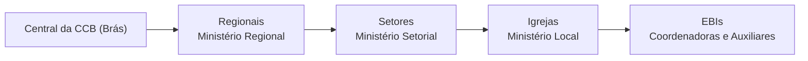

# Visão geral

O EBI precisa de uma plataforma única para saber quem participa, onde e quando, com segurança para dados de crianças e sem depender da igreja que a família frequenta.

## Contexto

O Espaço Bíblico Infantil (EBI) realiza atividades bíblicas lúdicas para crianças durante os cultos da Congregação Cristã no Brasil (CCB), conduzidas por coordenadoras e auxiliares. A faixa etária atendida e a exceção inclusiva estão em [elegibilidade etária](../02-regras-de-negocio/elegibilidade-etaria.md).

Para esta solução, a CCB organiza-se em:

Hoje cada igreja tem no máximo um EBI, mas o sistema permite mais de um, como pode acontecer na Central (Brás). Hierarquia confirmada em [ADR-0017](../06-arquitetura/decisoes/ADR-0017-hierarquia-e-ministerios.md).

## Objetivo

Disponibilizar uma plataforma integrada **Web + aplicativos Android/iOS + API**, hospedada na infraestrutura da CCB, para:

- gerir o cadastro único de participantes, responsáveis e equipes;
- organizar agenda, sessões, escalas e presenças;
- registrar feedbacks e produzir estatísticas;
- compartilhar materiais pedagógicos em PDF entre EBIs;
- permitir acompanhamento seguro pelos responsáveis.

## Princípios

1. **Um participante, um cadastro nacional**, independentemente da igreja frequentada.
2. **A presença pertence à sessão e à igreja onde ocorreu**, sem alterar o vínculo principal do participante.
3. **Privilégio mínimo e segregação territorial** para usuários administrativos.
4. **Privacidade e melhor interesse da criança por padrão.**
5. **Rastreabilidade** das operações e dos materiais reutilizados.
6. **Operação simples** para coordenadoras, auxiliares e responsáveis.
7. **Compatibilidade** com infraestrutura, identidade visual e contas de publicação da CCB, sujeita à aprovação.

## Escopo

**Incluído:** estrutura organizacional; cadastros; autenticação; consentimento; autorização; agenda de cultos/EBI; escalas; sessões; frequência; feedback; biblioteca PDF; reutilização e avaliação de atividades; relatórios; notificações; portal de responsáveis; auditoria; API; apps; configuração e governança.

**Fora do escopo inicial, salvo decisão posterior:** gestão financeira, doações, prontuário médico, reconhecimento facial, geolocalização contínua, divulgação pública de dados de crianças, redes sociais abertas e chats livres entre adultos e crianças.

## Módulos e telas

### Portal Web administrativo
- Login/MFA e seleção de contexto territorial.
- Dashboard com filtros e métricas autorizadas.
- Gestão de estrutura organizacional e geolocalização de igrejas.
- Gestão de usuários, papéis, vínculos e convites.
- Cadastro e pesquisa de participantes e responsáveis, com campos protegidos.
- Agenda, sessões, escalas e presenças.
- Biblioteca PDF, revisão, utilização e avaliações.
- Relatórios, exportações, auditoria e solicitações de privacidade.

Todos os módulos de app abaixo ficam em **um único aplicativo**, que mostra as visões conforme os papéis do usuário ([ADR-0009](../06-arquitetura/decisoes/ADR-0009-aplicativo-unico.md)).

### Visão de coordenadoras e auxiliares (app)
- Login/MFA, unidades autorizadas e escala pessoal.
- Próxima sessão, abertura/encerramento e registro rápido de presença.
- Sugestão de igreja por proximidade e seleção manual.
- Consulta de participantes no contexto autorizado.
- Feedbacks e histórico da sessão.
- Biblioteca PDF, publicação e registro de reutilização.
- Notificações de escala e substituição.

### Visão de responsáveis (app e portal Web)
- Cadastro, verificação de e-mail, login e recuperação de acesso.
- Termos, consentimentos e gestão de privacidade.
- Dependentes, matrícula, atualização cadastral e vínculos.
- Calendário/histórico de presença, igreja, passagem bíblica e feedback liberado.
- Notificações e canais de suporte.

### Visão de Ministério Local, Setorial, Regional e Nacional (app)
- Moderação de feedbacks (Ministério Local).
- Indicadores e consultas autorizadas no nível do usuário.

> **Decidido ([ADR-0009](../06-arquitetura/decisoes/ADR-0009-aplicativo-unico.md)):** um único app para todas as visões. Continua em aberto quem é titular da conta nas lojas ([D-07](../06-arquitetura/decisoes/README.md)).

## Ver também
- [Perfis e atores](perfis-e-atores.md)
- [Requisitos funcionais](../01-requisitos/funcionais/README.md)
- [Fases e roadmap](../07-produto/fases-e-roadmap.md)
