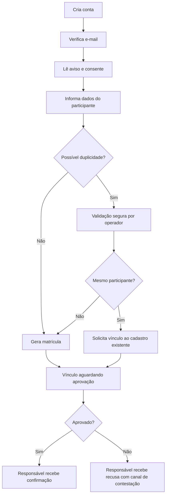

# FL-01 — Cadastro de responsável e participante

**Status:** proposto · **Requisitos:** [RF-02](../funcionais/RF-02-cadastro-de-participantes.md), [RF-03](../funcionais/RF-03-responsaveis-e-vinculos.md), [RF-04](../funcionais/RF-04-consentimento-e-privacidade.md)

1. O responsável instala o app ou acessa o portal, informa e-mail e cria senha.
2. O sistema envia link ou código de verificação.
3. O responsável verifica o e-mail, lê o aviso de privacidade e manifesta os consentimentos pertinentes.
4. Informa os dados mínimos do participante e a relação legal.
5. O sistema procura possíveis duplicidades sem revelar cadastros de terceiros.
6. Cadastro novo: gera matrícula. Possível duplicidade: encaminha para validação segura.
7. O vínculo é aprovado conforme a política institucional e o responsável recebe confirmação.

**Pendências:** quem aprova o vínculo ([D-03](../../06-arquitetura/decisoes/README.md)); famílias sem e-mail ([D-17](../../06-arquitetura/decisoes/README.md)).
