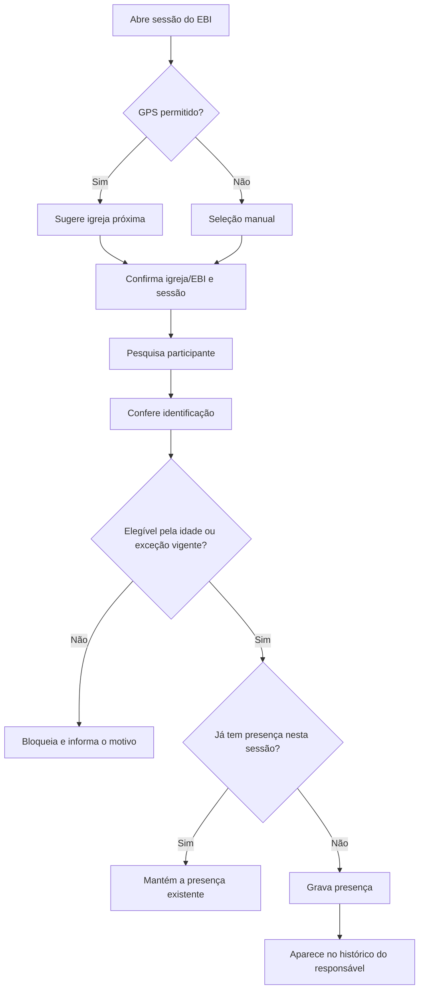

# FL-02 — Registro de presença em igreja diferente

**Status:** proposto · **Requisitos:** [RF-08](../funcionais/RF-08-registro-de-presenca.md)

1. A auxiliar autenticada acessa a sessão do EBI onde está atuando.
2. O app sugere a igreja por GPS, se permitido; a auxiliar confirma igreja/EBI e sessão.
3. Pesquisa o participante por nome ou matrícula, confere a identificação e seleciona o cadastro nacional.
4. O sistema aplica a [elegibilidade etária](../../02-regras-de-negocio/elegibilidade-etaria.md).
5. A auxiliar confirma a presença; o sistema impede duplicação e grava a sessão real (e, por ela, a igreja real).
6. O responsável autorizado vê o evento no histórico do dependente.

