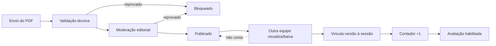

# FL-03 — Publicação e reutilização de PDF

**Status:** proposto · **Requisitos:** [RF-10](../funcionais/RF-10-biblioteca-de-atividades.md), [RF-11](../funcionais/RF-11-reutilizacao-de-atividade.md), [RF-12](../funcionais/RF-12-avaliacao-de-atividades.md)

1. Coordenadora ou auxiliar envia o PDF com metadados bíblicos, autoria e origem.
2. O sistema valida o arquivo: tipo real, tamanho e antivírus ([ADR-0005](../../06-arquitetura/decisoes/ADR-0005-armazenamento-e-antivirus.md)). Arquivo reprovado fica bloqueado.
3. O material passa pela **moderação editorial** (direitos declarados e critérios editoriais), conforme [RF-10](../funcionais/RF-10-biblioteca-de-atividades.md). Quem modera e se a moderação vale para toda publicação ou só para a nacional depende de [D-06](../../06-arquitetura/decisoes/README.md).
4. Aprovado, o material é publicado e pode ser encontrado por outros EBIs.
5. Outra equipe consulta ou visualiza o PDF e decide usá-lo em uma sessão.
6. Registra a utilização vinculada à sessão e à versão.
7. O sistema atualiza o contador e habilita a avaliação de 1 a 5 estrelas.

