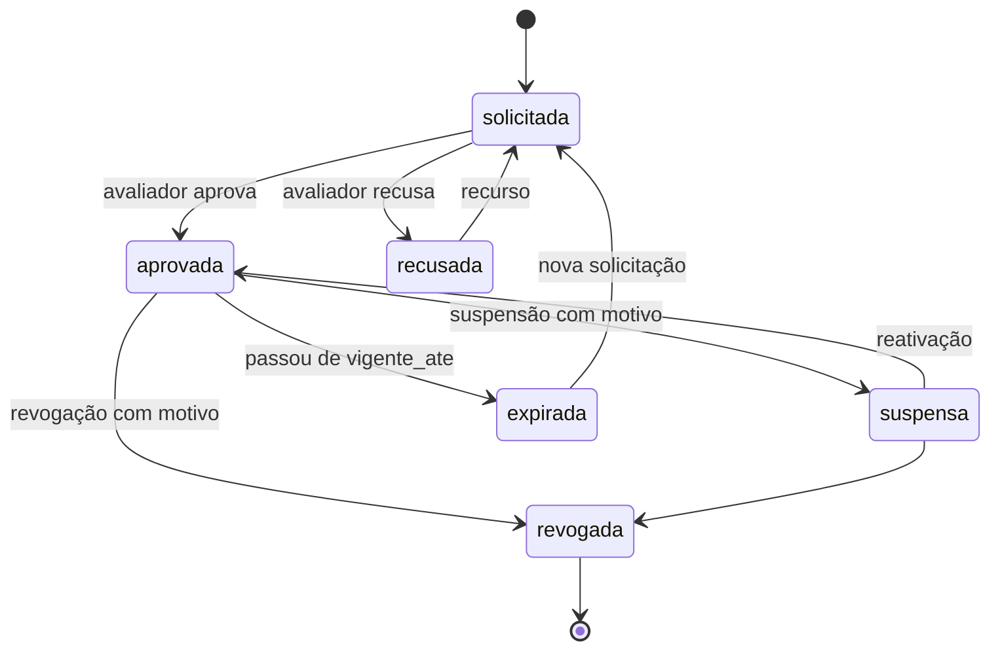

# FL-06 — Solicitação e revisão de exceção inclusiva

**Status:** proposto (novo na 2.0) · **Requisitos:** [RF-02](../funcionais/RF-02-cadastro-de-participantes.md) · **Regras:** [elegibilidade etária](../../02-regras-de-negocio/elegibilidade-etaria.md)

Esta é a regra mais delicada do sistema e a versão anterior não tinha fluxo para ela. Proposta para validar em [D-12](../../06-arquitetura/decisoes/README.md):

1. O responsável (ou a coordenadora, com ciência do responsável) solicita a exceção, informando as adaptações e apoios necessários e uma justificativa funcional mínima.
2. Laudo ou diagnóstico só é anexado se a política exigir, e vai para o módulo segregado.
3. Um avaliador com atribuição específica analisa e decide: aprova (com `vigente_ate` e `revisao_prevista_em`), pede complemento ou recusa.
4. O responsável é informado da decisão e do canal de recurso.
5. Antes de `revisao_prevista_em`, o sistema avisa o avaliador e o responsável.
6. A exceção pode ser suspensa ou revogada, com motivo. Presenças passadas não mudam.

**Pendências:** quem é avaliador, prazos de revisão e recurso ([D-12](../../06-arquitetura/decisoes/README.md)); participante adulto ([D-13](../../06-arquitetura/decisoes/README.md)).
