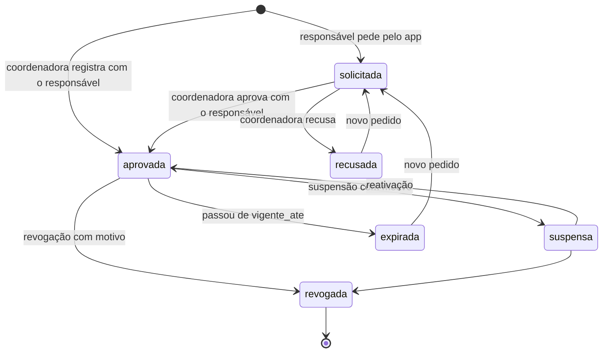

# FL-06 — Exceção inclusiva

**Status:** aprovado ([ADR-0012](../../06-arquitetura/decisoes/ADR-0012-excecao-decidida-pela-coordenadora.md)) · **Requisitos:** [RF-02](../funcionais/RF-02-cadastro-de-participantes.md) · **Regras:** [elegibilidade etária](../../02-regras-de-negocio/elegibilidade-etaria.md)

A coordenadora do dia decide, junto com o responsável, se o participante com deficiência e/ou neurodivergência continua no EBI depois dos 12 anos. Não há limite de idade.

1. O responsável pede a exceção pelo app ou conversa pessoalmente com a coordenadora.
2. A coordenadora e o responsável conversam sobre as adaptações e apoios necessários.
3. A coordenadora registra a decisão: aprova (com as adaptações e, se quiser, `revisao_prevista_em` e `vigente_ate`) ou recusa. O sistema grava quem decidiu, o responsável que concordou e a data.
4. Laudo ou diagnóstico só é anexado se for indispensável, e vai para o módulo segregado.
5. Com a exceção aprovada, o participante pode ter presença registrada em qualquer EBI. A coordenadora de cada sessão pode recusar a participação naquele dia sem revogar a exceção (proposto; ver status do bloco em elegibilidade etária).
6. A exceção pode ser suspensa ou revogada pela coordenadora, com motivo. Presenças passadas não mudam.

**Pendências:** como colher a concordância do próprio participante adulto: item aberto do jurídico em [D-04](../../06-arquitetura/decisoes/README.md) ([ADR-0019](../../06-arquitetura/decisoes/ADR-0019-base-normativa-lgpd.md)). Validade da exceção entre sessões: proposta em [elegibilidade etária](../../02-regras-de-negocio/elegibilidade-etaria.md#status-do-bloco).
