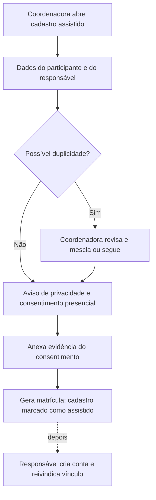

# FL-07 — Cadastro assistido pela coordenadora

**Status:** aprovado ([ADR-0015](../../06-arquitetura/decisoes/ADR-0015-cadastro-assistido.md)) · **Requisitos:** [RF-02](../funcionais/RF-02-cadastro-de-participantes.md), [RF-03](../funcionais/RF-03-responsaveis-e-vinculos.md), [RF-04](../funcionais/RF-04-consentimento-e-privacidade.md)

Para famílias sem e-mail ou com pouca familiaridade digital, a coordenadora faz o cadastro presencialmente.

1. A coordenadora abre "Cadastro assistido" no app, no contexto do EBI onde atua.
2. Informa os dados mínimos do participante e do responsável (nome, relação, telefone opcional). O responsável não precisa de conta.
3. O sistema procura duplicidades, como no FL-01.
4. A coordenadora apresenta o aviso de privacidade e colhe o consentimento do responsável, com a evidência definida pelo DPO (proposta: termo impresso assinado e digitalizado).
5. O sistema gera a matrícula e marca o cadastro como `assistido`.
6. Se o responsável criar conta depois, ele reivindica o vínculo, que passa por validação (FL-01, passo 7).

**Pendências:** a evidência (termo em papel assinado, fotografado e anexado) é padrão provisório do [ADR-0019](../../06-arquitetura/decisoes/ADR-0019-base-normativa-lgpd.md) e aguarda o jurídico/DPO.
