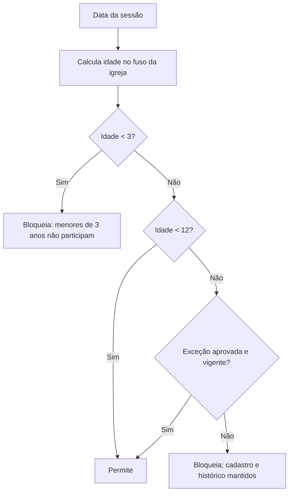

# Elegibilidade etária e exceção inclusiva

Este é o único lugar onde a regra de idade é definida. RF-02, RF-08, FL-02, FL-06 e os critérios de aceite apontam para cá.

## Status do bloco

O registro de presença do MVP (E04) depende do bloco inteiro. Ele só está pronto para implementar quando todas as linhas abaixo estiverem `aprovado`.

| Parte | Status | Pendente |
|---|---|---|
| RN-13 — faixa de 3 anos até a véspera dos 12; menores de 3 bloqueados | aprovado | Cadastro antecipado de menores de 3 anos (proposta: permitido) |
| RN-14 — exceção inclusiva decidida pela coordenadora com o responsável | aprovado | Validade da exceção entre sessões (proposta: vale até ser revogada); concordância do participante adulto ([ADR-0019](../06-arquitetura/decisoes/ADR-0019-base-normativa-lgpd.md)) |
| RN-15 — fim da exceção bloqueia novas presenças | proposto | Aprovação do produto |
| RN-16 — cálculo da idade (fuso da igreja; 29/02) | proposto | Aprovação do produto |

**Situação do bloco:** aguardando aprovação de RN-15, RN-16 e das duas propostas acima.

## Resumo

| Situação | Pode registrar presença? |
|---|---|
| Menos de 3 anos | Não, em nenhum caso ([ADR-0013](../06-arquitetura/decisoes/ADR-0013-bloqueio-menores-de-3-anos.md)) |
| De 3 anos até a véspera do 12º aniversário | Sim |
| A partir do 12º aniversário, sem exceção vigente | Não |
| Qualquer idade, com exceção inclusiva `aprovada` e dentro de `vigente_ate` | Sim |

## Regras

### RN-13 — Faixa etária regular
**Status:** aprovado ([ADR-0011](../06-arquitetura/decisoes/ADR-0011-faixa-etaria-confirmada.md), [ADR-0013](../06-arquitetura/decisoes/ADR-0013-bloqueio-menores-de-3-anos.md))

A participação regular é permitida a partir dos 3 anos e enquanto o participante **não tiver completado 12 anos** na data da sessão (até 11 anos, 11 meses e o último dia antes do aniversário). No dia do 12º aniversário, novas presenças pela regra geral são bloqueadas, sem apagar cadastro ou histórico.

**Menores de 3 anos não participam.** A presença é bloqueada e a exceção inclusiva não se aplica abaixo dessa idade. O cadastro antecipado é permitido (proposto; ver status do bloco).

### RN-14 — Exceção inclusiva
**Status:** aprovado ([ADR-0012](../06-arquitetura/decisoes/ADR-0012-excecao-decidida-pela-coordenadora.md))

Pessoas com deficiência e/ou neurodivergência podem continuar participando, **sem limite máximo de idade**, quando a necessidade de apoio e a adequação das atividades justificarem, conforme política institucional.

- **A coordenadora do dia decide, junto com o responsável**, e registra a decisão no sistema. Não há avaliador regional ou setorial.
- Proposto (ver status do bloco): a exceção registrada vale para as sessões seguintes, em qualquer EBI, até ser revogada; a coordenadora de cada sessão pode recusar a participação naquele dia.
- O diagnóstico isolado não gera presunção automática de incapacidade nem de "idade mental".
- A condição não é exposta a outras igrejas sem necessidade operacional e autorização.
- Para quem tem 12 anos ou mais, telas e registros usam "participante do EBI".

### RN-15 — Fim da exceção
**Status:** proposto

Exceção `suspensa`, `revogada` ou `expirada` (data atual depois de `vigente_ate`) impede novas presenças fora da faixa regular. Registros históricos e auditoria são preservados.

### RN-16 — Cálculo da idade
**Status:** proposto (novo na 2.0)

- A idade é calculada na **data local da sessão, no fuso horário da igreja**.
- Nascidos em 29/02 completam ano em 01/03 nos anos não bissextos.

## Cadastro da exceção

Campos registrados (entidade `excecao_etaria`, ver [modelo de dados](../03-dados/modelo-conceitual.md)):

- indicador de necessidade de atendimento inclusivo e categoria geral;
- adaptações e apoios necessários;
- justificativa funcional mínima;
- status: `solicitada`, `aprovada`, `recusada`, `suspensa`, `revogada`, `expirada` ([estados](../03-dados/estados.md#exceção-inclusiva));
- coordenadora que decidiu, responsável que concordou e data; `vigente_ate` (opcional); `revisao_prevista_em`; histórico de alterações.

Diagnóstico ou laudo, quando estritamente necessário, fica no módulo segregado `dado_sensivel_participante`, com acesso restrito, nunca em relatórios gerais.

A exceção é pedida pelo responsável (pelo app ou pessoalmente) e decidida pela coordenadora com ele. Fluxo em [FL-06](../01-requisitos/fluxos/FL-06-excecao-inclusiva.md).

## Proposta complementar
- Avisar o responsável 30 dias antes do 12º aniversário de participante sem exceção, para que possa pedir uma se for o caso ([RF-15](../01-requisitos/funcionais/RF-15-notificacoes.md)).

## Questões em aberto
- **Validação jurídica do participante adulto ([D-04](../06-arquitetura/decisoes/README.md), [ADR-0019](../06-arquitetura/decisoes/ADR-0019-base-normativa-lgpd.md)).** O produto decidiu que não há limite de idade e que a coordenadora decide com o responsável ([ADR-0012](../06-arquitetura/decisoes/ADR-0012-excecao-decidida-pela-coordenadora.md)). Pela Lei Brasileira de Inclusão (Lei 13.146/2015), o adulto com deficiência tem capacidade civil plena, e seu "responsável" não é automaticamente representante legal. O jurídico deve definir como colher a concordância do próprio participante adulto.
- Revisão vencida (`revisao_prevista_em` no passado, mas antes de `vigente_ate`) bloqueia presença? Proposta: não bloqueia, só alerta o avaliador.
