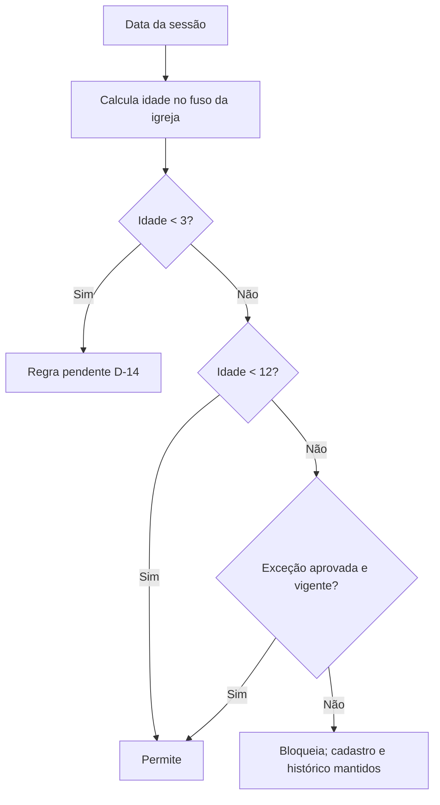

# Elegibilidade etária e exceção inclusiva

Este é o único lugar onde a regra de idade é definida. RF-02, RF-08, FL-02, FL-06 e os critérios de aceite apontam para cá.

## Resumo

| Situação | Pode registrar presença? |
|---|---|
| Menos de 3 anos | A definir ([D-14](../06-arquitetura/decisoes/README.md)) |
| De 3 anos até a véspera do 12º aniversário | Sim |
| A partir do 12º aniversário, sem exceção vigente | Não |
| Qualquer idade, com exceção inclusiva `aprovada` e dentro de `vigente_ate` | Sim |

## Regras

### RN-13 — Faixa etária regular
**Status:** proposto (confirmação em [D-12](../06-arquitetura/decisoes/README.md))

A participação regular é permitida a partir dos 3 anos e enquanto o participante **não tiver completado 12 anos** na data da sessão (até 11 anos, 11 meses e o último dia antes do aniversário). No dia do 12º aniversário, novas presenças pela regra geral são bloqueadas, sem apagar cadastro ou histórico.

### RN-14 — Exceção inclusiva
**Status:** proposto (confirmação em [D-12](../06-arquitetura/decisoes/README.md))

Pessoas com deficiência e/ou neurodivergência podem continuar participando, **sem limite máximo de idade**, quando a necessidade de apoio e a adequação das atividades justificarem, conforme política institucional.

- A exceção exige avaliação e autorização institucional registradas.
- O diagnóstico isolado não gera presunção automática de incapacidade nem de "idade mental".
- A condição não é exposta a outras igrejas sem necessidade operacional e autorização.
- Para quem tem 12 anos ou mais, telas e registros usam "participante do EBI".

### RN-15 — Fim da exceção
**Status:** proposto

Exceção `suspensa`, `revogada` ou `expirada` (data atual depois de `vigente_ate`) impede novas presenças fora da faixa regular. Registros históricos e auditoria são preservados.

### RN-16 — Cálculo da idade
**Status:** proposto (novo na 2.0)

- A idade é calculada na **data local da sessão, no fuso horário da igreja**.
- Nascidos em 29/02 completam ano em 01/03 nos anos não bissextos. *Proposta; confirmar com o jurídico.*

## Cadastro da exceção

Campos registrados (entidade `excecao_etaria`, ver [modelo de dados](../03-dados/modelo-conceitual.md)):

- indicador de necessidade de atendimento inclusivo e categoria geral;
- adaptações e apoios necessários;
- justificativa funcional mínima;
- status: `solicitada`, `aprovada`, `recusada`, `suspensa`, `revogada`, `expirada` ([estados](../03-dados/estados.md#exceção-inclusiva));
- quem autorizou e quando; `vigente_ate`; `revisao_prevista_em`; histórico de alterações.

Diagnóstico ou laudo, quando estritamente necessário, fica no módulo segregado `dado_sensivel_participante`, com acesso restrito, nunca em relatórios gerais.

A exceção pode ser pedida pelo responsável e é avaliada por perfis expressamente autorizados, com revisão e recurso definidos pela CCB. Fluxo proposto em [FL-06](../01-requisitos/fluxos/FL-06-excecao-inclusiva.md).

## Proposta complementar
- Avisar o responsável 30 dias antes do 12º aniversário de participante sem exceção, para que possa pedir uma se for o caso ([RF-15](../01-requisitos/funcionais/RF-15-notificacoes.md)).

## Questões em aberto
- **[D-12](../06-arquitetura/decisoes/README.md):** confirmar a faixa de 3 a menos de 12 anos e o fluxo de autorização e revisão.
- **[D-13](../06-arquitetura/decisoes/README.md):** participante adulto. A Lei Brasileira de Inclusão (Lei 13.146/2015) mantém a capacidade civil plena da pessoa com deficiência. O modelo "responsável → dependente" não serve automaticamente: é preciso definir quem consente, o papel de curador ou apoiador (tomada de decisão apoiada) e se o participante pode ter conta própria. Participantes de 12 a 17 anos são adolescentes pelo ECA e também precisam de tratamento definido.
- **[D-14](../06-arquitetura/decisoes/README.md):** menores de 3 anos — bloquear, alertar ou permitir com autorização.
- Revisão vencida (`revisao_prevista_em` no passado, mas antes de `vigente_ate`) bloqueia presença? Proposta: não bloqueia, só alerta o avaliador.
