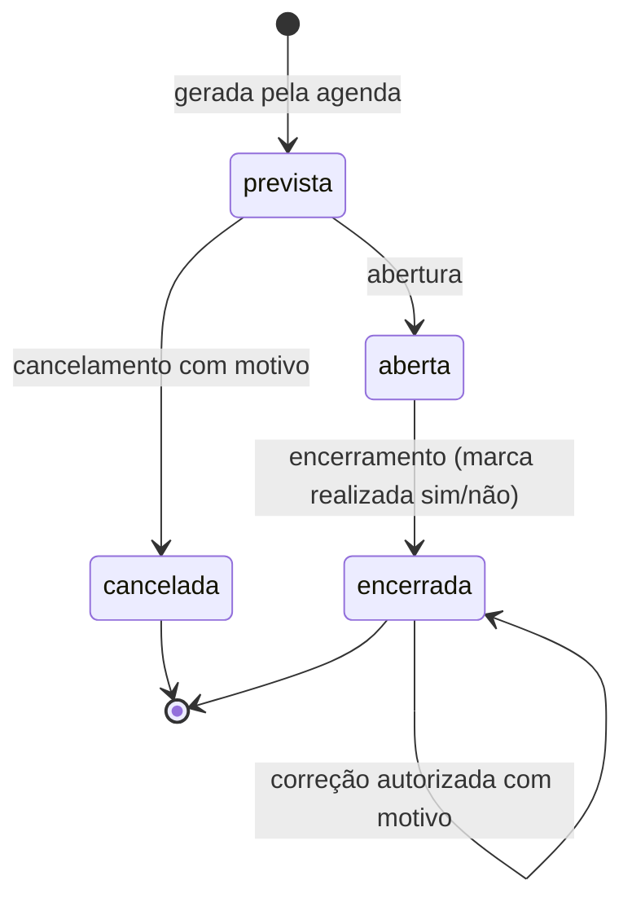
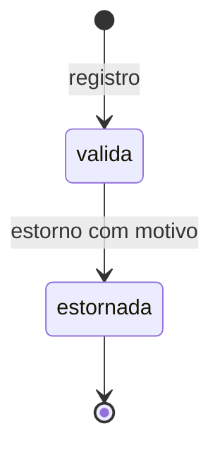
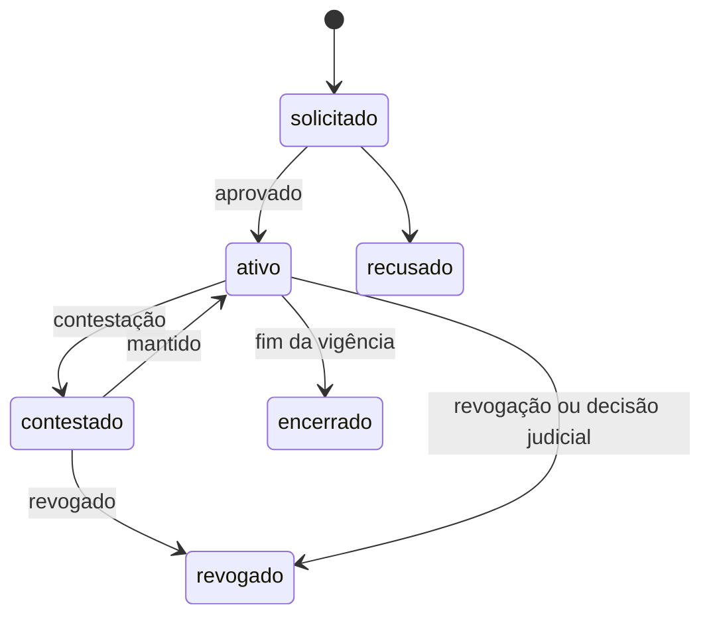
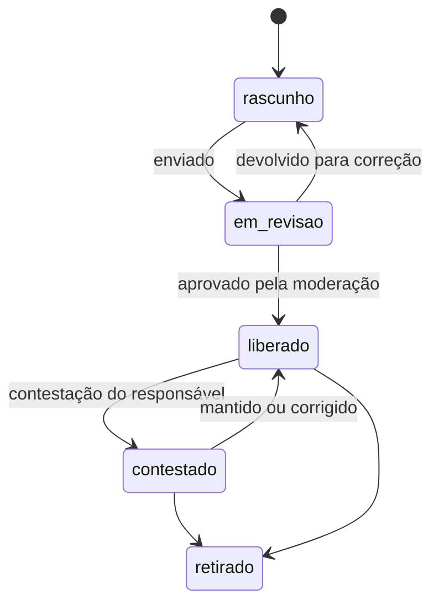
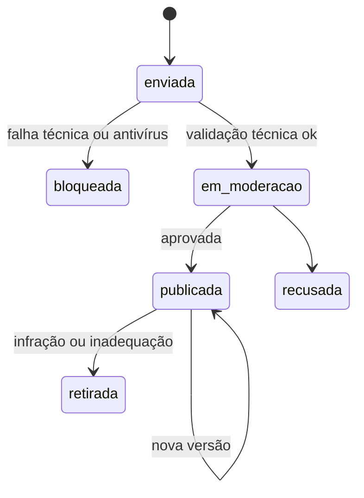

# Ciclos de vida

Estados e transições das entidades com regras de negócio. Toda transição gera evento de auditoria ([RN-10](../02-regras-de-negocio/regras-de-negocio.md#rn-10)).

## Exceção inclusiva

Definido em [FL-06](../01-requisitos/fluxos/FL-06-excecao-inclusiva.md). Estados: `solicitada`, `aprovada`, `recusada`, `suspensa`, `revogada`, `expirada`. Só `aprovada` dentro de `vigente_ate` permite presença fora da faixa regular.

## Sessão

## Presença

Um estorno não apaga o registro. Depois dele, um novo registro `valida` pode ser criado para a mesma sessão ([RN-03](../02-regras-de-negocio/regras-de-negocio.md#rn-03)).

## Vínculo de responsável

## Feedback

Se a política ([D-05](../06-arquitetura/decisoes/README.md)) dispensar moderação, `em_revisao` é pulado.

## Atividade

