# Ciclos de vida

Estados e transições das entidades com regras de negócio. Toda transição gera evento de auditoria ([RN-10](../02-regras-de-negocio/regras-de-negocio.md#rn-10)).

## Exceção inclusiva

Definido em [FL-06](../01-requisitos/fluxos/FL-06-excecao-inclusiva.md). Estados: `solicitada`, `aprovada`, `recusada`, `suspensa`, `revogada`, `expirada`. A coordenadora faz todas as transições, com o responsável. Só `aprovada` dentro de `vigente_ate` (quando houver) permite presença depois dos 12 anos; abaixo de 3 anos nenhuma exceção vale.

## Sessão

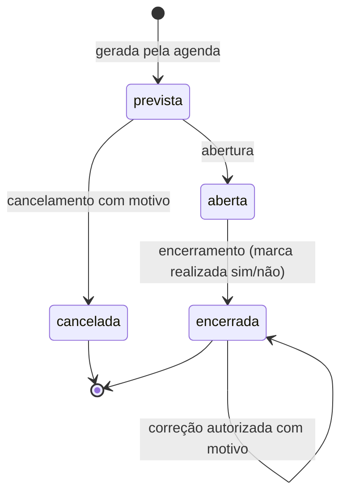

## Presença

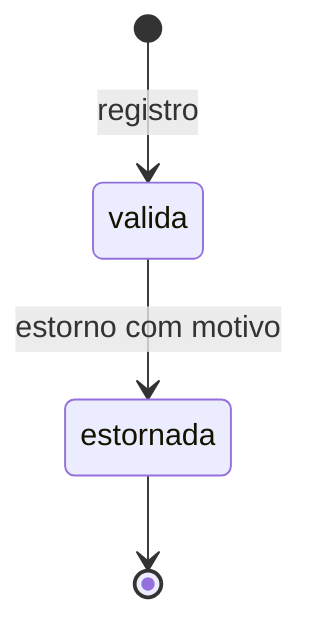

Um estorno não apaga o registro. Depois dele, um novo registro `valida` pode ser criado para a mesma sessão ([RN-03](../02-regras-de-negocio/regras-de-negocio.md#rn-03)).

## Vínculo de responsável

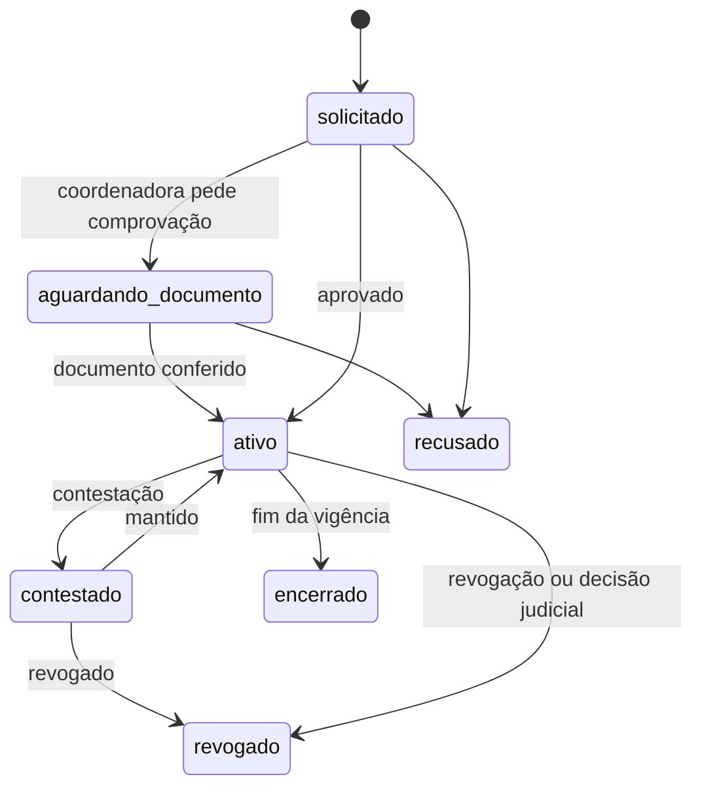

A situação corrente vive em `responsavel_participante` (`validacao`: `pendente`, `aprovada`, `aguardando_documento`, `recusada`); `solicitacao_vinculo` é o log append-only (solicitação, contestação, revogação). Só `aprovada` e vigente (`fim IS NULL`) libera o acesso do responsável ao dependente (CA-04). Encerrar preenche `fim` e **não** apaga o log ([ADR-0032](../06-arquitetura/decisoes/ADR-0032-vinculos-responsavel-e-participante.md)).

## Participante

`status`: `ativo` → `inativo`; `ativo` → `mesclado` (o duplicado de uma mesclagem, RN/CA-27). A mesclagem é **reversível**: o estado anterior do principal e o `status` do duplicado vão para `participante.snapshot_mesclagem`; desfazer restaura os dois ([ADR-0007](../06-arquitetura/decisoes/ADR-0007-cadastro-e-correcao-de-participantes.md)).

## Arquivo (pipeline de storage)

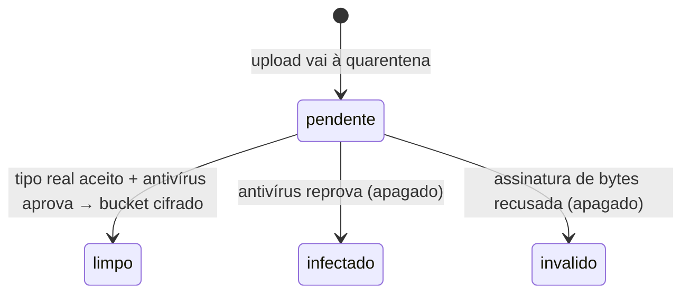

O tipo é decidido pela **assinatura de bytes** (magic number), nunca pela extensão nem pelo MIME declarado. Só `limpo` fica armazenado — em bucket privado e cifrado (SSE); `infectado`/`invalido` são apagados da quarentena e auditados ([ADR-0005](../06-arquitetura/decisoes/ADR-0005-armazenamento-e-antivirus.md)).

## Feedback

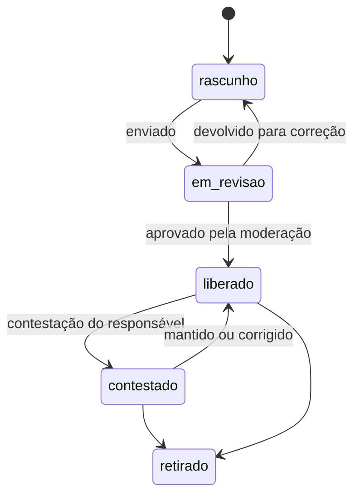

A moderação é obrigatória e feita pelo Ministério Local ([ADR-0008](../06-arquitetura/decisoes/ADR-0008-moderacao-de-feedback.md)); não há atalho de `rascunho` para `liberado`.

## Escala

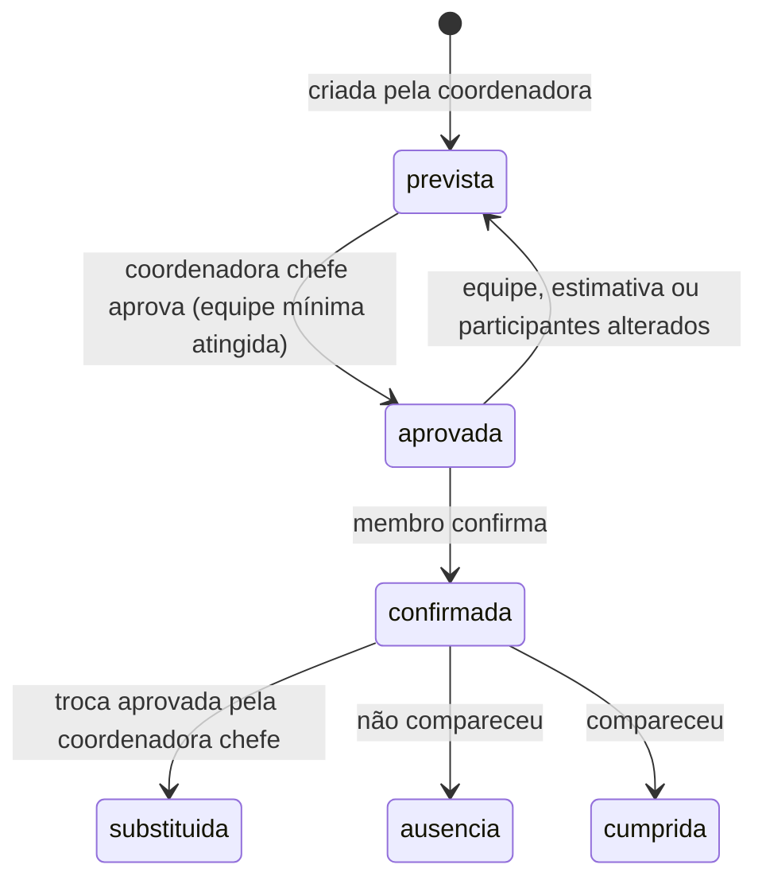

A aprovação é da **coordenadora chefe vigente do EBI**; sem chefe vigente, o `adm_igreja` aprova no lugar. Voltar a `prevista` por alteração **cancela as trocas abertas e aceitas** da escala ([ADR-0033](../06-arquitetura/decisoes/ADR-0033-coordenadora-chefe-e-regras-da-escala.md); [ADR-0010](../06-arquitetura/decisoes/ADR-0010-equipe-minima-e-aprovacao-de-escala.md)).

## Membro da escala

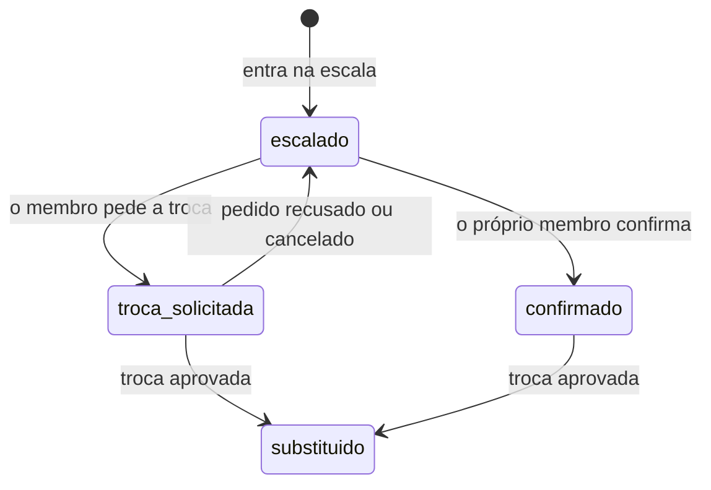

`escalado` e `confirmado` são os membros que contam; `substituido` sai da equipe efetiva. A presença (`presente` sim/não) é registrada na sessão `encerrada`, depois da equipe — não muda o `status`. Membro criado pela escolha de uma vaga entra já `confirmado` ([ADR-0034](../06-arquitetura/decisoes/ADR-0034-equipes-da-coordenadora-e-vaga-de-escala.md)).

## Vaga de escala

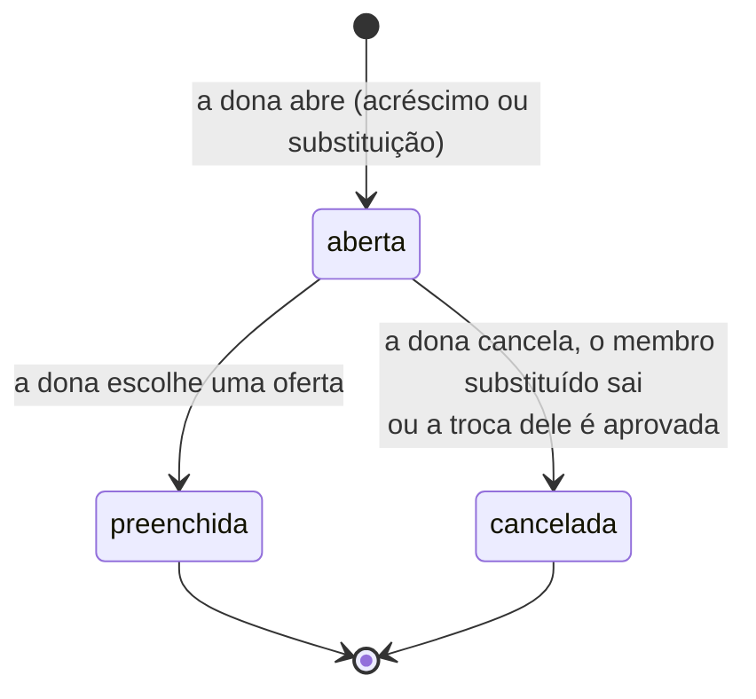

A vaga nasce `aberta` com as ofertas `pendente`. Escolher uma oferta leva a vaga a `preenchida` e as demais ofertas a `descartada`; a vaga não volta a abrir. O `motivo_encerramento` (`cancelada_pela_gestao`, `membro_retirado`, `membro_trocado`) diz por que uma vaga aberta foi cancelada. Conflito de horário não fica na máquina de estados: é informação do cartão ([ADR-0034](../06-arquitetura/decisoes/ADR-0034-equipes-da-coordenadora-e-vaga-de-escala.md)).

## Oferta para vaga

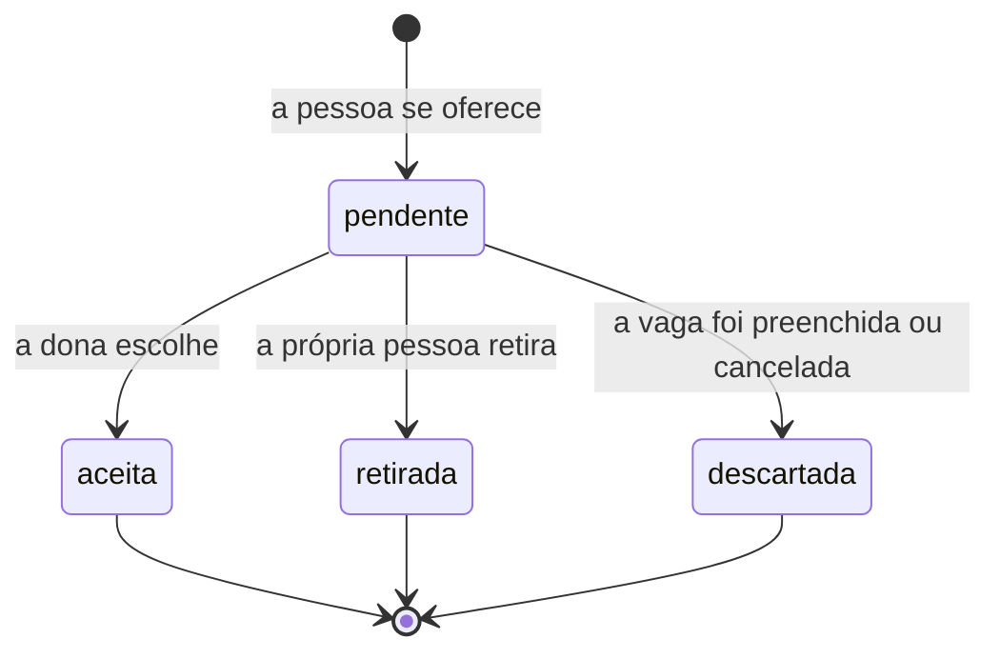

`aceita` é terminal e carrega `membro_criado_id`: apagar esse membro depois deixa a oferta `aceita` com `membro_criado_id` nulo, e a vaga continua `preenchida` — quem preencheu vem de `oferta.usuario_id`. A oferta aceita nasce do membro já `confirmado`; as ofertas não escolhidas só existem para a dona (a supervisão vê a contagem).

## Equipe da coordenadora

Não há máquina de estados: a equipe existe desde que é criada e não é excluída. Incluir e retirar membro mexem em `equipe_membro` (retirar apaga a linha); a vigência de cada pessoa vem do vínculo de acesso vigente hoje, não do quadro.

## Troca

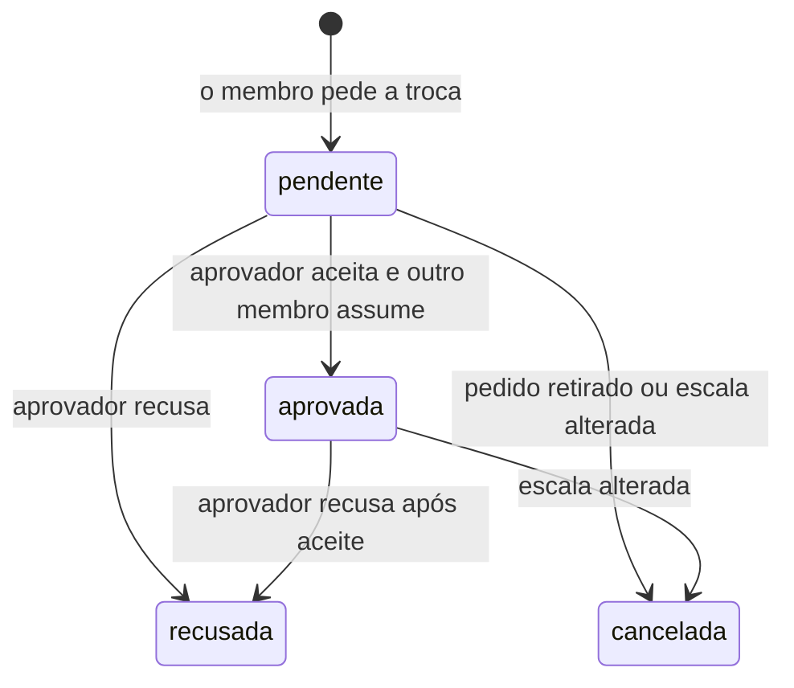

`situacao` guarda o estado atual do pedido; a listagem mostra `expirada` quando a sessão já passou e o pedido ficou em aberto sem decisão ([ADR-0033](../06-arquitetura/decisoes/ADR-0033-coordenadora-chefe-e-regras-da-escala.md)).

## Atividade

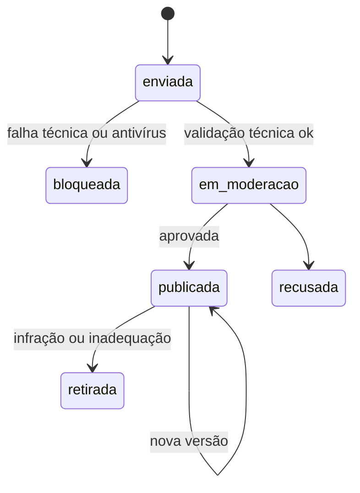
