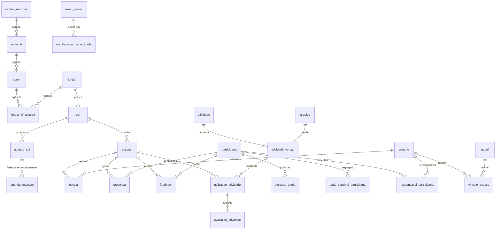

# Modelo de dados conceitual

Entidades e relacionamentos principais. Tipos, sensibilidade e retenção de cada campo ficam no [dicionário de dados](dicionario-de-dados.md); ciclos de vida em [estados](estados.md).

## Diagrama

## Entidades

### Organização
| Entidade | Campos-chave |
|---|---|
| `central_nacional` | id, nome *(novo na 2.0: a hierarquia começava em `regional`)* |
| `regional` | id, central_nacional_id, nome, código, status |
| `setor` | id, regional_id, nome, código, status |
| `igreja` | id, nome, endereço, latitude, longitude, timezone, status |
| `igreja_vinculacao` | id, igreja_id, setor_id, inicio, fim *(novo: histórico de transferências, RF-01)* |
| `ebi` | id, igreja_id, nome, status, coordenadora_chefe_id, participantes_por_auxiliar (parâmetro, padrão 4) |

### Identidade e acesso
| Entidade | Campos-chave |
|---|---|
| `usuario` | id, nome, email_normalizado, email_verificado_em, senha_hash ou identidade_federada, status |
| `papel` | id, código, descrição |
| `vinculo_acesso` | id, usuario_id, papel_id, tipo_escopo, escopo_id, inicio, fim, status |
| `convite` | id, email, papel_id, escopo, criado_por, expira_em, status *(novo)* |
| `fator_mfa` | id, usuario_id, tipo (totp, passkey, email), segredo_cifrado, criado_em *(novo)* |
| `codigo_recuperacao` | id, usuario_id, hash, usado_em *(novo)* |
| `sessao_login` | id, usuario_id, dispositivo, criada_em, expira_em, revogada_em *(novo)* |

### Participantes e responsáveis
| Entidade | Campos-chave |
|---|---|
| `participante` | id, matricula, nome, nome_social, data_nascimento, status, igreja_referencia_id (opcional), origem_cadastro (responsavel, assistido), cadastrado_por, evidencia_consentimento_id *(origem e evidência novas na 2.2, ADR-0015; era `crianca`; ver [ADR-0003](../06-arquitetura/decisoes/ADR-0003-entidade-participante.md))* |
| `excecao_etaria` | id, participante_id, tipo_necessidade (categoria geral), apoios_necessarios, justificativa_funcional, status, solicitado_por, decidido_por (coordenadora), responsavel_concordante_id, decidido_em, vigente_ate (opcional), revisao_prevista_em, revogado_em, motivo *(decisão pela coordenadora com o responsável, ADR-0012)* |
| `dado_sensivel_participante` | id, participante_id, tipo, conteudo_cifrado ou referencia_segura, finalidade, base_legal, controle_acesso, prazo_retencao |
| `responsavel_participante` | id, usuario_id (opcional), nome, telefone, participante_id, tipo_relacao, permissoes, restricoes, status, validacao, inicio, fim *(`usuario_id` opcional para responsável sem conta no cadastro assistido, ADR-0015)* |
| `solicitacao_vinculo` | id, usuario_id, participante_id, tipo (solicitação, contestação, revogação), status, decidido_por, decidido_em, motivo *(novo)* |

### Privacidade
| Entidade | Campos-chave |
|---|---|
| `termo_versao` | id, finalidade, versão, texto_hash, vigência |
| `manifestacao_privacidade` | id, usuario_id, participante_id, termo_versao_id, decisão, timestamp, evidência, origem |
| `solicitacao_titular` | id, solicitante_id, participante_id, tipo de direito, protocolo, responsavel_id, prazo, status *(novo, RF-16)* |

### Agenda, sessões e presença
| Entidade | Campos-chave |
|---|---|
| `agenda_ebi` | id, ebi_id, dia_semana, hora_inicio, hora_fim, vigência |
| `agenda_excecao` | id, agenda_ebi_id ou ebi_id, data, tipo (feriado, cancelamento, horário especial), motivo *(novo, RF-06)* |
| `sessao` | id, ebi_id, agenda_ebi_id, igreja_id, setor_id, regional_id, inicio_previsto, fim_previsto, inicio_real, fim_real, tema, passagem_biblica, status, realizada *(unidade territorial gravada na data — RN-09; previsto/real separados)* |
| `escala` | id, sessao_id, usuario_id, função, horário, status, aprovado_por, aprovado_em, confirmado_em, presente *(aprovação pela coordenadora chefe, ADR-0010)* |
| `solicitacao_troca_escala` | id, escala_id, solicitante_id, substituto_id, status, aprovado_por *(novo, RF-07)* |
| `presenca` | id, sessao_id, participante_id, registrado_por, registrado_em, origem (web, app), status, estornado_por, estornado_em, motivo_estorno *(origem e estorno novos, RF-08)* |
| `feedback` | id, sessao_id, participante_id, autor_id, conteúdo, participação, visibilidade, status, moderado_por (Ministério Local), moderado_em |

### Biblioteca
| Entidade | Campos-chave |
|---|---|
| `atividade` | id, autor_id, título, descrição, referência_bíblica, tema, faixa_etaria, origem_igreja_id, origem_setor_id, origem_regional_id, data_original, status *(tema, faixa e origem completa novos)* |
| `atividade_tag` | atividade_id, tag *(novo)* |
| `atividade_versao` | id, atividade_id, número, arquivo_id, hash, créditos, declaracao_direitos, publicado_em |
| `arquivo` | id, chave_storage, mime, tamanho, sha256, status_antivirus |
| `utilizacao_atividade` | id, atividade_versao_id, sessao_id, adaptacao_local, registrado_por, registrado_em *(adaptacao_local nova)* |
| `avaliacao_atividade` | id, utilizacao_id, usuario_id, estrelas, atualizado_em |
| `denuncia` | id, alvo (atividade, versão, avaliação), autor_id, motivo, status, decidido_por *(novo, RF-10 e RF-12)* |

### Comunicação e auditoria
| Entidade | Campos-chave |
|---|---|
| `notificacao` | id, destinatario_id, canal, tipo, status, enviado_em |
| `preferencia_notificacao` | usuario_id, tipo, canal, ativo *(novo)* |
| `evento_auditoria` | id, ator_id, ação, recurso, escopo, timestamp, origem, motivo, metadados_minimizados, hash_encadeado |
| `parametro` | chave, valor, escopo, atualizado_por *(novo)* |

## Índices e restrições
- `participante.matricula` UNIQUE.
- `usuario.email_normalizado` UNIQUE.
- `presenca(sessao_id, participante_id)` UNIQUE parcial onde `status = 'valida'`.
- `utilizacao_atividade(sessao_id, atividade_versao_id)` UNIQUE.
- `avaliacao_atividade(utilizacao_id, usuario_id)` UNIQUE ([ADR-0014](../06-arquitetura/decisoes/ADR-0014-avaliacao-por-utilizacao.md)).
- `igreja_vinculacao`: sem sobreposição de vigência para a mesma igreja.
- Índices em hierarquia, datas, vínculos e referências bíblicas.
- IDs opacos (UUID/ULID) expostos externamente; chaves e integridade referencial no banco.

## Histórico
Mudanças de hierarquia, versões de termos, atividades, vínculos e escalas preservam o contexto temporal. Retenção, arquivamento e anonimização definidos com o DPO ([D-04](../06-arquitetura/decisoes/README.md)).
