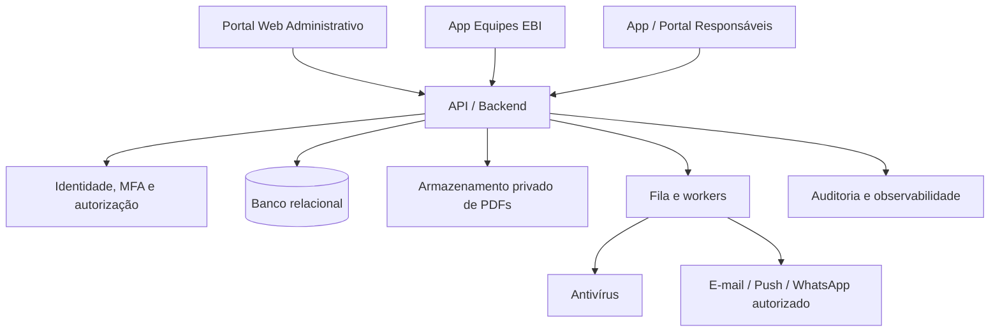

# Arquitetura de referência

**Status:** proposto, não vinculante. A decisão de infraestrutura e tecnologia depende de [D-11](decisoes/README.md).

## Visão de componentes

## Módulos

Um **monólito modular** com fronteiras claras entre módulos ([ADR-0002](decisoes/ADR-0002-monolito-modular.md)):

| Módulo | Responsabilidade | Requisitos |
|---|---|---|
| Identidade e Acesso | Login, MFA, papéis, vínculos de acesso, contexto | RF-05, autenticação |
| Organização | Hierarquia, igrejas, EBIs, transferências | RF-01 |
| Participantes e Privacidade | Cadastro, responsáveis, exceções, consentimentos, dados sensíveis | RF-02, RF-03, RF-04 |
| Agenda e Escalas | Programação, sessões previstas, escalas | RF-06, RF-07 |
| Sessões e Presença | Abertura, presença, estorno, elegibilidade | RF-06, RF-08 |
| Conteúdo Bíblico | Biblioteca, versões, moderação, utilização, avaliação | RF-10, RF-11, RF-12 |
| Feedback | Registro, moderação, liberação | RF-09 |
| Indicadores | Métricas, relatórios, exportação, supressão | RF-14 |
| Notificações | E-mail, push, WhatsApp, preferências | RF-15 |
| Auditoria | Trilha protegida, consulta | RF-16 |

O módulo de dados sensíveis (laudos) fica isolado, com chave de criptografia própria e acesso sempre auditado.

## Stack candidata (a validar)
- Backend: Laravel/PHP ou outra plataforma homologada pela CCB.
- Banco: PostgreSQL.
- Arquivos: armazenamento de objetos compatível com a infraestrutura da CCB.
- Filas: Redis ou equivalente.
- Web: framework moderno a definir.
- Mobile: Flutter ou React Native.

Não impor tecnologia antes de confirmar padrões, capacidade operacional e suporte da CCB.
