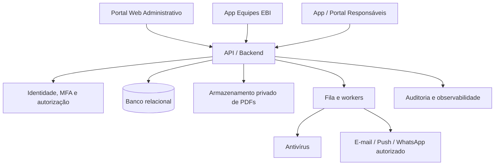
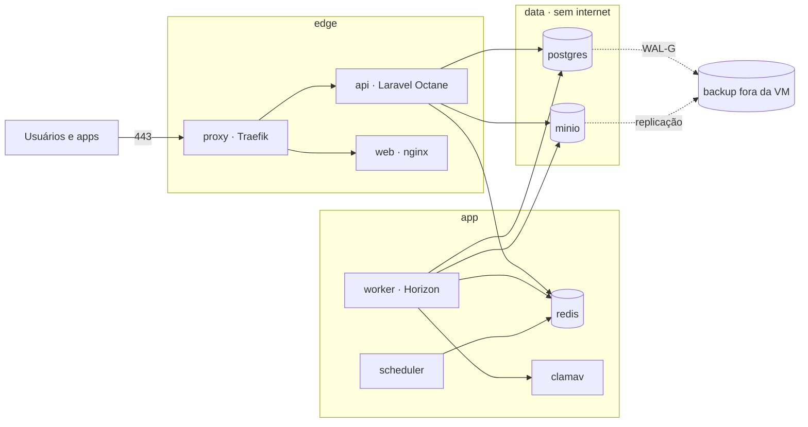

# Arquitetura de referência

**Status:** proposto. A decisão final de infraestrutura depende de [D-11](decisoes/README.md); a proposta para o piloto está nos ADRs 0004 a 0006.

## Visão de componentes

## Módulos

Um **monólito modular** com fronteiras claras entre módulos ([ADR-0002](decisoes/ADR-0002-monolito-modular.md)):

| Módulo | Responsabilidade | Requisitos |
|---|---|---|
| Identidade e Acesso | Login, MFA, papéis, vínculos de acesso, contexto | RF-05, autenticação |
| Organização | Hierarquia, igrejas, EBIs, transferências | RF-01 |
| Participantes e Privacidade | Cadastro, responsáveis, exceções, consentimentos, dados sensíveis | RF-02, RF-03, RF-04 |
| Agenda e Escalas | Programação, sessões previstas, escalas | RF-06, RF-07 |
| Sessões e Presença | Abertura, presença, estorno, elegibilidade | RF-06, RF-08 |
| Conteúdo Bíblico | Biblioteca, versões, moderação, utilização, avaliação | RF-10, RF-11, RF-12 |
| Feedback | Registro, moderação, liberação | RF-09 |
| Indicadores | Métricas, relatórios, exportação, supressão | RF-14 |
| Notificações | E-mail, push, WhatsApp, preferências | RF-15 |
| Auditoria | Trilha protegida, consulta | RF-16 |

O módulo de dados sensíveis (laudos) fica isolado, com chave de criptografia própria e acesso sempre auditado.

## Stack e implantação

- Backend: **Laravel** (confirmado), com Octane/FrankenPHP na api e Horizon nas filas.
- Banco: PostgreSQL.
- Arquivos: MinIO (compatível com S3) no piloto, com bucket de quarentena e verificação por ClamAV ([ADR-0005](decisoes/ADR-0005-armazenamento-e-antivirus.md)).
- Filas, cache e sessões: Redis.
- Web: SPA em React com TypeScript (Vite), build estático servido por nginx ([ADR-0021](decisoes/ADR-0021-portal-web-react.md)).
- Mobile: Flutter ou React Native (a definir).
- Implantação: tudo em contêineres Docker, orquestrados com Docker Compose em uma VM por ambiente no piloto ([ADR-0004](decisoes/ADR-0004-conteineres-e-orquestracao.md)). Segredos, backups e observabilidade em [ADR-0006](decisoes/ADR-0006-segredos-backups-e-observabilidade.md). Rascunho em [`infra/`](../../infra/README.md).

### Contêineres por ambiente (piloto)

Homologação e produção rodam em VMs separadas com a mesma imagem, promovida pelo digest. A validação final continua com a TI da CCB (D-11).
