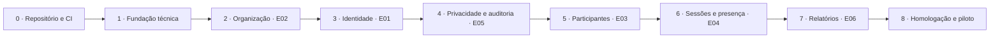

# Plano de desenvolvimento — MVP Brasília

**Status:** proposto · **Data:** 08/11/2026 · **Abrange:** fase 1 do [roadmap](fases-e-roadmap.md), épicos E01 a E06 do [backlog](backlog-epicos.md)

Este plano diz em que ordem construir o MVP e quando cada etapa está pronta. Não é cronograma: prazos dependem do tamanho da equipe, que ainda não está definido.

## 1. Já dá para começar?

Sim, com uma condição: **dá para desenvolver, mas não dá para colocar dados reais de crianças no sistema** até o jurídico/DPO e a TI da CCB fecharem os itens da seção 1.2. O desenvolvimento e o piloto com dados reais são portões diferentes.

### 1.1 O que não bloqueia o início

| Pendência | Por que não bloqueia | Como o código lida |
|---|---|---|
| Itens jurídicos do [ADR-0019](../06-arquitetura/decisoes/ADR-0019-base-normativa-lgpd.md) (bases legais, art. 14, retenção) | O produto adotou um padrão provisório conservador; o *texto* final pode chegar depois | Termos versionados (RF-04), prazos de retenção do padrão provisório como configuração, textos marcados como rascunho; desenvolvimento só com dados fictícios |
| Destino dos backups fora da VM ([ADR-0006](../06-arquitetura/decisoes/ADR-0006-segredos-backups-e-observabilidade.md)) | Só existe backup quando existe produção | WAL-G configurado e testado contra um MinIO local; destino definitivo entra na etapa 8 |
| D-11 — infraestrutura e SLA finais | O Compose roda em qualquer VM com Docker | Desenvolvimento e CI não dependem da VM da CCB |
| D-10 — dados identificáveis em níveis superiores | O MVP nasce com a regra mais restritiva, já aprovada pelo produto ([ADR-0029](../06-arquitetura/decisoes/ADR-0029-dados-identificaveis-acima-da-igreja.md)) | Relatórios acima da igreja só agregados e com supressão (ADR-0020); exportação identificável desligada até a validação da CCB e do DPO |
| D-06 — direitos dos PDFs | Biblioteca é fase 2 (E08); regra proposta no [ADR-0028](../06-arquitetura/decisoes/ADR-0028-politica-editorial-dos-pdfs.md) | — |
| D-07 — titular das lojas | Apps são fase 3 (E11) | — |
| Duração de sessão, política de senha e operações críticas ([autenticação](../05-seguranca-e-privacidade/autenticacao.md#a-definir)) | Valores padrão de mercado servem até a revisão | Tudo configurável; padrão proposto na etapa 3 |

### 1.2 O que bloqueia, e quando

| Pendência | Bloqueia | Precisa estar resolvida até |
|---|---|---|
| Parecer do jurídico e do DPO sobre o padrão provisório do ADR-0019 ([pacote para o jurídico](../05-seguranca-e-privacidade/pacote-para-o-juridico.md)) | Uso de dados reais: **nenhum dado real entra antes do parecer** | Etapa 8 (piloto) |
| Destino dos backups e VMs de homologação e produção | Ir ao ar | Etapa 8 |
| Indicação do encarregado (DPO) e canal do titular | Tela de privacidade e RF-16 | Etapa 8 |
| Autorização formal da CCB e lista das igrejas do piloto | Piloto | Etapa 8 |

O framework do portal Web, que era a única pendência que bloqueava o início, foi decidido: React com TypeScript ([ADR-0021](../06-arquitetura/decisoes/ADR-0021-portal-web-react.md)).

### 1.3 Lacunas na documentação técnica

Não impedem o início, mas são completadas durante o desenvolvimento:

- O [OpenAPI](../04-api/openapi.yaml) tem só dois caminhos. Cada épico descreve seus endpoints no OpenAPI antes de implementá-los (*contract-first*). O CI valida o OpenAPI com Spectral e confere se o catálogo de rotas continua alinhado a ele, porque o Spectral sozinho não compara os dois.
- Laudo anexo na exceção inclusiva (FL-06) exige MinIO e ClamAV já no MVP. Proposta: no MVP a exceção guarda decisão e justificativa em texto; o anexo de laudo entra junto com a biblioteca (E08), que já precisa da mesma infraestrutura. Precisa da sua confirmação.
- Manuais e runbooks (`docs/08-operacao/`, entregáveis 7 e 8) são escritos na etapa 8.

## 2. Visão das etapas

**Por que esta ordem:** escopo e papéis (E01) dependem da hierarquia (E02); todo dado pessoal depende de consentimento e trilha de auditoria (E05), então eles vêm antes do cadastro de participantes; presença depende de participante e sessão; relatório depende de presença. A trilha de auditoria começa como base na etapa 1 para que nenhuma escrita sensível nasça sem registro.

## 3. Etapas

### Etapa 0 — Repositório e CI

- Estrutura do monorepo: `api/` (Laravel), `web/` (portal em React + TypeScript), `infra/`, `docs/`.
- Proteção do `main`: só por PR, com CI verde e uma revisão.
- Modelo de PR (com campo "RF/CA atendidos"), `CODEOWNERS`, Dependabot, secret scanning.
- GitHub Actions: lint (Pint, PHPStan nível alto, ESLint), testes, validação do OpenAPI (Spectral) e conferência do catálogo de rotas contra o OpenAPI ([`scripts/check-endpoints.py`](../../scripts/check-endpoints.py)), build das imagens e publicação no GHCR com digest.
- Ambiente de desenvolvimento documentado em `CONTRIBUTING.md`: um `docker compose up` sobe tudo.

**Pronto quando:** um PR de exemplo passa por lint, testes e build, e a imagem aparece no GHCR.

### Etapa 1 — Fundação técnica

- Laravel na versão estável atual, PHP 8.4+, Octane com FrankenPHP; Horizon; scheduler.
- `infra/compose.yml` e `compose.dev.yml` funcionando com as imagens reais: proxy, api, worker, scheduler, migrate, web, postgres, redis, Mailpit. MinIO e ClamAV ficam configurados, mas só são exigidos quando houver upload.
- Esqueleto dos módulos do [ADR-0002](../06-arquitetura/decisoes/ADR-0002-monolito-modular.md) com teste de arquitetura (Pest/Deptrac) que impede um módulo de ler tabela de outro.
- Configuração *twelve-factor*: variáveis `*_FILE` para segredos, logs JSON em stdout sem dados pessoais.
- Base comum da API: `/api/v1`, `problem+json`, paginação por cursor, `Idempotency-Key`, rate limit, healthchecks.
- Base da trilha de auditoria (RF-16), *append-only*.
- Portal Web: projeto React + TypeScript com Vite, cliente da API gerado do OpenAPI, login de mentira, layout responsivo e acessível (RNF-05).

**Pronto quando:** `docker compose up` sobe tudo do zero, `/health` responde, um teste de arquitetura falha se um módulo violar fronteira, e o CI roda a suíte em menos de 10 minutos.

### Etapa 2 — Organização (E02)

- Central → Regional → Setor → Igreja → EBI ([ADR-0017](../06-arquitetura/decisoes/ADR-0017-hierarquia-e-ministerios.md)), vários EBIs por igreja.
- Vínculos com vigência e histórico (RN-09); transferência de igreja entre setores.
- Geocadastro de igrejas (só coordenadas; a sugestão por GPS é fase 3).
- Carga inicial da Regional de Brasília por importação CSV.

**Pronto quando:** CA-18 passa; a carga de Brasília roda em homologação sem erro.

### Etapa 3 — Identidade e acesso (E01)

- Cadastro com e-mail verificado, senha com Argon2id e verificação contra senhas vazadas, recuperação de senha sem enumeração de contas.
- MFA obrigatório para todo perfil que não seja Responsável: TOTP, códigos de recuperação e código por e-mail como contingência. Passkeys podem ficar para depois do MVP.
- Papéis e escopos conforme a [matriz de autorização](../05-seguranca-e-privacidade/matriz-de-autorizacao.md), incluindo os ministérios por nível e o acúmulo de papéis; cabeçalho `X-Acting-Scope` revalidado no servidor.
- Equipe do EBI (RF-05): convite, papéis, desativação.
- E-mail transacional pela fila.
- Padrões propostos até revisão: sessão de 12 h para Responsável e 8 h para equipe, senha mínima de 12 caracteres, reautenticação para vincular responsável, alterar papel e exportar dados.

**Pronto quando:** CA-03 e CA-15 passam; testes de autorização cobrem cada linha da matriz.

### Etapa 4 — Privacidade e auditoria (E05)

- Termos versionados e registro de consentimento com evidência (RF-04), inclusive para o cadastro assistido.
- Pedidos do titular: acesso, correção, revogação.
- Consulta da trilha de auditoria por perfil autorizado.
- Prazos de retenção como configuração, com rotina de descarte e anonimização desligada até o DPO aprovar os prazos.
- Módulo de dados sensíveis com chave própria, separada da `APP_KEY`.

**Pronto quando:** CA-16 passa; toda leitura de dado sensível gera registro de auditoria (teste automatizado).

### Etapa 5 — Participantes e responsáveis (E03)

- Cadastro único com matrícula (RN-01) e busca contextual, sem busca nacional aberta (R-03).
- Vínculo responsável–participante com estados, incluindo `aguardando_documento` ([ADR-0018](../06-arquitetura/decisoes/ADR-0018-comprovacao-de-responsavel.md)).
- Cadastro assistido pela coordenadora (FL-07).
- Deduplicação e mesclagem pela coordenadora ([ADR-0007](../06-arquitetura/decisoes/ADR-0007-cadastro-e-correcao-de-participantes.md)).
- Exceção inclusiva (FL-06, [ADR-0012](../06-arquitetura/decisoes/ADR-0012-excecao-decidida-pela-coordenadora.md)) com vigência e revogação.

**Pronto quando:** CA-01, CA-04, CA-06, CA-21 e CA-22 passam.

### Etapa 6 — Sessões e presença (E04)

- Agenda e sessões previstas; abertura e encerramento.
- Validação de elegibilidade etária num único serviço, a partir de [elegibilidade-etaria.md](../02-regras-de-negocio/elegibilidade-etaria.md), coberto por testes de tabela com datas-limite.
- Registro de presença idempotente, pensado para o celular (portal Web responsivo), com seleção manual da igreja.
- Estorno com motivo, autor e data, preservando o original.
- Histórico de presenças do participante.
- Aviso de equipe mínima durante a sessão ([ADR-0010](../06-arquitetura/decisoes/ADR-0010-equipe-minima-e-aprovacao-de-escala.md)).
- Modelo de contingência em papel e tela para lançar presenças depois (RNF-03, R-08).

**Pronto quando:** CA-02, CA-05, CA-07, CA-13, CA-17 e CA-19 passam; o registro de uma presença leva no máximo 3 toques depois de achar o participante.

### Etapa 7 — Relatórios básicos (E06)

- Participantes distintos, presenças e sessões por período e nível, conforme [métricas](../02-regras-de-negocio/metricas-e-indicadores.md).
- Supressão "< 5" e definição de ativo do [ADR-0020](../06-arquitetura/decisoes/ADR-0020-supressao-e-definicao-de-ativo.md).
- Exportação só de dados agregados até D-10.

**Pronto quando:** CA-14 passa; nenhum relatório acima da igreja mostra contagem de 1 a 4.

### Etapa 8 — Homologação e piloto

- VMs de homologação e produção; deploy por digest; segredos como arquivos.
- Backup com WAL-G para o destino escolhido; primeira restauração de teste com tempo medido (RTO).
- Observabilidade mínima: logs, métricas, Sentry, alertas e monitor externo.
- Teste de carga com a volumetria do RNF-04; revisão de segurança e teste de invasão básico.
- Textos finais dos termos aprovados pelo jurídico; DPO e canal do titular publicados.
- `docs/08-operacao/`: manual de administração, manual do EBI, orientação aos responsáveis, runbooks de deploy, restauração e incidente.
- Treinamento das igrejas selecionadas.

**Pronto quando:** todos os CA da fase 1 passam em homologação, a restauração fica dentro de 8 h, e a CCB aprova os controles de acesso (critério de passagem da fase 1).

## 4. Definição de pronto (vale para toda tarefa)

- Endpoint descrito no OpenAPI antes do código e marcado `no OpenAPI` em [endpoints.md](../04-api/endpoints.md) (o CI confere); teste de contrato passando.
- Testes automatizados da regra e da autorização (quem pode e quem não pode).
- Escrita sensível gera registro de auditoria.
- Nenhum dado pessoal em log.
- Tela acessível (teclado, contraste, leitor de tela) e usável no celular.
- [Rastreabilidade](../01-requisitos/rastreabilidade.md) atualizada com o RF e o CA atendidos.
- Revisada por PR e com CI verde.

## 5. Dados de teste

Nenhum dado real antes da etapa 8. Um *seeder* gera a hierarquia de Brasília com igrejas, EBIs, equipes e participantes fictícios, cobrindo os casos-limite de idade (véspera e dia do 12º aniversário, menos de 3 anos, exceção vigente e expirada).
