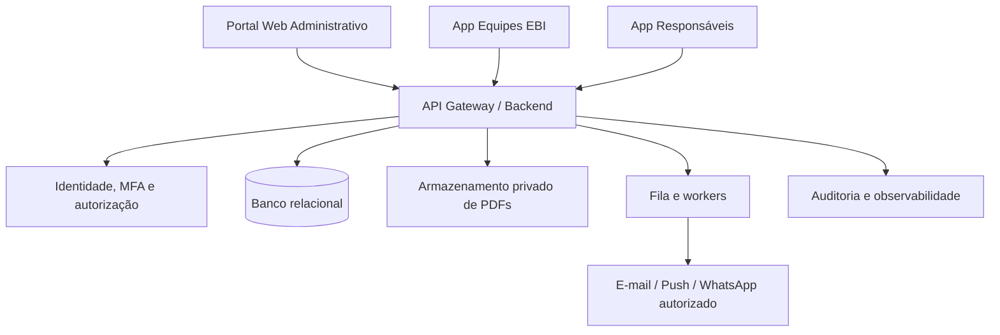

# Especificação de Requisitos — Plataforma de Gestão do Espaço Bíblico Infantil (EBI)

**Organização:** Congregação Cristã no Brasil (CCB)  
**Versão:** 1.0 — proposta para validação  
**Data:** 08/11/2026  
**Abrangência prevista:** nacional, com implantação piloto na Regional de Brasília  
**Classificação:** documento de trabalho; requisitos sujeitos à aprovação institucional

---

## 1. Visão executiva

### 1.1. Contexto
O Espaço Bíblico Infantil (EBI) atende, pela regra geral, crianças a partir de 3 anos e **menores de 12 anos** (até 11 anos, 11 meses e 29 dias, conforme calendário), com exceções de idade para participantes com deficiência ou neurodivergência mediante registro e autorização institucional durante os cultos, em atividades bíblicas lúdicas conduzidas por coordenadoras e auxiliares. A CCB organiza-se, para os fins desta solução, em **Central Nacional → Regionais → Setores → Igrejas → EBI(s)**. Essa hierarquia deverá ser validada com a administração da CCB antes da implementação.

### 1.2. Objetivo
Disponibilizar uma plataforma integrada **Web + aplicativos Android/iOS + API**, hospedada na infraestrutura da CCB, para gerir cadastro único de crianças, responsáveis, equipes, atividades, sessões, presenças, escalas, feedbacks e estatísticas; compartilhar materiais pedagógicos em PDF entre EBIs; e permitir acompanhamento seguro pelos responsáveis legais.

### 1.3. Princípios
1. **Uma criança, um cadastro nacional**, independentemente da igreja frequentada.
2. **Presença pertence à sessão e à igreja onde ocorreu**, sem alterar o vínculo principal da criança.
3. **Privilégio mínimo e segregação territorial** para usuários administrativos.
4. **Privacidade e melhor interesse da criança por padrão**.
5. **Rastreabilidade** das operações e dos materiais reutilizados.
6. **Operação simplificada** para coordenadoras, auxiliares e responsáveis.
7. **Compatibilidade com infraestrutura, identidade visual e contas de publicação da CCB**, sujeita à aprovação.

### 1.4. Escopo
**Incluído:** estrutura organizacional; cadastros; autenticação; consentimento; autorização; agenda de cultos/EBI; escalas; sessões; frequência; feedback; biblioteca PDF; reutilização e avaliação de atividades; relatórios; notificações; portal de responsáveis; auditoria; API; apps; configuração e governança.

**Fora do escopo inicial, salvo decisão posterior:** gestão financeira, doações, prontuário médico, reconhecimento facial, geolocalização contínua, divulgação pública de dados de crianças, redes sociais abertas e chats livres entre adultos e crianças.

## 2. Atores e perfis de acesso

| Perfil | Abrangência | Permissões principais |
|---|---|---|
| Super Admin | Nacional | Configurações globais, estrutura, usuários, auditoria e governança; acesso a dados pessoais apenas quando justificado |
| Administrador de Regional | Regional designada | Gerir setores/igrejas, equipes, relatórios e parâmetros regionais |
| Administrador de Setor | Setor designado | Gerir igrejas/EBIs, equipes e relatórios do setor |
| Administrador de Igreja | Igreja designada | Gerir EBI, horários, equipe, escalas e dados operacionais locais |
| Coordenadora EBI | EBI(s) autorizados | Planejar sessões, registrar presenças, feedbacks, atividades e escalas locais |
| Auxiliar EBI | EBI(s) autorizados | Consultar escalas, registrar presenças, contribuir com atividades e feedbacks conforme autorização |
| Consulta Todas Regionais | Nacional, leitura | Indicadores agregados; dados identificáveis somente mediante autorização específica |
| Consulta da Regional | Regional, leitura | Indicadores e consultas autorizadas na regional |
| Consulta do Setor | Setor, leitura | Indicadores e consultas autorizadas no setor |
| Consulta da Igreja | Igreja, leitura | Indicadores e consultas autorizadas na igreja |
| Responsável | Apenas dependentes vinculados | Cadastrar/atualizar dependentes, consentir, acompanhar frequência, conteúdos e feedbacks |

**Regras transversais:** um usuário poderá acumular papéis e ter vínculos com mais de uma unidade; cada permissão deve ser verificada **no servidor** contra recurso, ação, unidade e vínculo ativo. Papéis de consulta não implicam automaticamente acesso a nomes, contatos ou feedbacks individuais. O Super Admin não deve ter acesso irrestrito automático a conteúdos sensíveis sem registro de finalidade.

## 3. Requisitos funcionais

### RF-01 — Estrutura organizacional
- Cadastrar e manter Central Nacional, Regionais, Setores, Igrejas e EBIs.
- Cada igreja terá identificador estável, nome, endereço, fuso horário, latitude, longitude, situação e vinculação hierárquica.
- Permitir que uma igreja não possua EBI ou possua mais de um EBI, caso autorizado pela governança.
- Preservar histórico de transferências de igreja entre setores e regionais, sem reescrever registros históricos.
- Disponibilizar importação controlada e deduplicação de cadastros organizacionais.

### RF-02 — Cadastro único de crianças
- Gerar **matrícula nacional imutável e não sequencialmente previsível**.
- Dados mínimos propostos: nome completo, data de nascimento, nome social quando aplicável, vínculo com responsáveis, situação cadastral, igreja/EBI de referência opcional, datas de criação e atualização.
- Dados adicionais (fotografia, necessidades de acessibilidade, contatos de emergência e informações de saúde) somente se indispensáveis, com acesso restrito e fundamento legal específico; não coletar por padrão.
- Permitir pesquisa por matrícula e nome, limitada à finalidade e ao escopo do operador; usar critérios adicionais controlados para evitar homônimos.
- Detectar possíveis duplicidades por combinação de atributos e revisão humana, sem fusão automática irreversível.
- Registrar histórico de vínculos, atualizações, correções e inativação.
- **Elegibilidade por idade:** a participação regular é permitida a partir dos 3 anos e somente enquanto a criança **não tiver completado 12 anos**. Na data do 12º aniversário, bloquear novas presenças pela regra geral, sem apagar cadastro ou histórico.
- **Exceção inclusiva sem limite máximo de idade:** permitir a continuidade da participação de pessoas com deficiência e/ou neurodivergência quando a necessidade de apoio e a adequação das atividades do EBI justificarem a exceção, conforme política institucional. O diagnóstico isolado não deve gerar presunção automática de incapacidade ou de determinada "idade mental".
- **Cadastro de exceção:** registrar indicador de necessidade de atendimento inclusivo, adaptações/apoios necessários, status da exceção (solicitada, aprovada, suspensa, revogada), justificativa funcional mínima, responsável pela autorização, data e histórico de alterações. Dados de diagnóstico/laudo, quando estritamente necessários, devem ficar em módulo segregado e de acesso restrito, nunca em relatórios gerais.
- A exceção poderá ser solicitada pelo responsável e avaliada por perfis expressamente autorizados, com procedimento de revisão e recurso definido pela CCB. A condição de deficiência/neurodivergência não deve ser exposta às demais igrejas sem necessidade operacional e autorização adequada.
- Para participantes com 12 anos ou mais amparados pela exceção, manter matrícula única e histórico, com nomenclatura de **participante do EBI** nos registros e telas em que "criança" não for adequado.

### RF-03 — Responsáveis e vínculos
- Responsável cria conta com e-mail verificado, senha e aceitação dos termos pertinentes.
- Registrar nome, e-mail, telefone opcional e relação com a criança; solicitar comprovação ou validação de legitimidade conforme risco.
- Permitir mais de um responsável por criança, com permissões e restrições individualizadas.
- Impedir que o simples conhecimento da matrícula permita vincular uma criança a uma conta.
- Oferecer fluxo de solicitação, aprovação, contestação e revogação de vínculo, com tratamento especial para guarda e decisões judiciais.
- Evitar exposição de dados de um responsável a outro sem necessidade ou autorização.

### RF-04 — Consentimento, transparência e privacidade
- Apresentar aviso de privacidade e termo de consentimento específico, claro, destacado e compreensível antes do cadastro da criança.
- Registrar versão do termo, finalidade, responsável declarante, data/hora, evidência de aceite, origem e status.
- Permitir consultar, retirar consentimento e solicitar direitos dos titulares, com fluxo de análise e efeitos definidos por finalidade e base legal.
- **Não presumir que consentimento é a única base legal para todo tratamento:** submeter o mapeamento de bases legais e o tratamento de dados de crianças à avaliação jurídica/DPO, observando o melhor interesse.
- Separar consentimentos facultativos (ex.: notificações não essenciais, fotos, uso de imagem) do tratamento necessário à operação.
- Não publicar nome, foto, frequência ou feedback de crianças na biblioteca de atividades.

### RF-05 — Equipe de EBI
- Cadastrar coordenadoras e auxiliares, vinculando usuários a uma ou várias igrejas/EBIs.
- Registrar nome, e-mail, contato funcional opcional, papel, situação e períodos de atuação.
- Aprovação de vínculo por autoridade administrativa competente; histórico de nomeações, afastamentos e desligamentos.
- Não permitir que usuário desligado registre sessões ou consulte dados após revogação.

### RF-06 — Agenda e sessões de EBI
- Cadastrar dias da semana, horários, exceções, feriados, cancelamentos e vigência da programação por EBI.
- Gerar sessões previstas e permitir abertura, edição controlada, encerramento e cancelamento.
- Cada sessão terá ID, EBI, igreja, início/fim previsto e real, equipe designada, tema/passagem bíblica e situação.
- Uma sessão encerrada poderá ser corrigida apenas por perfil autorizado, com motivo e trilha de auditoria.
- Impedir sessões duplicadas no mesmo EBI/intervalo, salvo exceção expressamente autorizada.

### RF-07 — Escalas
- Criar escalas de coordenadoras e auxiliares por sessão, com função, horário e situação (prevista, confirmada, substituída, ausência).
- Detectar conflitos de horário entre igrejas e alertar sobre lacunas de cobertura.
- Permitir confirmação, solicitação de troca e aprovação de substituição, respeitando hierarquia.
- Notificar profissionais sobre novas escalas, alterações e lembretes, conforme preferências.
- Manter histórico de escalas planejadas versus efetivamente cumpridas.

### RF-08 — Registro de presença
- Na sessão aberta, pesquisar participante por nome ou matrícula, selecionar resultado, confirmar identidade e verificar automaticamente a elegibilidade etária ou exceção inclusiva vigente antes do lançamento.
- Registrar presença com criança, sessão, igreja/EBI, data/hora, usuário responsável, origem (Web/app) e status.
- Uma criança pode frequentar igrejas diferentes, preservando matrícula única e histórico por local.
- Evitar presença duplicada da mesma criança na mesma sessão; sinalizar presença em sessões simultâneas de locais distintos para verificação.
- Permitir correção/estorno justificado e auditado, sem exclusão física silenciosa.
- **Geolocalização:** com permissão explícita do dispositivo, sugerir igrejas próximas com base nas coordenadas cadastradas; exigir confirmação manual do EBI e sessão. Oferecer seleção manual sempre. Não usar proximidade como prova única de presença, nem rastrear crianças.
- Prever operação com conectividade instável e sincronização segura como evolução priorizável; resolver conflitos e duplicações no servidor.

### RF-09 — Feedback individual da participação
- Coordenadora ou auxiliar autorizado poderá registrar observações pedagógicas objetivas, respeitosas e pertinentes à participação na sessão.
- Campos sugeridos: participação (opcional, escala definida), atividade realizada, observação breve, autor, data e visibilidade.
- Proibir rótulos diagnósticos, avaliações vexatórias, dados sensíveis desnecessários ou comparações públicas entre crianças.
- Definir fluxo de revisão/moderação, correção e contestação de registros.
- Responsáveis visualizarão apenas feedbacks autorizados de seus próprios dependentes; registros internos de proteção/salvaguarda, se existentes, exigem processo segregado e não integram o feedback comum.

### RF-10 — Biblioteca compartilhada de atividades bíblicas
- Coordenadoras e auxiliares autorizadas poderão enviar **PDFs** com título, descrição, livro/capítulo/versículos, tema, faixa etária recomendada, tags, autoria/créditos, Regional/Setor/Igreja de origem e data da apresentação original.
- A origem territorial e a data original devem ser preservadas; edições posteriores geram versão/histórico.
- Pré-visualização de PDF, pesquisa por texto/metadados, filtros por passagem bíblica, idade, tema, regional, setor, igreja, data, popularidade e avaliação.
- Downloads sujeitos a regras de acesso e licenciamento; escanear arquivos contra malware, validar tipo real, impor limites e usar armazenamento privado.
- Aplicar revisão editorial/moderação antes da publicação nacional, se aprovado pela CCB.
- Registrar autoria, declaração de direitos de uso e eventual retirada de material por infração ou inadequação.

### RF-11 — Reutilização de atividade
- Ao usar material em outra igreja, selecionar a **atividade e versão** e vinculá-las à sessão realizada.
- Gravar igreja/EBI de utilização, data, equipe responsável e eventual adaptação local.
- **Visualização ou download não contam como utilização**; apenas o vínculo confirmado com uma sessão válida.
- Evitar contagem duplicada para a mesma combinação atividade-versão/sessão; permitir múltiplas atividades por sessão.
- Exibir total de sessões que utilizaram a atividade e histórico territorial conforme permissão.

### RF-12 — Avaliação de atividades
- Permitir avaliação de **1 a 5 estrelas** por usuário habilitado após utilização confirmada em sessão.
- Regra inicial: uma avaliação ativa por usuário e utilização; atualizações substituem a nota anterior, mantendo auditoria.
- Exibir média aritmética e quantidade de avaliações, separadas do número de utilizações; não apresentar ranking como qualidade comprovada com amostras pequenas.
- Permitir denúncia/moderação de conteúdo inadequado; não criar avaliações públicas de crianças ou pessoas.

### RF-13 — Portal e aplicativo dos responsáveis
- Painel por dependente com identificação, matrícula, histórico de presenças por data e igreja, passagem bíblica/tema da sessão e feedbacks liberados.
- Atualizar dados permitidos, gerenciar solicitações de vínculo, termos, notificações e privacidade.
- Visualizar informações de sessão mesmo quando a criança participou de igreja diferente da sua referência.
- Não exibir nomes de outras crianças, escala nominal de equipe além do estritamente necessário, nem informações internas administrativas.

### RF-14 — Indicadores e relatórios
- Total de crianças cadastradas (nacional, regional, setor, igreja) e crianças distintas ativas em período definido.
- Presenças totais por período, sessões realizadas, média de presentes por sessão, frequência por igreja e evolução temporal.
- Crianças distintas atendidas por igreja versus crianças distintas atendidas no agregado: **não somar contagens locais para obter o total nacional**, pois uma criança pode frequentar múltiplas igrejas.
- Taxa de comparecimento somente quando existir denominador válido (ex.: crianças vinculadas/esperadas), com definição documentada.
- EBIs ativos/inativos, cobertura de escalas, quantidade de atividades publicadas, reutilizações, avaliações e passagens trabalhadas.
- Filtros por período, Regional, Setor, Igreja e EBI; exportação CSV/XLSX/PDF conforme autorização e minimização.
- Aplicar limiares de agregação/supressão para evitar reidentificação em unidades com poucas crianças.

### RF-15 — Notificações
- E-mail transacional para verificação, recuperação de conta e alertas de segurança.
- Notificações de escala, alterações, confirmação de vínculo e novidades pertinentes; push opcional.
- WhatsApp apenas via provedor/API oficial e mediante condições contratuais, custo, finalidade e permissões aplicáveis.
- Preferências de comunicação e registros de envio/entrega sem armazenar códigos em texto claro.

### RF-16 — Administração, auditoria e suporte
- Gerir parâmetros, catálogos, perfis, convites, revogações e solicitações de suporte.
- Registrar eventos relevantes: login, falha de autenticação, mudança de permissão, vínculo de responsável, consentimento, alteração cadastral, presença, feedback, publicação e reutilização.
- Trilha de auditoria protegida contra adulteração, com ator, ação, recurso, data, origem e motivo quando aplicável.
- Permitir atendimento de solicitações LGPD com protocolo, responsável e prazo, sem conceder acesso desnecessário ao suporte.

## 4. Autenticação e autorização

### 4.1. Responsáveis
- Cadastro com e-mail único verificado e senha forte; confirmar e-mail antes de liberar funções sensíveis.
- Recuperação de senha com token de uso único e validade curta; limitar tentativas e proteger contra enumeração de contas.
- Oferecer MFA opcional e exigir autenticação reforçada em operações de maior risco (ex.: vinculação/alteração de responsável), conforme política de segurança.

### 4.2. Equipes e administradores
- Login com e-mail e senha ou identidade corporativa federada, se disponível.
- **MFA obrigatório:** TOTP compatível com Google Authenticator e outros autenticadores; códigos por e-mail como contingência controlada; WhatsApp como alternativa apenas após análise de risco, pois é mais vulnerável a comprometimento de canal e dependências externas.
- Preferir TOTP ou passkeys para administradores; oferecer códigos de recuperação de uso único.
- Definir expiração de sessão, revogação de dispositivos, bloqueio progressivo, alertas de acesso e reautenticação para operações críticas.
- Armazenar senhas com Argon2id (ou equivalente recomendado), nunca reversivelmente; guardar segredos TOTP criptografados.

### 4.3. Matriz de autorização
A implementação deve combinar **RBAC (papéis)** com **ABAC (escopo territorial, vínculo ativo, finalidade e propriedade do recurso)**. Cada endpoint e consulta de banco deve impor autorização; ocultar botões na interface não basta. Criar testes automáticos contra acesso horizontal e vertical indevido.

## 5. Regras de negócio críticas

| ID | Regra |
|---|---|
| RN-01 | Matrícula do participante é única nacionalmente e não muda quando frequenta outra igreja. |
| RN-13 | Participação regular: idade mínima de 3 anos e idade estritamente inferior a 12 anos na data da sessão; a partir do 12º aniversário, somente com exceção inclusiva vigente. |
| RN-14 | A exceção inclusiva por deficiência/neurodivergência não possui limite máximo de idade; exige avaliação e autorização institucional registradas, com tratamento reservado dos dados sensíveis. |
| RN-15 | Revogação ou vencimento da autorização de exceção impede novas presenças fora da faixa etária regular, preservando registros históricos e auditoria. |
| RN-02 | Presença exige sessão existente e autorização do operador para o EBI correspondente. |
| RN-03 | Um registro ativo de presença por criança/sessão. |
| RN-04 | Igreja sugerida por GPS deve ser confirmada; sem GPS, seleção manual. |
| RN-05 | Responsável só acessa dependente após vínculo legitimado e ativo. |
| RN-06 | Material reutilizado deve estar associado a sessão e versão identificáveis. |
| RN-07 | Download e visualização não incrementam contador de utilização. |
| RN-08 | Média de estrelas e contagem de utilizações são métricas independentes. |
| RN-09 | Transferências organizacionais não modificam a igreja histórica da sessão. |
| RN-10 | Alterações em presença, consentimento, vínculos e feedbacks geram auditoria. |
| RN-11 | Usuário com múltiplos vínculos escolhe o contexto de atuação; acesso sempre validado no backend. |
| RN-12 | Dados pessoais de crianças não entram em arquivos compartilhados nacionalmente. |

## 6. Fluxos de usuário

### FL-01 — Cadastro de responsável e criança
1. Responsável instala app ou acessa portal, informa e-mail e cria senha.
2. Sistema envia link/código de verificação de e-mail.
3. Responsável verifica e-mail, lê aviso e manifesta consentimentos pertinentes.
4. Informa dados mínimos da criança e sua relação legal.
5. Sistema verifica possíveis duplicidades sem revelar cadastros de terceiros.
6. Caso seja cadastro novo, gera matrícula; se possível duplicidade, encaminha a validação segura.
7. Vinculação é aprovada segundo política institucional; responsável recebe confirmação.

### FL-02 — Registro de presença em igreja diferente
1. Auxiliar autenticada acessa sessão do EBI onde está atuando.
2. App sugere igreja por GPS, se permitido; auxiliar confirma igreja/EBI e sessão.
3. Pesquisa participante por nome/matrícula, verifica identificação suficiente, seleciona cadastro nacional e valida idade ou exceção vigente.
4. Confirma presença; sistema impede duplicação e grava igreja e sessão reais.
5. Responsável autorizado visualiza o evento no histórico do dependente.

### FL-03 — Publicação e reutilização de PDF
1. Coordenadora/Auxiliar envia PDF e metadados bíblicos, autoria e origem.
2. Sistema valida arquivo, direitos declarados e critérios editoriais.
3. Material é publicado e pode ser localizado por outros EBIs.
4. Outra equipe consulta/visualiza PDF e decide usá-lo em uma sessão.
5. Registra utilização efetiva vinculada à sessão e à versão.
6. Sistema atualiza contador e habilita avaliação de 1–5 estrelas.

### FL-04 — Escala
1. Coordenadora cria escala para sessões futuras.
2. Sistema detecta conflitos e notifica profissionais.
3. Profissionais confirmam ou solicitam troca.
4. Coordenadora aprova substituição.
5. Após a sessão, registra-se equipe efetivamente presente.

### FL-05 — Feedback
1. Operadora autorizada abre sessão concluída e seleciona criança presente.
2. Registra observação objetiva, breve e adequada à finalidade.
3. Conforme regra de moderação, feedback é liberado ao responsável.
4. Alterações e contestações ficam auditadas.

## 7. Modelo de dados conceitual

| Entidade | Campos-chave / relacionamentos |
|---|---|
| regional | id, nome, código, status |
| setor | id, regional_id, nome, código, status |
| igreja | id, setor_id, nome, endereço, latitude, longitude, timezone, status |
| ebi | id, igreja_id, nome, status |
| usuario | id, nome, email_verificado, senha_hash/identidade_federada, status |
| papel | id, código, descrição |
| vinculo_acesso | id, usuario_id, papel_id, tipo_escopo, escopo_id, início, fim, status |
| crianca | id, matricula, nome, data_nascimento, status, igreja_referencia_id opcional (entidade legada denominada `crianca`, inclusive para participantes com exceção acima de 12 anos) |
| excecao_etaria_ebi | id, crianca_id, tipo_necessidade (categoria geral), apoios_necessarios, justificativa_funcional, status, autorizado_por, autorizado_em, revogado_em, revisao_prevista_em |
| dado_sensivel_participante | id, crianca_id, tipo, conteudo_cifrado/referencia_segura, finalidade, base_legal, controle_acesso, prazo_retencao |
| responsavel_crianca | id, usuario_id, crianca_id, tipo_relacao, status, validação, início, fim |
| termo_versao | id, finalidade, versão, texto_hash, vigência |
| manifestacao_privacidade | id, usuario_id, crianca_id, termo_versao_id, decisão, timestamp, evidência |
| agenda_ebi | id, ebi_id, dia_semana, hora_inicio, hora_fim, vigência |
| sessao | id, ebi_id, início/fim, tema, passagem_biblica, status |
| escala | id, sessao_id, usuario_id, função, status, confirmação |
| presenca | id, sessao_id, crianca_id, registrado_por, registrado_em, status |
| feedback | id, sessao_id, crianca_id, autor_id, conteúdo, visibilidade, status |
| atividade | id, autor_id, título, descrição, referência_bíblica, origem_igreja_id, data_original, status |
| atividade_versao | id, atividade_id, número, arquivo_id, hash, créditos, publicado_em |
| arquivo | id, chave_storage, mime, tamanho, sha256, status_antivirus |
| utilizacao_atividade | id, atividade_versao_id, sessao_id, registrado_por, registrado_em |
| avaliacao_atividade | id, utilizacao_id, usuario_id, estrelas, atualizado_em |
| notificacao | id, destinatario_id, canal, tipo, status, enviado_em |
| evento_auditoria | id, ator_id, ação, recurso, escopo, timestamp, origem, metadados_minimizados |

**Índices/restrições recomendados:** `crianca.matricula UNIQUE`; `usuario.email_normalizado UNIQUE`; `presenca(sessao_id, crianca_id)` único para presença ativa (conforme estratégia de estorno); `utilizacao_atividade(sessao_id, atividade_versao_id) UNIQUE`; índices em hierarquia, datas, vínculos e referências bíblicas. Usar IDs opacos (UUID/ULID ou equivalente) externamente; chaves de relacionamento e integridade referencial no banco.

**Histórico:** alterações hierárquicas, versões de termos, atividades, vínculos e escalas devem preservar contexto temporal. Definir estratégia de retenção, arquivamento e anonimização com jurídico/DPO.

## 8. API — proposta inicial

Padrão REST versionado (`/api/v1`), HTTPS, JSON, paginação, filtros, autorização por recurso e erros padronizados. Operações de escrita críticas devem suportar **idempotência**.

| Método | Rota exemplificativa | Finalidade |
|---|---|---|
| POST | `/auth/register-parent` | Criar conta de responsável |
| POST | `/auth/verify-email` | Verificar e-mail |
| POST | `/auth/login` | Autenticar |
| POST | `/auth/mfa/verify` | Validar MFA |
| GET | `/me/children` | Dependentes vinculados |
| POST | `/children` | Solicitar cadastro de criança |
| POST | `/children/{id}/guardians` | Solicitar vínculo responsável-criança |
| GET | `/regions/{id}/sectors` | Consultar setores autorizados |
| GET | `/churches/nearby?lat=&lon=` | Sugerir igrejas próximas, com controles de uso |
| GET | `/ebis/{id}/sessions` | Consultar sessões |
| POST | `/sessions/{id}/attendance` | Registrar presença |
| POST | `/sessions/{id}/feedback` | Registrar feedback |
| GET | `/ebis/{id}/roster` | Consultar escala |
| GET | `/activities` | Pesquisar biblioteca |
| POST | `/activities` | Cadastrar atividade e metadados |
| POST | `/activities/{id}/versions` | Enviar nova versão PDF |
| POST | `/sessions/{id}/activity-uses` | Confirmar utilização |
| POST | `/activity-uses/{id}/ratings` | Avaliar utilização |
| GET | `/reports/attendance` | Indicadores autorizados |
| GET | `/privacy/consents` | Consultar manifestações |
| POST | `/privacy/requests` | Solicitar exercício de direitos |

**Contratos a detalhar:** payloads, códigos HTTP, autenticação, rate limits, paginação, ordenação, formato de erros, validação, upload multipart/presigned, callbacks de antivírus, idempotency keys, OpenAPI 3.1 e testes de contrato.

## 9. Telas e módulos

### 9.1. Portal Web administrativo
- Login/MFA e seleção de contexto territorial.
- Dashboard com filtros e métricas autorizadas.
- Gestão de estrutura organizacional e geolocalização de igrejas.
- Gestão de usuários, papéis, vínculos e convites.
- Cadastro/pesquisa de crianças e responsáveis, com campos protegidos.
- Agenda, sessões, escalas e presenças.
- Biblioteca PDF, revisão, utilização e avaliações.
- Relatórios, exportações, auditoria e solicitações de privacidade.

### 9.2. App Coordenadoras/Auxiliares
- Login/MFA, unidades autorizadas e escala pessoal.
- Próxima sessão, abertura/encerramento e registro rápido de presença.
- Sugestão de igreja por proximidade e seleção manual.
- Consulta de crianças no contexto autorizado.
- Feedbacks e histórico da sessão.
- Biblioteca PDF, publicação e registro de reutilização.
- Notificações de escala e substituição.

### 9.3. App Responsáveis
- Cadastro, verificação de e-mail, login e recuperação de acesso.
- Termos, consentimentos e gestão de privacidade.
- Dependentes, matrícula, atualização cadastral e vínculos.
- Calendário/histórico de presença, igreja, passagem bíblica e feedback liberado.
- Notificações e canais de suporte.

**Decisão de produto:** avaliar um único app com experiências segregadas por perfil versus dois apps. Recomenda-se **um app com módulos por papel** apenas se a CCB aceitar maior complexidade de navegação e suporte; dois apps podem simplificar a experiência dos responsáveis e a segurança operacional. Validar antes do desenho de UX.

## 10. Requisitos não funcionais

### RNF-01 — Segurança
- HTTPS/TLS moderno; criptografia em repouso; gestão segura de chaves e segredos.
- MFA obrigatório para equipe; proteção contra brute force, credential stuffing, CSRF quando aplicável, XSS, SQL injection, IDOR/BOLA e uploads maliciosos.
- Política de acesso administrativo, segregação de ambientes, hardening, patching, análise de dependências, SAST/DAST e testes de invasão antes do lançamento.
- Logs sem senhas, tokens, códigos MFA ou informações excessivas de crianças.

### RNF-02 — Privacidade e LGPD
- Inventário de dados, bases legais e finalidades; RIPD quando recomendado pela avaliação de risco; encarregado/DPO; contratos com operadores; regras de compartilhamento.
- Minimização, privacidade desde a concepção, retenção e descarte documentados.
- Verificar enquadramento jurídico do tratamento de dados de menores e as exigências aplicáveis de consentimento, informação e melhor interesse.
- Proibir publicidade comportamental direcionada a crianças e uso de dados para finalidades alheias ao EBI.
- Considerar que a informação sobre participação religiosa pode revelar **dado pessoal sensível**; aplicar controles reforçados e análise jurídica específica.

### RNF-03 — Disponibilidade e continuidade
- Metas **propostas para negociação**, não compromissos aprovados: disponibilidade mensal de 99,5% no piloto; RPO até 24h; RTO até 8h.
- Backups automáticos criptografados, restauração testada e plano de contingência para registro manual quando indisponível.
- Monitoramento, alertas, métricas de erro e plano de resposta a incidentes.

### RNF-04 — Desempenho e escala
- Metas preliminares: 95% das buscas de crianças em até 2 segundos e 95% dos registros de presença em até 3 segundos sob carga-alvo definida em teste.
- Dimensionar infraestrutura com estimativas reais de igrejas, sessões simultâneas, crianças, PDFs e acessos; testes de carga e crescimento nacional.
- Processar PDFs, notificações e relatórios pesados de forma assíncrona.

### RNF-05 — Usabilidade e acessibilidade
- Interfaces responsivas, linguagem clara, fluxo de presença com poucos passos e mensagens de erro acionáveis.
- Acessibilidade conforme WCAG 2.2 AA como objetivo de projeto, com testes em dispositivos e leitores de tela.
- Suporte a fuso horário, formatos brasileiros, conexão móvel instável e dispositivos Android/iOS suportados pela política da CCB.

### RNF-06 — Governança técnica
- Infraestrutura sob gestão da CCB; homologação e produção segregadas.
- Apps publicados nas contas oficiais da CCB na Google Play e App Store, condicionados a titularidade, certificados, políticas das lojas e aprovações internas.
- CI/CD, versionamento, documentação de arquitetura, OpenAPI, migrações de banco, observabilidade e política de atualização.

## 11. Arquitetura de referência (não vinculante)

**Stack candidata, a validar:** backend Laravel/PHP ou outra plataforma homologada; PostgreSQL; armazenamento de objetos compatível com infraestrutura CCB; Redis/filas; frontend Web moderno; aplicativo Flutter ou React Native. Evitar impor tecnologia antes de confirmar padrões, capacidade operacional e suporte da CCB.

**Separação lógica sugerida:** Identidade e Acesso; Organização; Crianças/Responsáveis/Privacidade; Agenda/Escalas; Sessões/Presença; Conteúdo Bíblico; Feedback; Indicadores; Notificações; Auditoria. Inicialmente, um **monólito modular bem delimitado** pode reduzir complexidade operacional em comparação com microsserviços.

## 12. Métricas e definições

| Indicador | Fórmula/critério |
|---|---|
| Crianças cadastradas | Quantidade de matrículas ativas na abrangência definida |
| Crianças distintas atendidas | `COUNT(DISTINCT crianca_id)` nas presenças válidas do período e escopo |
| Total de presenças | Quantidade de registros de presença válidos no período |
| Média por sessão | Presenças válidas ÷ sessões realizadas no período |
| Sessões realizadas | Sessões encerradas e confirmadas como realizadas |
| Taxa de cobertura da escala | Sessões com equipe mínima confirmada ÷ sessões previstas, com regra de equipe mínima definida |
| Utilizações de atividade | Número de pares únicos (sessão, versão da atividade) confirmados |
| Avaliação média | Soma de estrelas válidas ÷ quantidade de avaliações válidas |
| Igrejas com EBI ativo | Igrejas com ao menos um EBI habilitado, segundo critério operacional aprovado |

Os relatórios devem declarar período, fuso, abrangência, filtros, critérios de exclusão e data de atualização. Diferenciar claramente **crianças únicas** de **frequências totais**.

## 13. Critérios de aceite — cenários essenciais

1. **Cadastro único:** dada criança já cadastrada, ao frequentar outra igreja, o sistema reutiliza a mesma matrícula e não cria outro registro.
2. **Presença idempotente:** dois envios simultâneos para a mesma criança/sessão resultam em apenas uma presença válida.
3. **Escopo:** administrador de igreja A não consegue consultar crianças/feedbacks da igreja B fora das permissões e finalidades autorizadas.
4. **Responsável:** usuário sem vínculo validado não consegue acessar dados da criança, mesmo conhecendo matrícula ou URL.
5. **Idade:** participante sem exceção ativa pode registrar presença até a véspera do 12º aniversário; no 12º aniversário, a presença é bloqueada. Com exceção inclusiva aprovada, a presença é permitida independentemente da idade máxima.
6. **Privacidade da exceção:** usuário sem autorização específica não acessa diagnóstico, laudo ou justificativa sensível.
7. **Localização:** com GPS desabilitado, auxiliar seleciona igreja manualmente e registra presença normalmente.
6. **Biblioteca:** PDF enviado passa por validação; material bloqueado não é disponibilizado.
7. **Reutilização:** baixar PDF não altera contador; vincular versão a sessão realizada incrementa uma utilização.
8. **Avaliação:** usuário habilitado avalia de 1 a 5; alteração de nota não duplica avaliação ativa.
9. **Feedback:** responsável só vê observação de dependente vinculado e liberada conforme política.
10. **Escalas:** conflito de horários é sinalizado antes da confirmação.
11. **Auditoria:** estorno de presença preserva registro original, motivo, autor e data.
12. **Relatório nacional:** criança presente em duas igrejas conta como uma criança distinta nacional e duas presenças.
13. **MFA:** usuário de equipe sem segundo fator validado não acessa área operacional.
14. **Consentimento:** versão e evidência de manifestação podem ser recuperadas por operador autorizado.

## 14. Priorização e fases de implantação

| Fase | Entregáveis | Critério de passagem |
|---|---|---|
| 0 — Descoberta e governança | Validação hierárquica, política de dados, fluxos de legitimidade, perfis, arquitetura e protótipos | Aprovação institucional, jurídica e de segurança |
| 1 — MVP Brasília | Estrutura, login/MFA, crianças/responsáveis, consentimento, agenda, sessões, presença, dashboards básicos | Piloto com igrejas selecionadas e controles de acesso aprovados |
| 2 — Operação EBI | Escalas, feedback, biblioteca PDF, reutilização, estrelas, relatórios ampliados | Testes de aceitação e moderação concluídos |
| 3 — Aplicativos e escala | Apps, notificações, sugestão GPS, desempenho e implantação regional | Publicação nas contas oficiais e suporte preparado |
| 4 — Expansão nacional | Importação de unidades, operação multirregional, relatórios nacionais, continuidade aprimorada | Governança e capacidade nacional demonstradas |

**Dependências críticas:** autorização formal da CCB; validação da estrutura nacional; nomeação de responsável pelo produto e encarregado de dados; definição de quem valida responsáveis; política de proteção infantil; titularidade das contas das lojas; dimensionamento de infraestrutura e orçamento.

## 15. Riscos, controles e decisões em aberto

| Risco ou decisão | Impacto | Tratamento recomendado |
|---|---|---|
| Dados de crianças e participação religiosa | Alto risco de privacidade e exposição sensível | Minimização, avaliação jurídica/RIPD, controles reforçados e política de retenção |
| Responsável fraudulento reivindicar criança | Exposição de histórico infantil | Validação de vínculo e contestação; matrícula nunca funciona como segredo de acesso |
| Busca nacional aberta por nome | Consulta indevida e enumeração | Busca contextual, limites, justificativa quando necessário e auditoria |
| Geolocalização imprecisa ou falsificada | Registro na igreja errada | GPS só sugere; confirmação de EBI/sessão e validação do operador |
| Conteúdo PDF com direitos de terceiros | Risco jurídico e reputacional | Declaração de direitos, moderação e retirada rápida |
| Feedback subjetivo ou sensível | Estigmatização de criança | Campos objetivos, treinamento, moderação e direito de correção |
| Estatísticas com dupla contagem | Decisões equivocadas | Métricas distintas por criança única, sessão e presença |
| Ausência de internet na igreja | Perda de registros | Procedimento de contingência e eventual modo offline seguro |
| Hierarquia administrativa mudar | Perda de contexto histórico | Vínculos com vigência e histórico organizacional |
| Canal WhatsApp para MFA | Custos, dependência e risco de tomada de conta | Preferir TOTP; canal alternativo apenas após avaliação |
| Aplicativos em lojas oficiais | Dependência de governança e políticas | Confirmar titularidade, responsáveis por publicação e conformidade |

### Decisões que precisam de aprovação antes do desenvolvimento

**D-01.** A hierarquia formal e a existência de EBIs múltiplos por igreja.  
**D-02.** Quem pode criar, aprovar, mesclar e corrigir cadastros de crianças.  
**D-03.** Como comprovar legitimidade de responsáveis, inclusive guarda compartilhada/restrita.  
**D-04.** Bases legais, termos, retenção, descarte e procedimento de incidentes.  
**D-05.** Quais feedbacks serão visíveis aos responsáveis e quem os modera.  
**D-06.** Política editorial, direitos autorais e publicação nacional dos PDFs.  
**D-07.** Se serão um ou dois apps, e quem terá conta de desenvolvedor nas lojas.  
**D-08.** Requisitos de funcionamento offline e sincronização.  
**D-09.** Critérios de equipe mínima e aprovação de escalas.  
**D-10.** Regras de exportação e acesso a dados identificáveis em níveis superiores.  
**D-11.** Infraestrutura, padrões tecnológicos e metas finais de SLA/RPO/RTO.  
**D-12.** Confirmar a regra de 3 a menos de 12 anos e aprovar o fluxo de autorização e revisão das exceções inclusivas sem limite máximo de idade, com responsáveis institucionais definidos.

## 16. Backlog inicial — épicos

| Épico | Itens principais | Prioridade proposta |
|---|---|---|
| E01 Identidade | Login, verificação de e-mail, MFA, recuperação, papéis/escopos | P0 |
| E02 Organização | Regional, setor, igreja, EBI, geocadastro | P0 |
| E03 Crianças e responsáveis | Cadastro único, vínculo, deduplicação, consentimento | P0 |
| E04 Sessões e frequência | Agenda, abertura, pesquisa, registro, estorno, histórico | P0 |
| E05 Privacidade e auditoria | Termos, direitos, trilhas, retenção, controles de acesso | P0 |
| E06 Relatórios básicos | Crianças distintas, presenças, sessões, filtros | P0 |
| E07 Escalas | Planejamento, confirmação, trocas, conflitos | P1 |
| E08 Biblioteca | PDFs, metadados bíblicos, moderação, pesquisa | P1 |
| E09 Reutilização e avaliação | Uso por sessão, histórico, estrelas, indicadores | P1 |
| E10 Feedback | Registro, moderação, visualização por responsável | P1 |
| E11 Apps | Experiências de equipe/responsáveis, publicação | P1 |
| E12 Geolocalização e notificações | Sugestão de EBI, push, e-mail, WhatsApp opcional | P2 |
| E13 Continuidade | Offline, sincronização e resiliência avançada | P2, sujeito à necessidade do piloto |

**P0** = necessário ao MVP; **P1** = próxima entrega; **P2** = evolução. A classificação é recomendação preliminar, não cronograma aprovado.

## 17. Entregáveis esperados da equipe de desenvolvimento

1. Documento de requisitos aprovado e matriz de rastreabilidade RF → histórias → testes.
2. Protótipos navegáveis Web e mobile, com validação de acessibilidade.
3. Modelo lógico/físico do banco, dicionário de dados e migrações.
4. OpenAPI 3.1, especificações de eventos e política de versionamento.
5. Modelo de ameaças, matriz de permissões e documentação LGPD.
6. Código-fonte, pipelines CI/CD, testes automatizados e evidências de segurança.
7. Manual de administração, manual operacional do EBI e orientação aos responsáveis.
8. Procedimentos de backup, restauração, monitoramento, suporte e resposta a incidentes.
9. Plano de implantação piloto, migração, treinamento e expansão nacional.

---

## 18. Glossário

- **CCB:** Congregação Cristã no Brasil.
- **EBI:** Espaço Bíblico Infantil.
- **Sessão:** realização específica do EBI em data, horário e igreja definidos.
- **Matrícula:** identificador nacional único da criança.
- **Igreja de referência:** vínculo cadastral preferencial, que não limita visitas a outros EBIs.
- **Utilização:** registro confirmado de uma atividade PDF em uma sessão realizada.
- **MFA:** autenticação multifator.
- **TOTP:** código temporário gerado por aplicativo autenticador.
- **RBAC/ABAC:** controles de acesso por papel e por atributos/contexto.
- **LGPD:** Lei Geral de Proteção de Dados Pessoais (Lei nº 13.709/2018).
- **RIPD:** Relatório de Impacto à Proteção de Dados Pessoais.
- **RPO/RTO:** objetivos de perda máxima de dados e de tempo de recuperação.

**Nota de governança:** este documento descreve uma proposta de solução e não presume autorização da administração nacional da CCB, nem substitui validação jurídica, pastoral/institucional, de segurança ou de proteção de dados.
