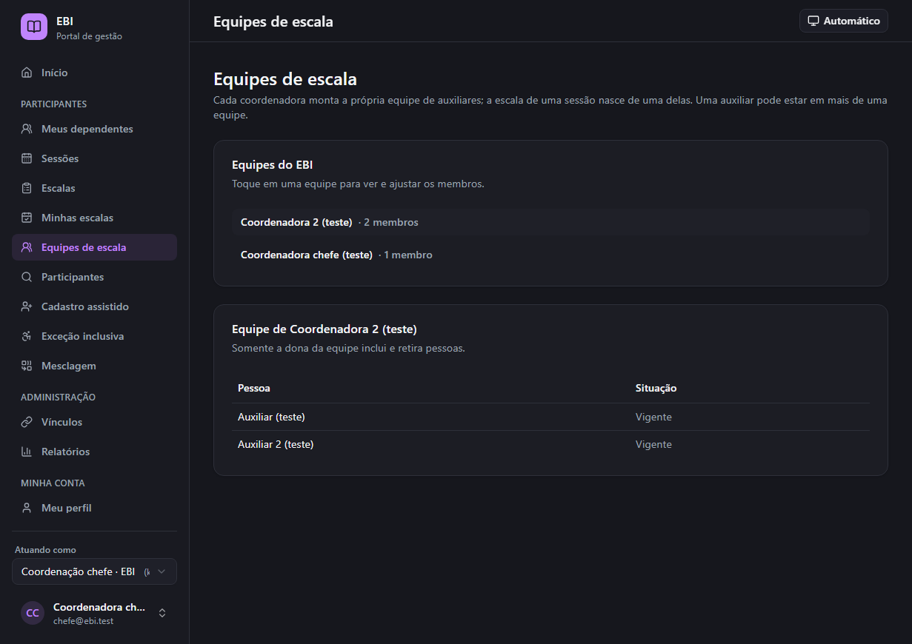
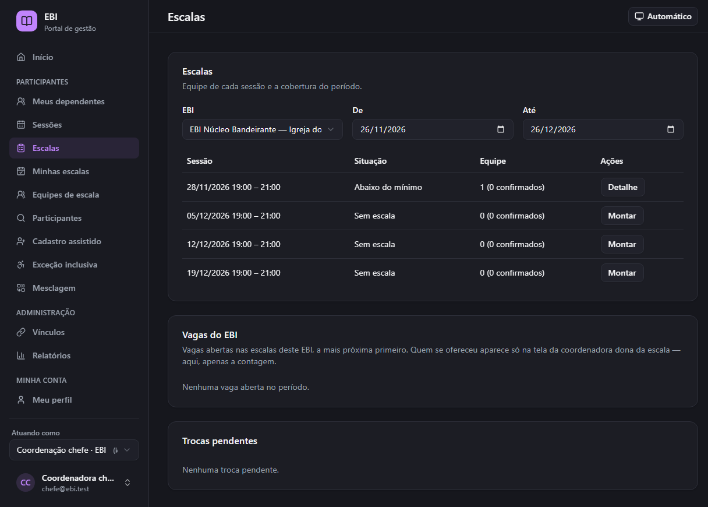
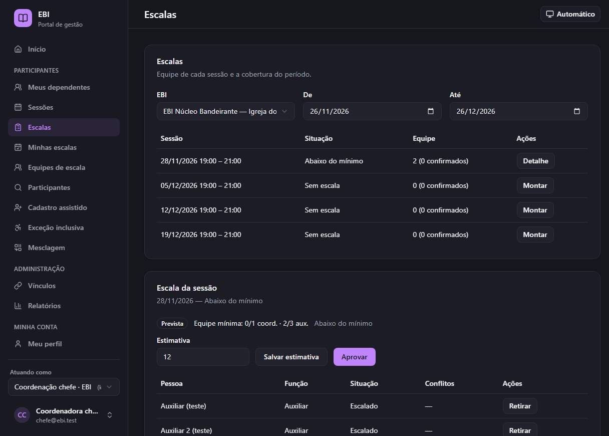

# Escalas

A escala diz **quem trabalha em cada sessão** e em qual função. Ela sai de uma **equipe de
escala**: cada coordenação tem a sua equipe de auxiliares, e a escala de uma sessão é montada a
partir de uma dessas equipes.

## As duas telas

| Tela | Para quê |
|---|---|
| **Equipes de escala** | Manter a equipe de auxiliares de cada coordenação |
| **Escalas** | Montar a escala de cada sessão e acompanhar a cobertura |
| **Minhas escalas** | O que a auxiliar vê da própria agenda |

## Equipes de escala

Menu **Participantes → Equipes de escala**.

- Cada card mostra a coordenação dona da equipe e quantas pessoas ela tem.
- **Só a dona da equipe** inclui ou retira membros. Outra coordenação que tente mexer recebe a
  recusa `nao_e_dona_da_equipe`.
- Uma auxiliar pode estar em **mais de uma** equipe — ela trabalha com mais de uma coordenação.
- A pessoa sem vínculo ativo com o EBI aparece marcada como **sem vínculo**; ela pode ser escalada,
  mas é sinal para o administrador regularizar o vínculo.

## Escalas

Menu **Participantes → Escalas**. Escolha o EBI e o período.

Cada linha é uma sessão, com a **situação da escala**:

| Situação | Significa |
|---|---|
| **Sem escala** | Ninguém escalado ainda — ação **Montar** |
| **Abaixo do mínimo** | Tem equipe, mas falta coordenação ou auxiliar |
| **Completa** | Atingiu o mínimo calculado |
| **Aprovada** | A coordenação chefe aprovou |

### Montar a escala

1. Na linha da sessão sem escala, toque em **Montar**.
2. Informe a **estimativa de participantes**.
3. Escolha a **equipe** de onde vêm as pessoas.
4. Inclua as pessoas da equipe com a função de cada uma.

O sistema calcula a **equipe mínima** a partir da estimativa: quantas coordenações e quantos
auxiliares são necessários. A quantidade de participantes por auxiliar é um parâmetro do EBI.

### Ajustar a escala

Abra **Detalhe** na linha da sessão.

No detalhe você vê e faz:

- **Equipe mínima** e o quanto já foi preenchido (ex.: `0/1 coord. · 2/3 aux.`).
- **Estimativa** de participantes — altere e **Salvar estimativa**.
- **Aprovar** a escala (só a coordenação chefe).
- A **lista de pessoas** com função, situação, **conflitos** e o botão **Retirar**.
- **Incluir da equipe do EBI**: escolha a pessoa e toque em **Incluir**.
- **Vagas desta escala** e **Abrir vaga**.
- **Vagas do EBI** e **Trocas pendentes**.

### Conflito de horário

Se a mesma auxiliar estiver escalada em duas sessões que se sobrepõem, o sistema marca o
**conflito** na linha da pessoa. A coordenação resolve retirando uma das escalas ou pedindo troca.

## Quem aprova

| Ação | Quem |
|---|---|
| Montar, alterar e retirar pessoas da escala | Coordenação dona da escala, Admin da igreja |
| **Aprovar** a escala | Coordenação chefe; sem chefe vigente, o Admin da igreja decide no lugar |
| Decidir troca | Coordenação chefe |
| Ver a escala do EBI | Administradores, coordenação, ministério local |

A regra de aprovação existe para o EBI não ficar sem adulto suficiente em uma sessão. Aprovar é
dizer "esta equipe é a que vai trabalhar".

## Vagas abertas

Quando falta gente, a coordenação pode **Abrir vaga** na escala, com observação e,
opcionalmente, a pessoa que a vaga substitui. A vaga aparece no painel **Vagas do EBI** e na tela
**Minhas escalas** dos auxiliares, que podem se oferecer.

Quem se ofereceu aparece **só para a coordenação dona da escala** — no painel do EBI vê-se apenas
a contagem. É uma proteção: ninguém fica exposto por ter se candidatado.

## Trocas

Depois de aprovada, a escala pode mudar por **troca**: a auxiliar pede troca em **Minhas escalas**,
indicando o motivo; a pessoa substituta aceita; a coordenação chefe **decide**. O histórico da
troca aparece em **Trocas pendentes** enquanto não for decidida.

Enquanto a troca está pendente, quem pediu pode desistir em **Minhas escalas**; veja
[Fluxo do auxiliar](Fluxo-do-auxiliar).

## Próximo passo

Auxiliares acompanham a própria agenda em [Fluxo do auxiliar](Fluxo-do-auxiliar).
