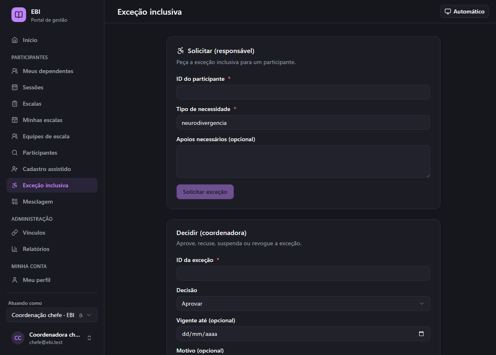

# Exceção inclusiva

O EBI atende uma **faixa etária**. Uma criança que não se encaixa na faixa pode ser aceita por
**exceção inclusiva** — mas a exceção não é informal: ela é pedida, decidida, registrada e tem
prazo.

## Por que existe

Sem exceção, o sistema recusaria a presença da criança e ela ficaria de fora do EBI. Com exceção,
a inclusão é uma **decisão registrada** da coordenação, com o responsável, e não uma brecha no
cadastro.

## Pedir a exceção

Menu **Participantes → Exceção inclusiva**, cartão **Solicitar (responsável)**.

1. Informe o **ID do participante** (a criança).
2. Escolha o **tipo de necessidade** (ex.: `neurodivergencia`).
3. Descreva os **apoios necessários** (opcional) — o que a equipe precisa saber para acolher bem.
4. Toque em **Solicitar exceção**.

A coordenação também pode pedir a exceção no lugar do responsável.

> **Cuidado com o texto.** Os **apoios necessários** descrevem *o que ajuda a criança a
> participar*, não um diagnóstico. "Precisa de um adulto por perto na hora do lanche" é útil;
> prontuário não é assunto do sistema.

## Decidir a exceção

No mesmo menu, cartão **Decidir (coordenadora)**:

1. Informe o **ID da exceção**.
2. Escolha a **decisão**: **Aprovar**, **Recusar**, **Suspender** ou **Revogar**.
3. Defina **Vigente até** (opcional): a exceção com prazo pede revisão depois.
4. Registre o **motivo** (opcional, mas recomendado em recusa e revogação).

| Decisão | Quando usar |
|---|---|
| **Aprovar** | A criança pode participar da faixa, conforme a solicitação |
| **Recusar** | Não é o caso; explique o motivo |
| **Suspender** | Valeu, mas foi interrompida temporariamente |
| **Revogar** | Deixa de valer em definitivo |

A decisão é da **coordenação do EBI** — é ela quem conhece o dia a dia —, em conjunto com o
responsável. Não é uma fila de aprovação administrativa.

## O que a exceção não faz

- **Não** muda a data de nascimento nem a ficha da criança.
- **Não** estende automaticamente o EBI para outras crianças da mesma família.
- **Não** é permissão de presença: ela destrava o caso, mas a presença continua sendo registrada
  sessão a sessão.

## Auditoria

Pedido, decisão, prazo e motivo ficam na trilha de eventos. Em caso de questionamento, a resposta
está registrada.
