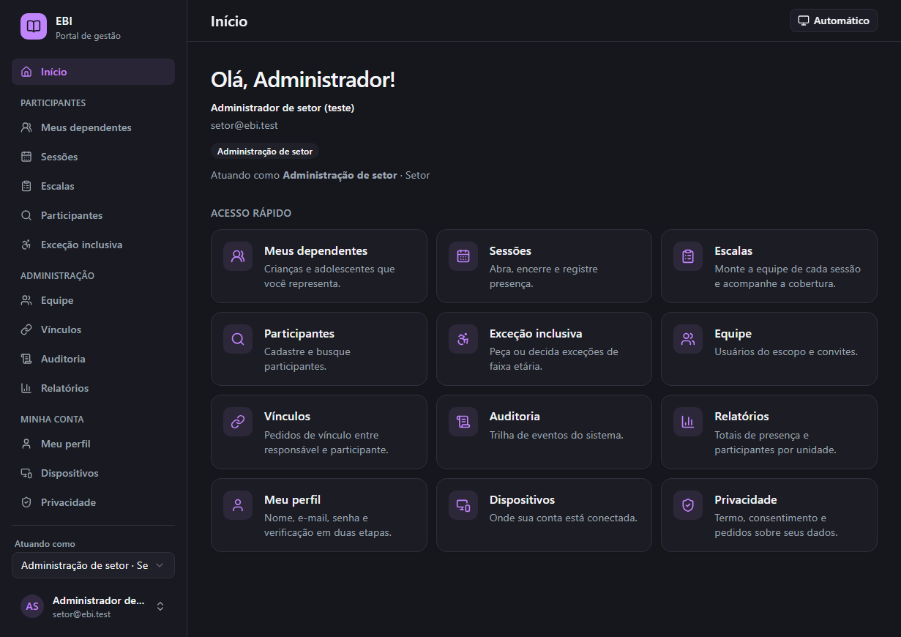
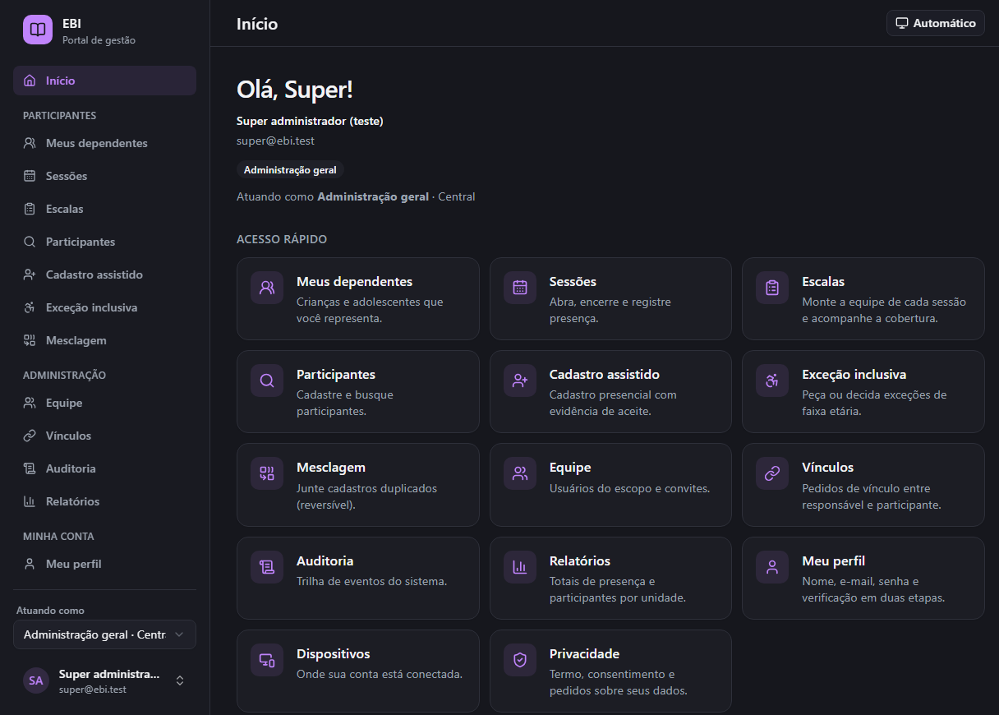
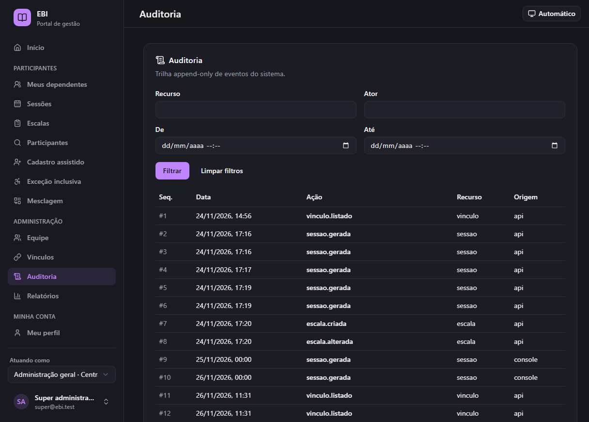

# Fluxo da administração superior

Cobre **Administrador de Setor**, **Administrador Regional** e **Super Admin**. A lógica é a mesma
— cada um opera a sua unidade e vê o que está abaixo dela —, mudando a abrangência e o acesso à
auditoria.






## A hierarquia

```
Central (Super Admin)
└── Regional
    └── Setor
        └── Igreja
            └── EBI  ── sessões, escalas, participantes
```

Cada nível administra o que está **abaixo** dele — nunca o que está ao lado nem acima.

| Perfil | Gerencia | Vê relatórios de | Auditoria |
|---|---|---|---|
| Super Admin | Toda a estrutura, usuários, parâmetros | Todo o país | Sim |
| Admin regional | Setores e igrejas da regional | A regional e abaixo | Sim |
| Admin de setor | Igrejas e EBIs do setor | O setor e abaixo | Sim |

## 1. Equipe e acessos

Menu **Administração → Equipe**. Convide administradores e coordenações com o papel certo, e
confira se ninguém acumula acesso que perdeu.

Veja [Fluxo do administrador da igreja](Fluxo-do-administrador-da-igreja); a tela é a mesma.

## 2. Estrutura

Criar e ajustar regionais, setores, igrejas e EBIs. Antes de mudar, confirme onde a unidade fica na
hierarquia: mover uma igreja de setor muda o que os administradores enxergam.

## 3. Auditoria

Menu **Administração → Auditoria**.



Cada linha é um evento com **sequência**, **data**, **ação**, **recurso** e **origem**. Filtre por
recurso, ator e período.

Use a auditoria para responder perguntas que vão aparecer:

- **Quem consultou a ficha desta criança, e com qual finalidade?**
- **Quem aprovou esta exceção e quando?**
- **Quando esta escala foi aprovada?**
- **Quem mexeu no papel desta pessoa?**

**O que cada nível vê dos participantes**

Desde a versão 2.22, os eventos de participante (cadastro, consulta, mesclagem, correção, vínculo e
exceção) ficam registrados no território **onde a ação foi feita**: o EBI ou a igreja de quem agiu.

Pedido de vínculo, pedido de exceção e cadastro com igreja de referência ficam no território **da
igreja da criança**.

O Admin de setor e o Admin regional veem os eventos do próprio território. **Não** aparecem para
eles: ações feitas pelo Super Admin; pedidos e cadastros de criança sem igreja de referência; e
eventos anteriores à 2.22. Esses só o Super Admin vê.

Se um evento não aparece para você, isso não quer dizer que ele não aconteceu. Peça ao Super Admin
para consultar.

## 4. Relatórios de território

Menu **Administração → Relatórios**. Escolha o período e navegue pela unidade. A supressão
(`< 5`, `Não divulgado`) vale igual para todos os níveis — inclusive para o Super Admin.

Veja [Relatórios](Relatorios).

## 5. Dados pessoais

O Super Admin tem acesso amplo, mas **não** é acesso livre a dados de crianças: toda leitura
exige **finalidade** registrada e fica na auditoria. Aplicar esse princípio é parte do papel.

## Dúvidas frequentes

**"Um administrador de igreja não vê a igreja vizinha."** Está correto — a hierarquia é fechada.

**"O relatório da regional soma menos que a soma dos setores."** Não: os totais suprimidos entram
como `Não divulgado`. O número real pode ser menor que a soma aparente.

**"Preciso do nome das crianças de um setor."** Relatórios não entregam nome. Peça à coordenação
do EBI, que tem a finalidade e a autorização para isso.
