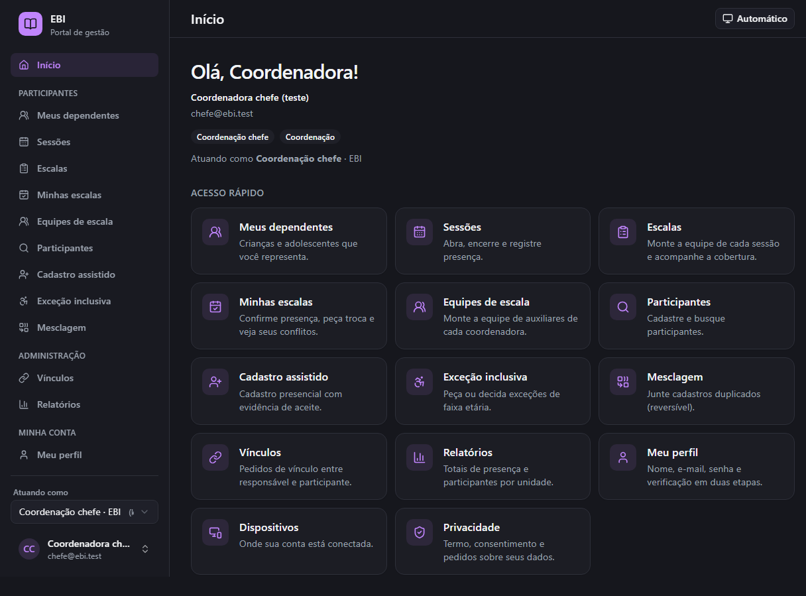
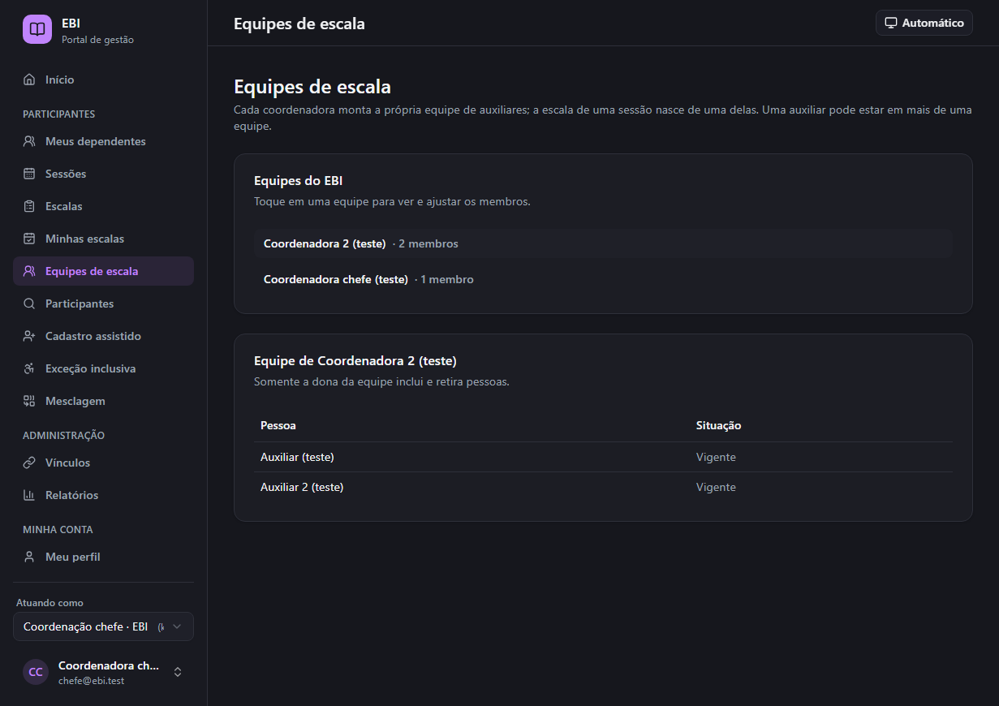
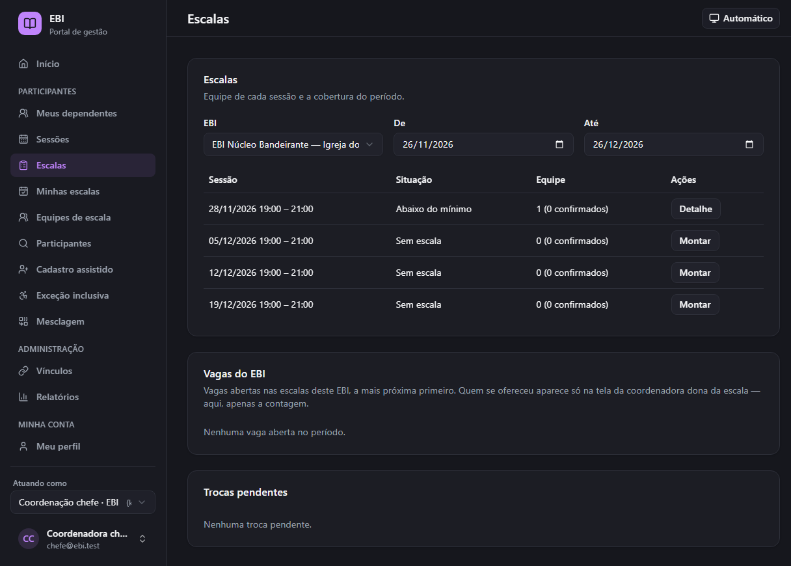
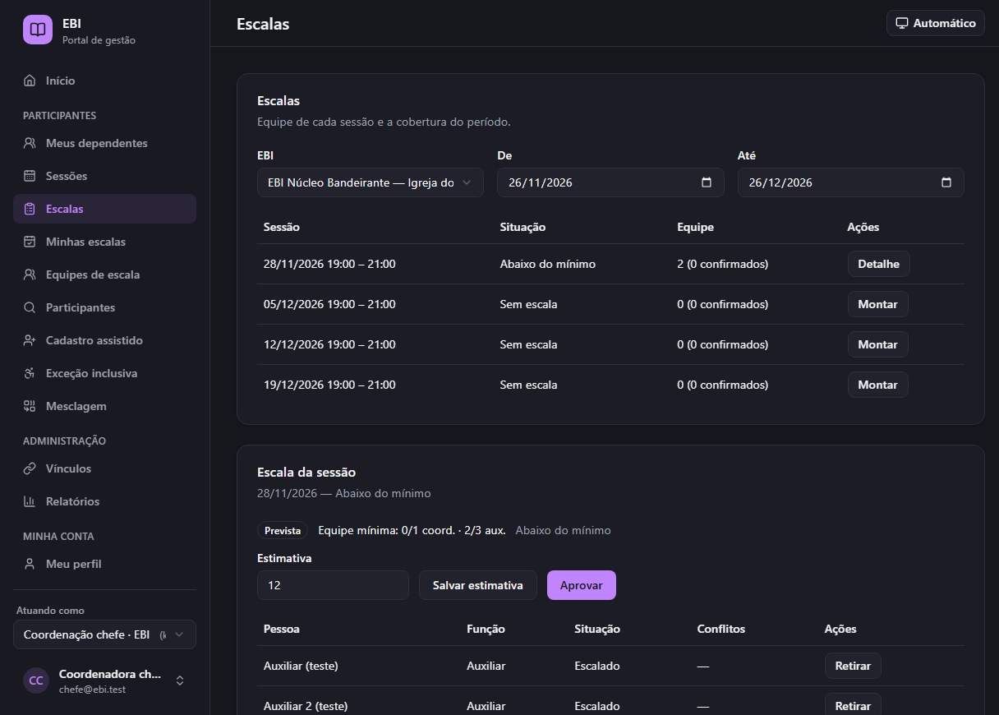
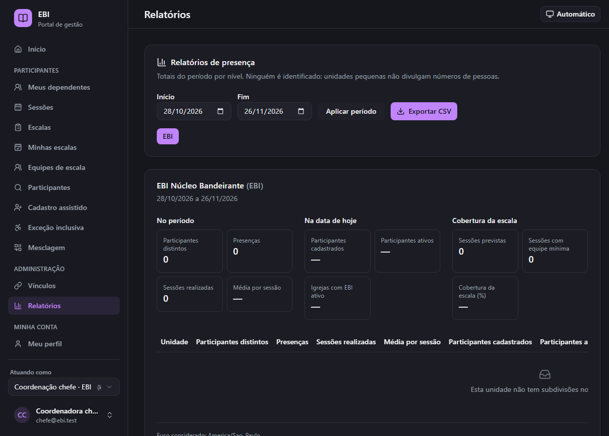
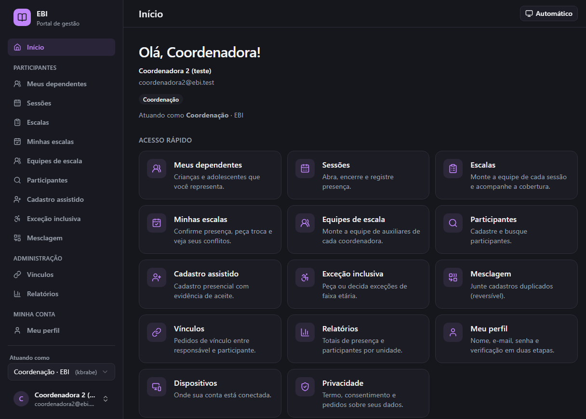

# Fluxo da coordenação

Este é o caminho completo de quem toca o EBI no dia a dia: **Coordenadora EBI** e **Coordenadora
chefe**. As duas fazem quase tudo igual; a chefe tem mais duas chaves — **aprovar a escala** e
**decidir as trocas**.



## O ciclo em uma página

```
Faixas de horário  →  Sessões geradas  →  Equipe de escala  →  Escala montada
      →  Aprovação (chefe)  →  Sessão aberta  →  Presença registrada  →  Relatórios
```

## 1. Conferir a agenda do EBI

**Participantes → Sessões** → aba **Agenda**.

Ajuste as faixas quando o horário do EBI mudar: encerre a faixa antiga e crie a nova, com a
vigência correta. Depois, gere as sessões do período — o que já existe é ignorado.

Passo a passo em [Sessões e agenda](Sessoes-e-agenda).

## 2. Manter a equipe de escala

**Participantes → Equipes de escala**.

Cada coordenação tem a sua equipe de auxiliares. Você — e só você, como dona da equipe — inclui e
retira membros. Uma auxiliar pode estar em mais de uma equipe.



## 3. Montar a escala de cada sessão

**Participantes → Escalas**.



1. Veja quais sessões estão **Sem escala** e toque em **Montar**.
2. Informe a **estimativa de participantes**.
3. Escolha a **equipe** de onde vêm as pessoas.
4. Confirme as pessoas e funções.

O sistema calcula a equipe mínima e marca **Abaixo do mínimo** enquanto faltar alguém.

## 4. Ajustar e aprovar

Abra **Detalhe** na sessão.



- Ajuste a **estimativa**, inclua ou retire pessoas.
- Confira os **conflitos** marcados na lista.
- A chefe toca em **Aprovar**.

Passo a passo completo em [Escalas](Escalas).

## 5. Acompanhar a sessão

**Participantes → Sessões** → **Abrir** na sessão do dia. Registre a presença e **encerre** ao
final. Se aconteceu sem registro, use o lançamento em contingência com o motivo.

## 6. Tratar faltas e trocas

- Se faltar gente, **Abra vaga** na escala e avise as auxiliares.
- Trocas pedidas aparecem em **Trocas pendentes**; a chefe decide.

Veja [Fluxo do auxiliar](Fluxo-do-auxiliar) para entender o lado de quem pede.

## 7. Cadastros e inclusão

- **Busque antes de cadastrar** — sempre.
- Responsável sem conta no portal: use **Cadastro assistido**, com a evidência do termo.
- Fichas duplicadas: **Mesclagem**.
- Criança fora da faixa etária: **Exceção inclusiva**, pedido e decisão.
- Pedido de vínculo de responsável: **Vínculos**.

Detalhes em [Participantes](Participantes), [Exceção inclusiva](Excecao-inclusiva) e
[Fluxo do responsável](Fluxo-do-responsavel).

## 8. Fechar o mês

**Administração → Relatórios**: compare presenças com sessões realizadas, olhe a **cobrança da
escala** e exporte o CSV para a reunião da liderança.



Veja [Relatórios](Relatorios).

## O que a coordenação vê no menu



Início · Meus dependentes · Sessões · Escalas · Minhas escalas · Equipes de escala ·
Participantes · Cadastro assistido · Exceção inclusiva · Mesclagem · Vínculos · Relatórios ·
Meu perfil · Dispositivos · Privacidade.

## Dúvidas frequentes

**"Montei a escala e continua abaixo do mínimo."** Falta coordenação ou auxiliar para a estimativa
informada. Veja a linha *Equipe mínima* no detalhe (`0/1 coord. · 2/3 aux.`).

**"Não consigo incluir alguém na minha equipe."** Só a dona da equipe inclui membros. Se a pessoa
for de outra coordenação, ela pede à coordenação dela.

**"A auxiliar aparece com conflito."** Ela está em duas sessões que se sobrepõem. Retire de uma das
escalas ou peça troca.

**"A escala está certa mas a presença não fecha."** Confira se a sessão foi **encerrada** e se
alguém foi registrado em contingência.
