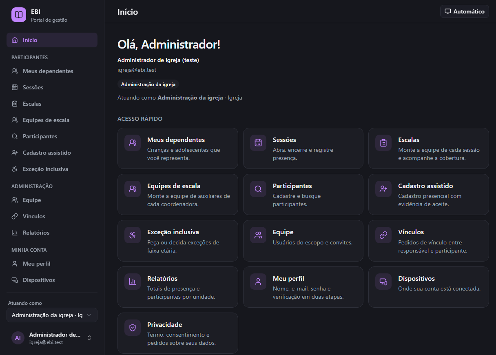
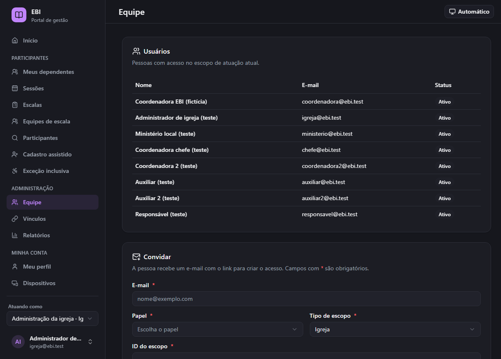
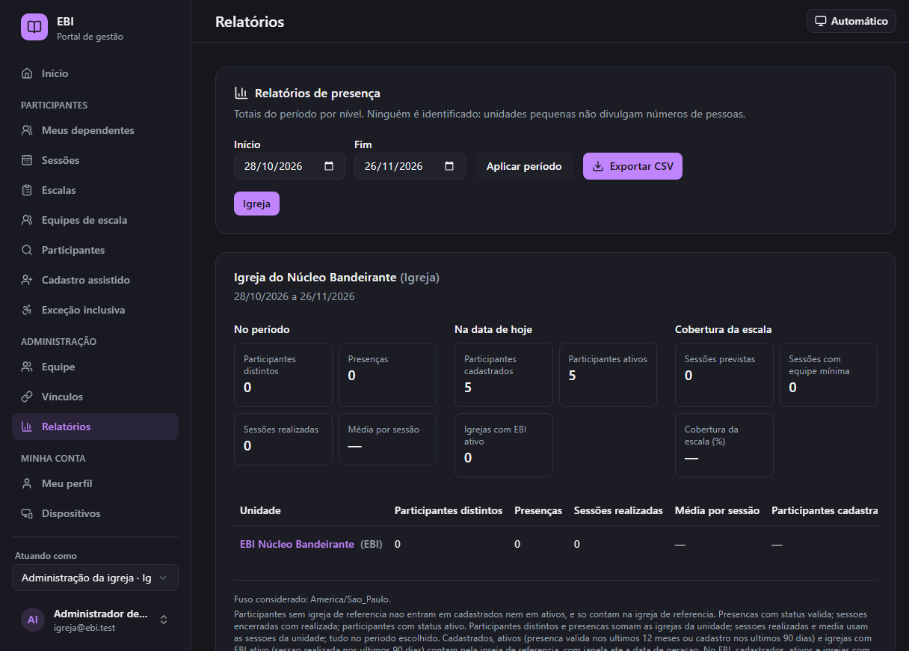

# Fluxo do administrador da igreja

O **Administrador de Igreja** responde por todos os EBIs da sua igreja: quem tem acesso, com que
função, e se o trabalho acontece como previsto.

## 1. Conhecer a equipe

Menu **Administração → Equipe**.

A tela lista os usuários com acesso no seu escopo, com o **papel** de cada um. É aqui que você:

- **Convida** uma pessoa por e-mail — o convite cria o acesso com o papel escolhido.
- Confere quem está ativo.
- Troca o papel de alguém que mudou de função.

O sistema **não deixa** você conceder papel acima do seu: um Admin de igreja não cria Super Admin.

## 2. Estrutura do EBI

As **igrejas e EBIs** do seu território são a base de tudo que vem depois. Confira se cada EBI
existe, se está ativo e se as **faixas de horário** da agenda estão certas.

O ajuste fino da agenda e das escalas é da coordenação; você acompanha para garantir que foi feito.
Veja [Sessões e agenda](Sessoes-e-agenda) e [Escalas](Escalas).

## 3. Substituir a coordenação chefe

Quando **não há coordenação chefe vigente**, o Admin da igreja **aprova a escala** e **decide as
trocas** no lugar dela. Se o EBI anda seguindo sem aprovação, o problema pode ser a falta da
coordenação chefe — não a tela.

## 4. Cadastros e inclusão

- **Participantes** — busca, cadastro e cadastro assistido.
- **Mesclagem** — duplicados que quebram a frequência.
- **Exceção inclusiva** — quando o caso sai da faixa etária.
- **Vínculos** — pedidos de responsável esperando decisão.

Veja [Participantes](Participantes) e [Exceção inclusiva](Excecao-inclusiva).

## 5. Acompanhar números

Menu **Administração → Relatórios**.

Você vê a igreja e os EBIs abaixo dela. O que exigir atenção:

- **Cobertura da escala (%)** baixa — converse com a coordenação.
- **Média por sessão** caindo — vale investigar se é presença ou cadastro desatualizado.
- Números `< 5` e **Não divulgado** são supressão de privacidade, não erro.

Veja [Relatórios](Relatorios).

## 6. O que o Admin da igreja não faz

- Não altera dados de unidades fora da sua igreja.
- Não vê auditoria de outros escopos (auditoria é de setor para cima).
- Não cadastra um papel superior ao seu.

## O que aparece no menu

Início · Meus dependentes · Sessões · Escalas · Equipes de escala · Participantes · Cadastro
assistido · Exceção inclusiva · Equipe · Vínculos · Relatórios · Meu perfil · Dispositivos ·
Privacidade.

## Dúvidas frequentes

**"A escala da sessão de sábado está parada."** Veja se há coordenação chefe; sem ela, a aprovação
é sua.

**"Convidei alguém e a pessoa não entrou."** O convite chega por e-mail e expira. Reenvie.

**"O relatório mostra `Não divulgado`."** Uma unidade abaixo tem menos de 5 pessoas. É proteção de
dados, não falta de dados.
