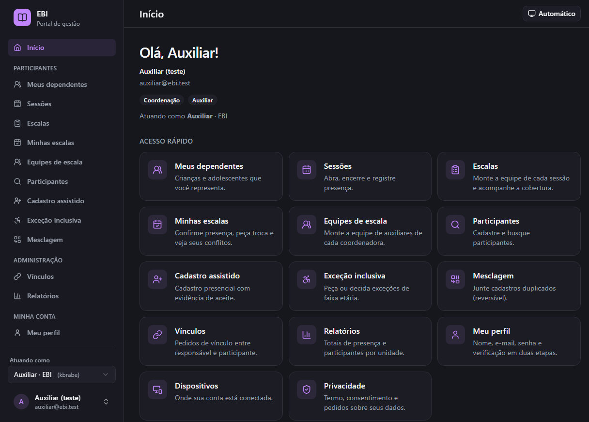
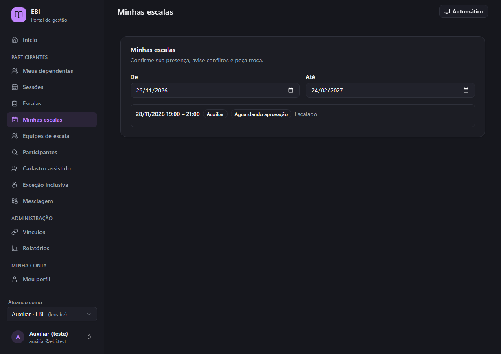

# Fluxo do auxiliar

O auxiliar apoia a coordenação no EBI: sabe quando vai trabalhar, confirma presença, avisa
conflito e registra presença das crianças quando autorizado.

## 1. Ver a própria agenda

Menu **Minhas escalas**. O período padrão já vem preenchido.

Cada linha mostra **data e horário**, a **função** e a **situação**:

| Situação | Significa | O que fazer |
|---|---|---|
| **Aguardando aprovação** | A escala ainda não foi aprovada pela chefe | Só aguardar |
| **Escalado** | Você está na escala | **Confirmar presença** |
| **Confirmado** | Sua presença está registrada | Comparecer |
| **Substituído** | Outra pessoa assumiu seu lugar | Nada |

Se você está em mais de uma equipe, aparecem todas as suas escalas.

## 2. Confirmar presença

Na linha da escala, confirme a presença. Confirmar cedo é o que permite à coordenação perceber a
falta a tempo de abrir vaga.

Se **não** puder ir, use o aviso de conflito logo em vez de simplesmente faltar.

## 3. Avisar conflito

Se o horário bate com outro compromisso, registre o conflito. A coordenação vê o conflito na escala
e pode retirar você ou pedir troca. Isso protege você: a falta fica registrada como **avisada**.

## 4. Pedir troca

Se precisar sair de uma escala já aprovada:

1. Na linha da escala, **pedir troca**.
2. Informe o **motivo**.
3. A pessoa substituta aceita.
4. A **coordenação chefe decide**.

A troca fica em **Trocas pendentes** até a decisão. Não deixe para a véspera: o EBI precisa de
gente confirmada na sessão.

## 5. Vagas abertas

Quando uma escala tem vaga aberta, ela aparece em **Minhas escalas**. Ofereça-se se puder cobrir.
Sua oferta é vista **só pela coordenação dona daquela escala** — a listagem geral do EBI mostra
apenas a contagem, não mostra quem se ofereceu.

## 6. Registrar presença

Em **Sessões**, a sessão aberta permite registrar a presença das crianças se você tiver a
autorização. Veja [Sessões e agenda](Sessoes-e-agenda).

## 7. Conhecer as crianças

Se a coordenação pedir, você pode:

- **Buscar participante** (informando a finalidade da leitura — ela fica registrada).
- **Cadastro assistido**, com a evidência do termo.
- **Pedir exceção inclusiva** para um caso que precisa de acolhimento.

Veja [Participantes](Participantes) e [Exceção inclusiva](Excecao-inclusiva).

## O que o auxiliar não faz

- Não monta escala nem inclui membros na equipe — isso é da coordenação.
- Não aprova escala nem decide trocas — isso é da coordenação chefe.
- Não mescla cadastros — isso é da coordenação e do Super Admin.
- Não vê relatórios por unidade.

## Dúvidas frequentes

**"Minha escala sumiu."** Confira o período (De/Até). Escalas fora da janela não aparecem.

**"Aparece 'Aguardando aprovação' e não consigo confirmar."** A escala só é confirmada depois da
aprovação da coordenação chefe.

**"Por que a coordenação ainda me escalou se eu avisei o conflito?"** O aviso não retira você
automaticamente: a coordenação precisa retirar ou abrir vaga. Fale com ela.
