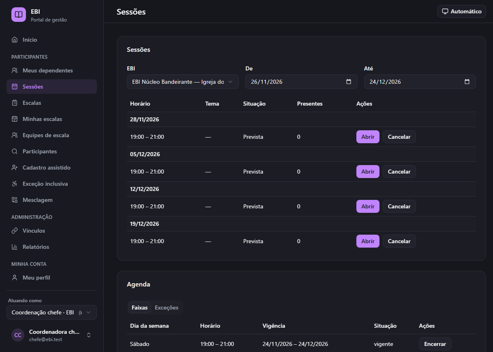
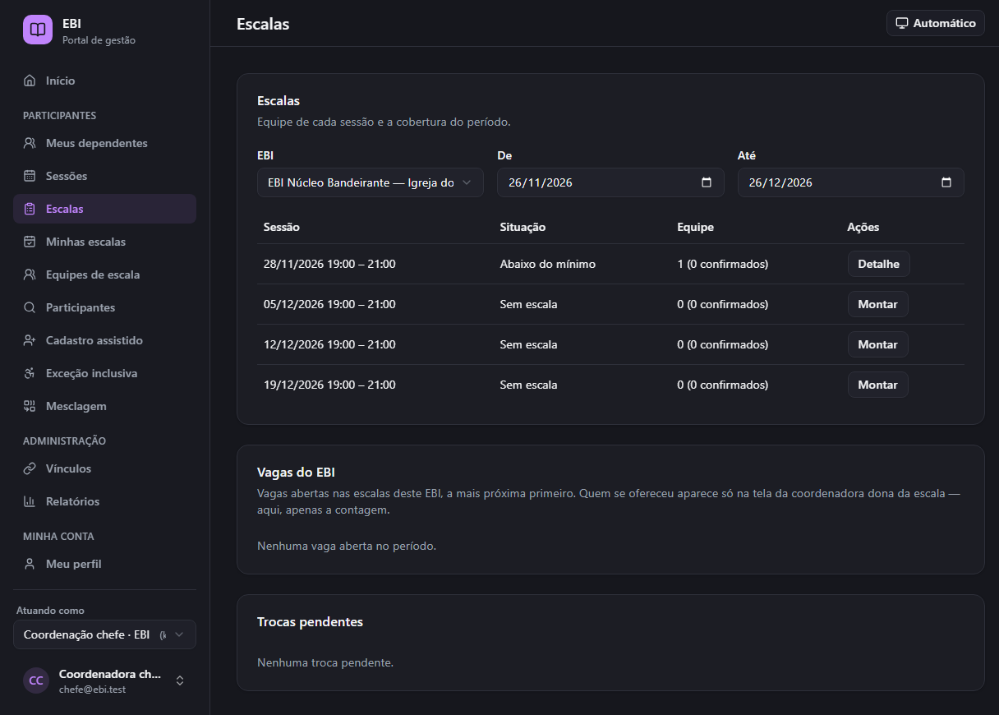
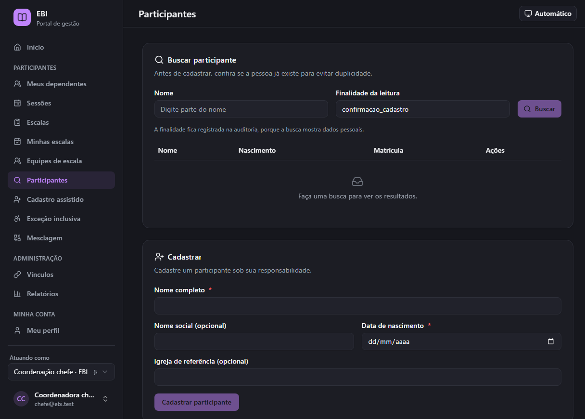
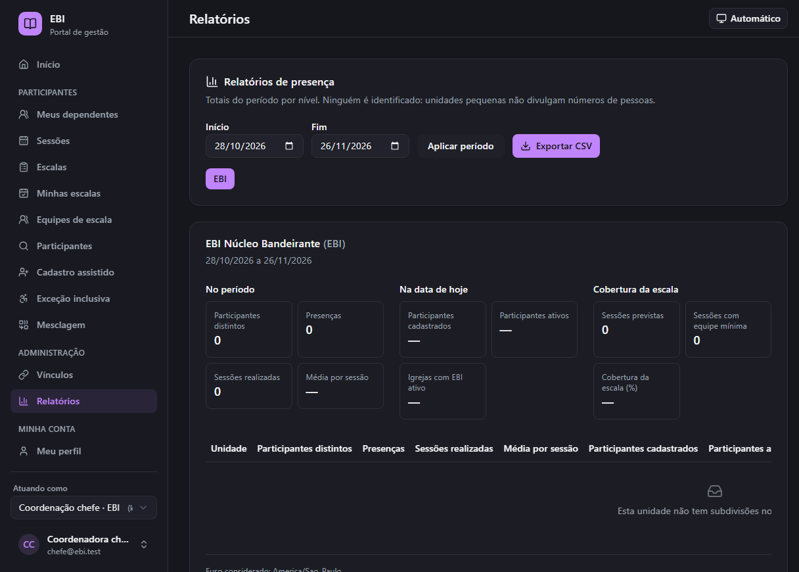

# Fluxo do ministério local

O **Ministério local** acompanha o trabalho do EBI na igreja: quantas crianças, quantas presenças,
se a escala está coberta. Ele **acompanha** — não monta escala, não cadastra participante como
dono do fluxo e não decide exceção.

## 1. Visão da igreja

Início mostra os atalhos do perfil: sessões, escalas, participantes, relatórios.

## 2. Sessões

Menu **Participantes → Sessões**. Escolha o EBI e o período. Você vê **situação** e **presença** de
cada encontro.

Veja [Sessões e agenda](Sessoes-e-agenda).

## 3. Escalas

Menu **Participantes → Escalas**. Acompanhe a **cobertura**: quais sessões estão **Sem escala**,
**Abaixo do mínimo**, **Completas** ou **Aprovadas**.

O painel **Vagas do EBI** mostra as vagas abertas — **sem** mostrar quem se ofereceu. Quem se
ofereceu é visto apenas pela coordenação dona da escala.

Se a cobertura estiver baixa, o caminho é conversar com a coordenação — não montar a escala.

## 4. Participantes

Menu **Participantes → Participantes**. Busca com **finalidade da leitura** registrada.

Veja [Participantes](Participantes).

## 5. Relatórios

Menu **Administração → Relatórios**: números agregados por unidade, com supressão de valores
pequenos (`< 5`, `Não divulgado`).

Veja [Relatórios](Relatorios).

## 6. O que o ministério local não faz

- Não monta, altera nem aprova escalas.
- Não inclui ou retira membros de equipe.
- Não decide exceção inclusiva nem troca.
- Não mescla cadastros.

## Dúvidas frequentes

**"A tela de escalas não deixa eu montar."** Correto: montar é da coordenação dona da escala.

**"Vejo 'Nenhuma vaga aberta' e a coordenação fala que tem."** O painel mostra vagas do período
escolhido em **De/Até**. Confira o período.
