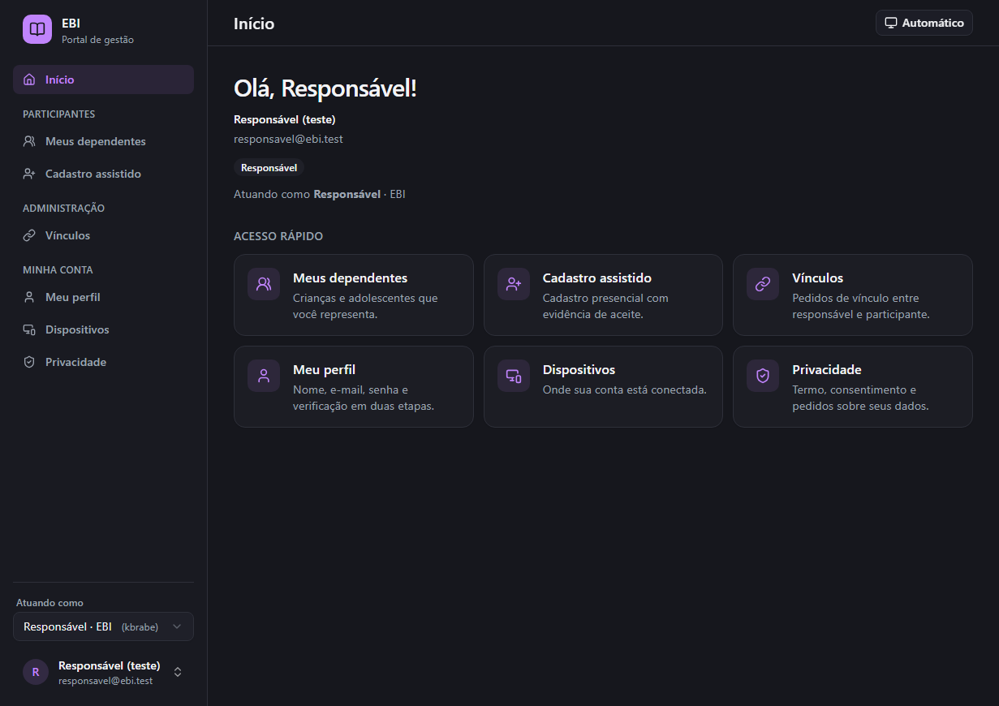
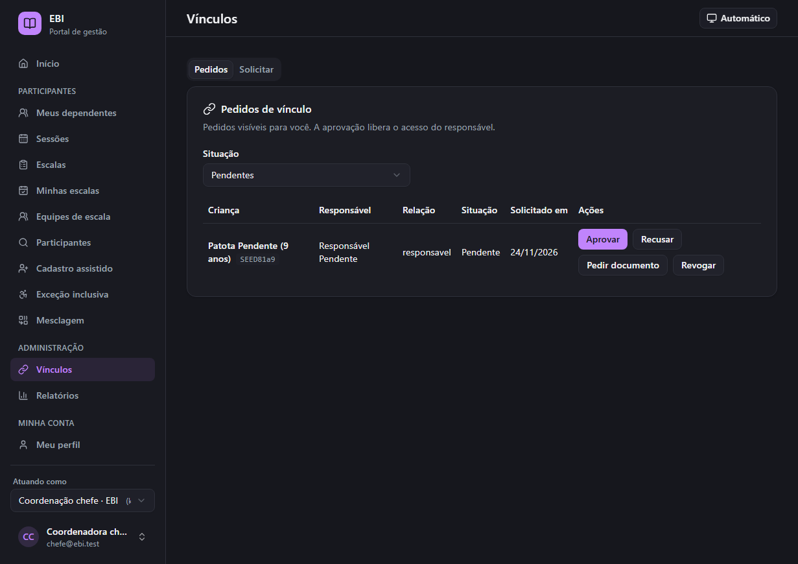
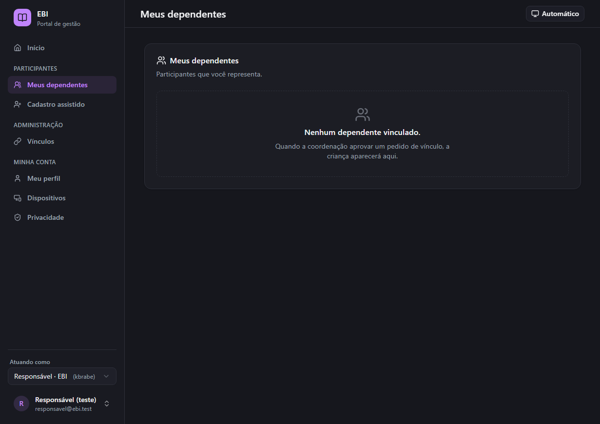

# Fluxo do responsável

O responsável representa uma criança perante o EBI: mantém o cadastro correto, autoriza o
tratamento dos dados, acompanha a frequência e pede inclusão quando precisa.

## 1. Pedir vínculo com a criança

Ninguém vê uma criança só por saber o nome dela. O primeiro passo é o **vínculo**.

1. Entre em **Administração → Vínculos** e abra **Solicitar**.
2. Informe o participante e a sua relação com ele.
3. Envie o pedido.

O pedido vai para a coordenação do EBI, que pode **Aprovar**, **Recusar** ou **Pedir documento**.

Se pedirem documento, anexe a comprovação no próprio pedido. Sem vínculo aprovado, a criança **não
aparece** em Meus dependentes.

## 2. Meus dependentes

Menu **Participantes → Meus dependentes**.

Aqui ficam as crianças vinculadas. Para cada uma você acompanha a **frequência** (presenças
registradas nas sessões) e os dados do cadastro.

Quando uma criança está para fazer 12 anos, aparece o aviso:

> ‹nome› faz 12 anos em ‹data›. Sem exceção inclusiva aprovada, a presença fica bloqueada a partir dessa data. Se for o caso, peça a exceção à coordenação do EBI.

Se a criança precisa continuar, procure a coordenação do EBI antes dessa data.

## 3. Consentimento e privacidade

Menu **Minha conta → Privacidade**.

- Leia o **Termo de cadastro** vigente e aceite ou recuse.
- Use **Solicitação** para pedir acesso, correção, portabilidade ou exclusão dos dados.

Veja [Minha conta](Minha-conta).

## 4. Quando a criança precisa de acolhimento especial

Se a criança está fora da faixa etária ou precisa de apoio para participar, procure a coordenação
do EBI. Ela registra o pedido de **exceção inclusiva** e decide.

Leve a descrição dos apoios de que a criança precisa para participar, não um diagnóstico.

Veja [Exceção inclusiva](Excecao-inclusiva).

## 5. Se você não tem conta no portal

A coordenação usa o **Cadastro assistido**, com a sua presença e o termo assinado. O que você
precisa fazer é assinar o termo em papel na hora — a coordenação fotografa e anexa o arquivo, que
fica guardado cifrado no sistema.

## Dúvidas frequentes

**"Meu filho não aparece em Meus dependentes."** O vínculo ainda não foi aprovado. Veja o estado do
pedido em **Vínculos**.

**"Quero apagar os dados do meu filho."** Use **Privacidade → Solicitação**. A exclusão é tratada
pelo encarregado de dados, com o histórico que a lei exige manter.

**"Apareceu que meu filho faz 12 anos."** Sem exceção inclusiva aprovada, a presença fica
bloqueada a partir dessa data. Fale com a coordenação do EBI.

**"Posso cadastrar meu filho sozinho?"** Não pelo portal. Peça à coordenação do EBI, que faz o cadastro com você; veja [Se você não tem conta no portal](#5-se-você-não-tem-conta-no-portal).
