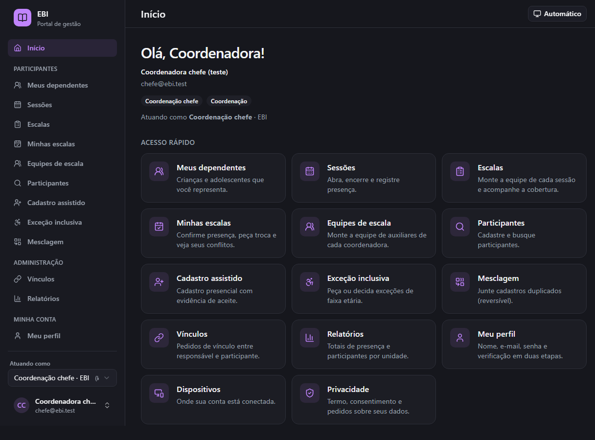

# Manual do EBI — Plataforma de gestão

Este wiki é o **manual de uso** da Plataforma EBI da CCB. Ele mostra, tela a tela, **como cada
tipo de usuário trabalha no dia a dia**: o que cada perfil enxerga, em que ordem fazer as
tarefas e o que o sistema faz por trás de cada decisão.

O público é quem usa o portal — coordenação, auxiliares, responsáveis, administradores de
igreja/setor/regional/central. Não é documentação técnica: para arquitetura, API e decisões de
projeto, veja os documentos em `docs/` no repositório.

## Por onde começar

| Se você é... | Comece em |
|---|---|
| Vai usar pela primeira vez | [Primeiros passos](Primeiros-passos) |
| Coordenação de EBI | [Fluxo da coordenação](Fluxo-da-coordenacao) |
| Auxiliar de EBI | [Fluxo do auxiliar](Fluxo-do-auxiliar) |
| Responsável por uma criança | [Fluxo do responsável](Fluxo-do-responsavel) |
| Admin de igreja | [Fluxo do administrador da igreja](Fluxo-do-administrador-da-igreja) |
| Admin de setor, regional ou central | [Fluxo da administração superior](Fluxo-da-administracao-superior) |
| Ministério local | [Fluxo do ministério local](Fluxo-do-ministerio-local) |
| Quer entender uma tela específica | [Mapa das telas](Mapa-das-telas) |

## Sumário completo

**Uso**
- [Primeiros passos](Primeiros-passos) — acesso, verificação em duas etapas e escolha do contexto.
- [Mapa das telas](Mapa-das-telas) — o que existe no menu e quem enxerga o quê.
- [Fluxo da coordenação](Fluxo-da-coordenacao) — o caminho completo, da sessão à escala aprovada.
- [Fluxo do auxiliar](Fluxo-do-auxiliar) — minhas escalas, presença e trocas.
- [Fluxo do responsável](Fluxo-do-responsavel) — dependentes, consentimento e frequência.
- [Fluxo do administrador da igreja](Fluxo-do-administrador-da-igreja) — equipe, convites, EBIs e relatórios.
- [Fluxo da administração superior](Fluxo-da-administracao-superior) — setor, regional e central; auditoria.
- [Fluxo do ministério local](Fluxo-do-ministerio-local) — acompanhamento da igreja.

**Referência por recurso**
- [Sessões e agenda](Sessoes-e-agenda) — faixas de horário, geração de sessões, presença.
- [Escalas](Escalas) — equipes de escala, montagem, aprovação, vagas e trocas.
- [Participantes](Participantes) — busca, cadastro, cadastro assistido, mesclagem.
- [Exceção inclusiva](Excecao-inclusiva) — pedido e decisão de exceção de faixa etária.
- [Relatórios](Relatorios) — totais por unidade e exportação.
- [Minha conta](Minha-conta) — perfil, verificação em duas etapas, dispositivos, privacidade.

## Regra de manutenção

Toda funcionalidade nova chega **com a sua página neste wiki**, e toda mudança de fluxo atualiza
a página correspondente. O passo a passo de publicação está em
[Manutenção do wiki](Manutencao-do-wiki).
