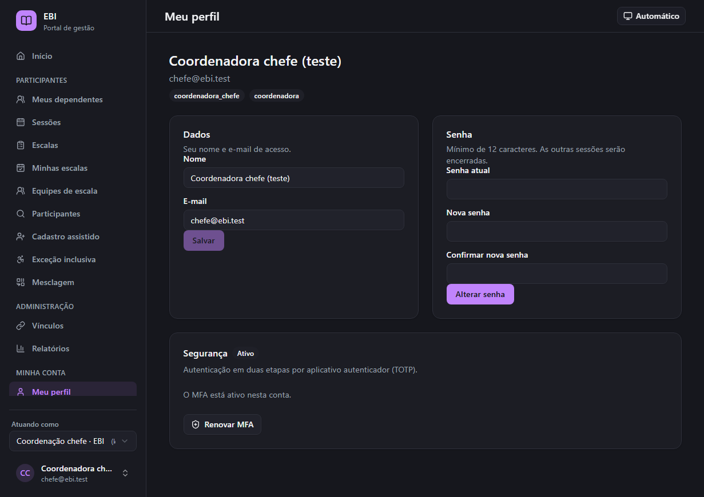
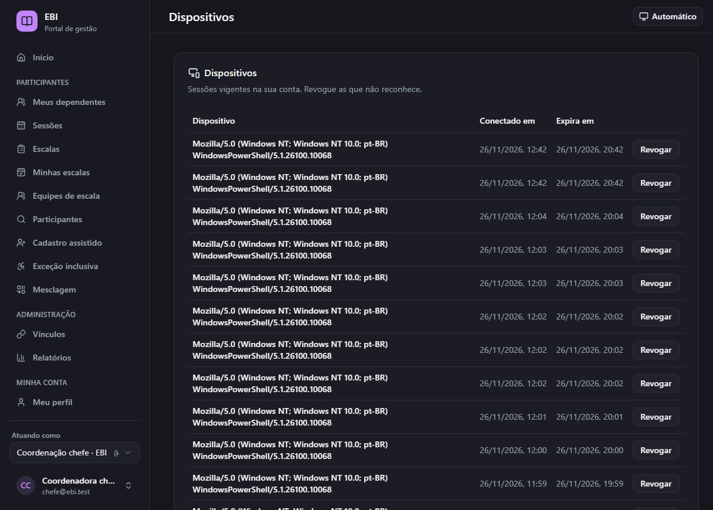
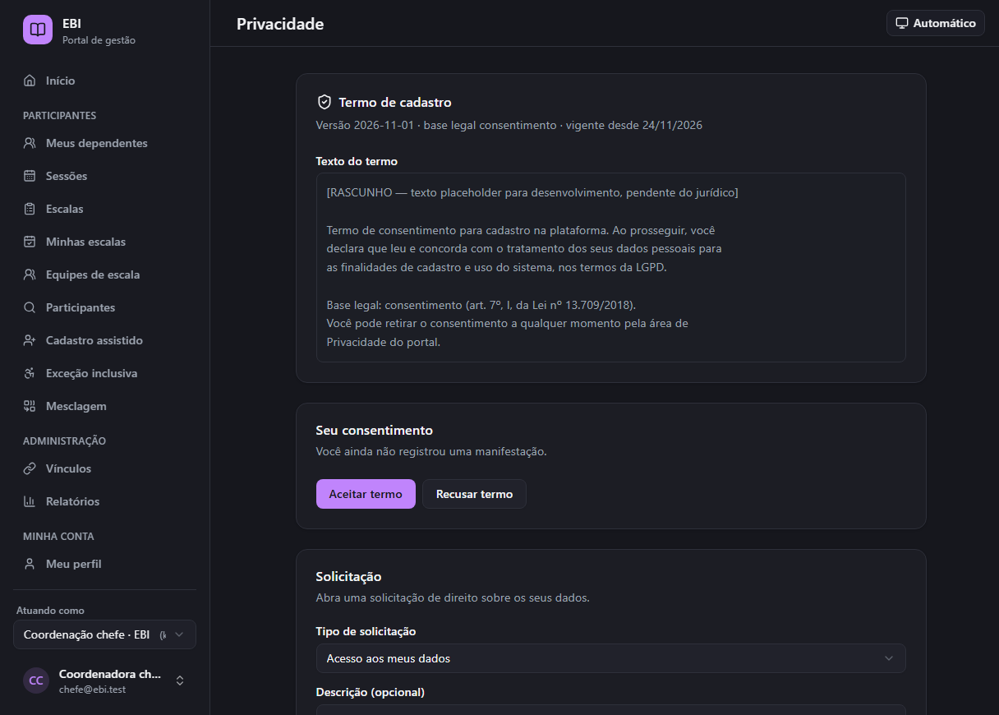

# Minha conta

Três telas, no grupo **Minha conta**: **Meu perfil**, **Dispositivos** e **Privacidade**. Todo
mundo tem acesso.

## Meu perfil

Menu **Minha conta → Meu perfil**.

Aqui você vê e atualiza:

- **Nome** e **e-mail** da conta
- **Senha** — troca pede a senha atual
- **Verificação em duas etapas** — o aplicativo autenticador ligado à conta

### Trocar a senha

1. Informe a senha atual e a nova senha (duas vezes).
2. Salve.

Depois da troca, as sessões abertas em outros aparelhos continuam valendo até expirarem — se a
troca foi por suspeita de vazamento, **revogue os dispositivos** também.

### Verificação em duas etapas

Nunca desligue a verificação em duas etapas. Se você trocou de celular, configure o novo
autenticador **antes** de apagar o antigo, ou use um código de recuperação.

## Dispositivos

Menu **Minha conta → Dispositivos**.

A lista mostra cada sessão aberta com **dispositivo**, **conectado em** e **expira em**. Use
**Revogar** em qualquer sessão que você não reconheça.

> **Sessão expira sozinha:** o portal expira a sessão depois de um tempo de uso. Se você trabalha
> muito tempo no mesmo dia, pode ter que entrar de novo — é proposital.

## Privacidade

Menu **Minha conta → Privacidade**.

A tela tem três partes:

### Termo de cadastro

O texto do **termo de consentimento** vigente, com a **versão**, a **base legal** (consentimento,
art. 7º, I, da Lei nº 13.709/2018 — LGPD) e a data em que entrou em vigor.

### Seu consentimento

Sua manifestação sobre o termo: **Aceitar termo** ou **Recusar termo**. O consentimento é
**revogável a qualquer momento** e a recusa não apaga automaticamente a conta — ela é tratada como
uma solicitação.

### Solicitação

Para exercer um direito sobre seus dados (acesso, correção, portabilidade, exclusão — LGPD):

1. Escolha o **tipo de solicitação**.
2. Descreva livremente, se quiser.
3. Envie.

O pedido vai para o **encarregado (DPO)**, que responde no prazo legal. Todo acesso a dado pessoal
na plataforma fica registrado com a finalidade — inclusive o acesso feito para atender a sua
solicitação.

## Responsável: o que muda

Além deste grupo, o responsável tem as duas telas mais importantes para ele:

- [Meus dependentes e frequência](Fluxo-do-responsavel)
- [Pedidos de vínculo](Fluxo-do-responsavel)

A verificação em duas etapas do responsável é **opcional**, mas reforçada nas operações de risco
(por exemplo, pedir vínculo com uma criança).
