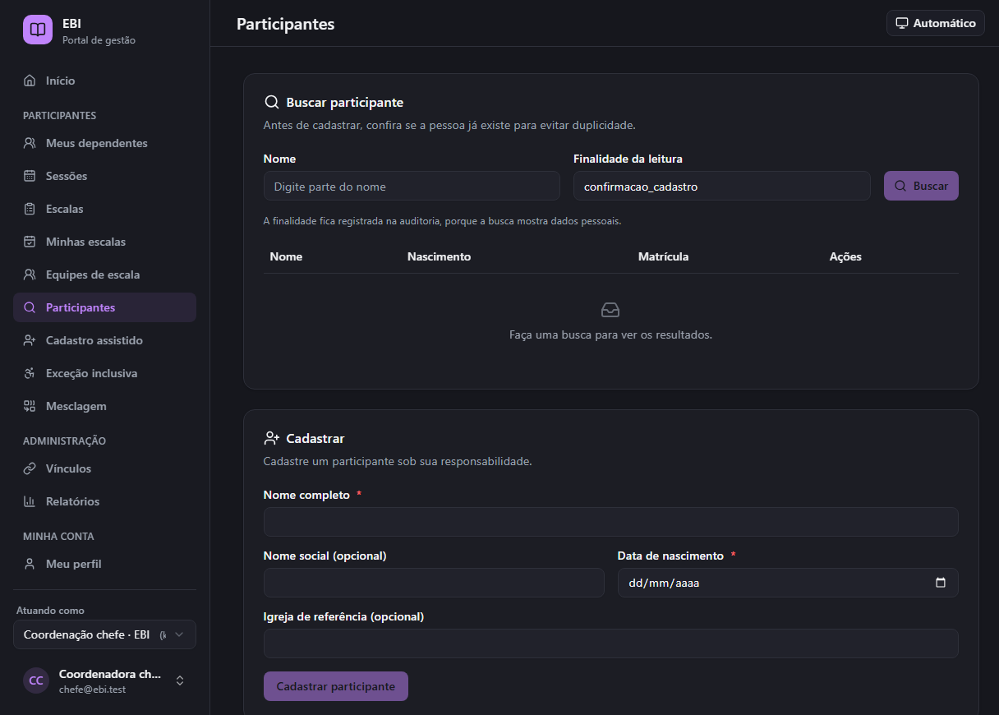
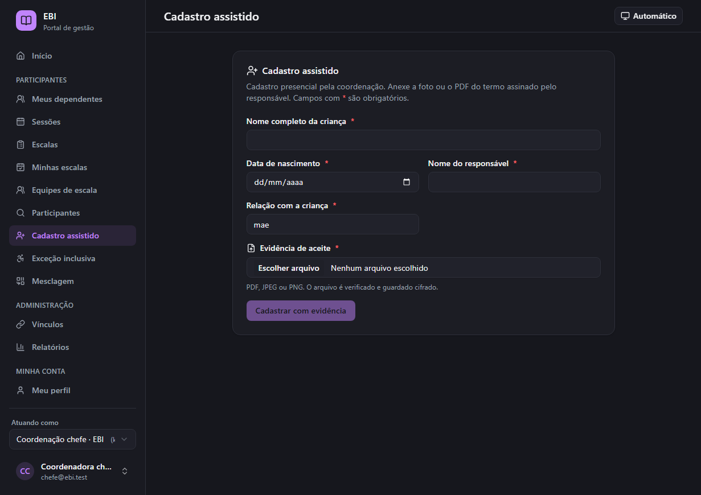
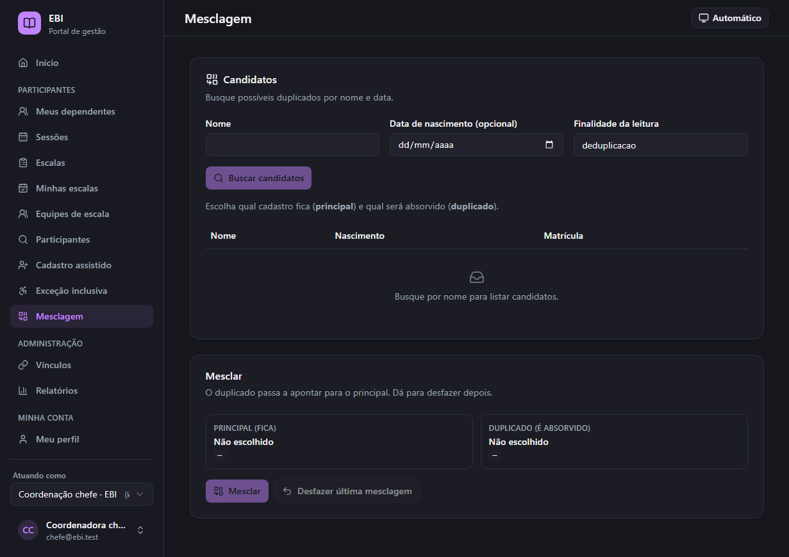
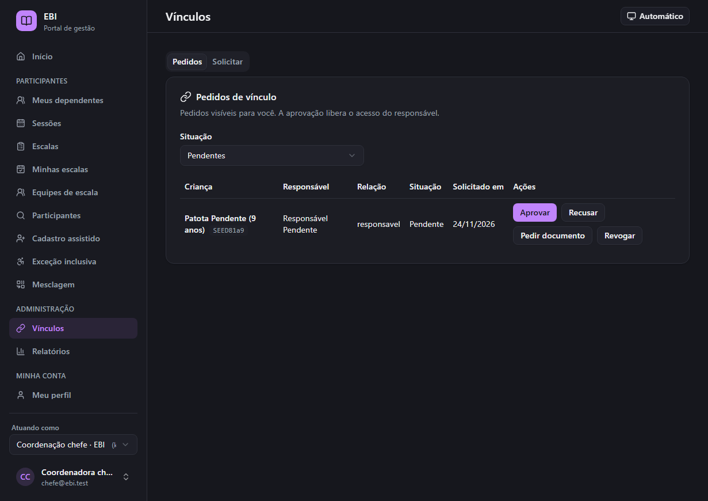

# Participantes

Participante é a criança ou adolescente atendido pelo EBI. Este é o dado mais sensível da
plataforma: por isso a busca registra a **finalidade da leitura**, o cadastro exige uma base de
consentimento e a coordenadora pode corrigir cadastros duplicados sem perder histórico.

## Buscar antes de cadastrar

Menu **Participantes → Participantes**.

1. Digite parte do **nome**.
2. Informe a **finalidade da leitura** — ex.: `confirmacao_cadastro`, `presenca`,
   `acompanhamento`. Esse campo não é burocracia: a finalidade **fica registrada na auditoria**
   junto com quem consultou.
3. Toque em **Buscar**.

A lista mostra **nome**, **data de nascimento** e **matrícula**.

> **Sempre busque antes de cadastrar.** Duas fichas da mesma criança quebram a frequência, os
> relatórios e o vínculo com o responsável. Se encontrar a criança, use-a em vez de criar outra.

## Cadastrar

No mesmo formulário:

- **Nome completo** (obrigatório)
- **Nome social** (opcional) — é o nome usado nas telas quando preenchido
- **Data de nascimento** (obrigatório) — define a faixa etária e a regra de EBI
- **Igreja de referência** (opcional)

Toque em **Cadastrar participante**. O cadastro nasce ligado a quem cadastrou.

A **igreja de referência** precisa existir no cadastro de igrejas e estar no seu escopo. Fora dele,
aparece "A igreja de referência não está no seu escopo." e nada é gravado.

O campo recebe o **identificador** da igreja, não o nome. Se não souber qual é, deixe em branco. Se
o identificador não existir, aparece um aviso de dado inválido, em inglês; confira o identificador.

## Cadastro assistido

Para cadastrar alguém **presencialmente**, quando o responsável está ali mas não tem conta no
portal: menu **Participantes → Cadastro assistido**.

1. **Nome completo da criança**
2. **Data de nascimento**
3. **Nome do responsável**
4. **Relação com a criança** (mãe, pai, avó, tutor…)
5. **Evidência de aceite** — a foto ou o PDF do termo assinado pelo responsável.

O arquivo é **verificado e guardado cifrado**. Ele é a prova de que o responsável autorizou o
cadastro — sem ele, o cadastro assistido não é aceito.

## Exceção inclusiva

Uma criança fora da faixa etária do EBI pode ser aceita por **exceção inclusiva**, com pedido e
decisão registrados. Veja [Exceção inclusiva](Excecao-inclusiva).

## Mesclagem de duplicados

Quando aparecem duas fichas da mesma criança, use **Participantes → Mesclagem**.

1. Busque os candidatos por **nome** e, se quiser refinar, **data de nascimento**.
2. Escolha qual cadastro **fica** (principal) e qual é **absorvido** (duplicado).
3. Toque em **Mesclar**.

O duplicado passa a apontar para o principal, e o histórico (presenças, vínculos, escalas) acompanha.
A fusão é **reversível**: **Desfazer última mesclagem** devolve os cadastros ao estado anterior,
enquanto a janela de desfazer estiver aberta.

Quem mescla: coordenação e Super Admin. A ação fica na auditoria com os dois cadastros.

## Corrigir um cadastro

Use para corrigir um dado errado (nome, nome social, data de nascimento ou igreja) sem criar outra
ficha.

1. Busque o participante.
2. Na linha dele, toque em **Corrigir**.
3. Altere só o que estiver errado nos campos **Nome completo**, **Nome social (opcional)**,
   **Data de nascimento** e **Igreja de referência (opcional)**. Este último recebe o
   identificador da igreja, como no cadastro.
4. Informe o **Motivo da correção**, de 3 a 255 caracteres.
5. Toque em **Salvar correção**.

Ao final, a linha mostra o dado novo e aparece "Cadastro corrigido.".

O botão **Salvar correção** fica desabilitado enquanto nada mudou ou o motivo está fora do limite.

### Se aparecer uma mensagem

A janela de correção continua aberta em todos os casos.

- "O participante não está ligado a um EBI onde você atua." — a criança é de outro EBI; peça à
  coordenação de lá.
- "Cadastro mesclado não pode ser corrigido; desfaça a mesclagem." — desfaça a mesclagem ou
  corrija o cadastro principal.
- "Nenhum campo difere do cadastro atual." — altere algum campo.
- "A nova igreja de referência não está no seu escopo." — use uma igreja do seu escopo.
- Um aviso de dado inválido, em inglês — o identificador da igreja não existe; confira.

Quem corrige: a coordenação, só no cadastro ligado ao seu EBI, e o Super Admin. Os outros perfis
não veem o botão. A correção fica na auditoria com o motivo e o estado anterior.

## Vínculo com o responsável

O responsável não vê uma criança só por saber o nome dela: precisa de **vínculo** aprovado. O
fluxo é: o responsável pede à coordenação do EBI → a coordenação registra e decide (aprova, pede
documento ou recusa, e depois pode revogar).

Veja também [Fluxo do responsável](Fluxo-do-responsavel).

## Quem faz o quê

| Ação | Quem |
|---|---|
| Buscar participante | Administradores, coordenação, auxiliar, ministério local |
| Cadastrar | Administradores, coordenação, auxiliar |
| Cadastro assistido | Coordenação, auxiliar, Admin da igreja, responsável |
| Corrigir cadastro | Coordenação, Super Admin |
| Mesclar / desfazer mesclagem | Coordenação, Super Admin |
| Pedir exceção inclusiva | Coordenação (o responsável pede à coordenação) |
| Decidir exceção inclusiva | Coordenação |

## O que nunca fazer

- Não anote dados de saúde ou diagnóstico em campo livre de observação.
- Não fotografe termo de um responsável e guarde fora do sistema: use o **Cadastro assistido**.
- Não repasse lista de participantes por fora. Use **Relatórios**, que mostram totais agregados.
