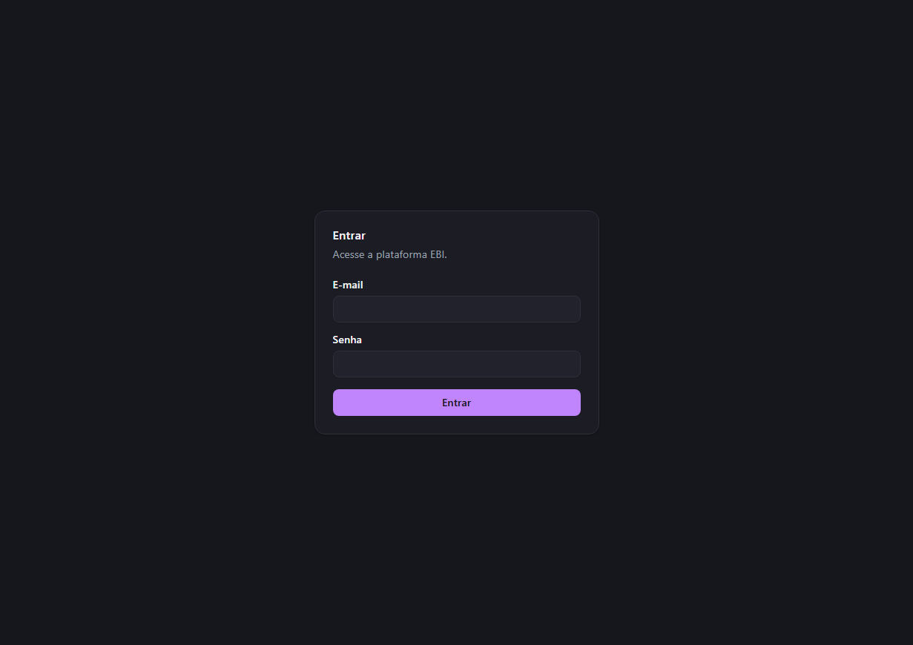
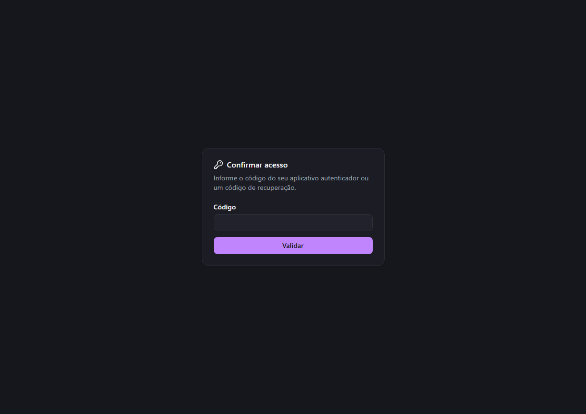
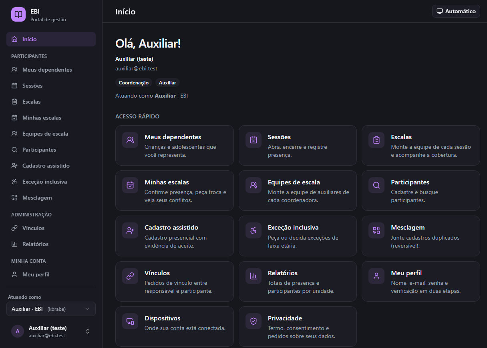

# Primeiros passos

## 1. Abrir o portal

Acesse o endereço do portal (no ambiente de desenvolvimento, `http://localhost:8000`).

Entre com o **e-mail** e a **senha** que a coordenação ou o administrador cadastrou para você.
Se esqueceu a senha, peça a redefinição ao administrador da sua unidade — não há tela pública de
recuperação.

## 2. Verificação em duas etapas

Depois da senha, o portal pede um código do aplicativo autenticador.

1. Abra o aplicativo autenticador no celular.
2. Digite o código de 6 dígitos que aparece para o EBI (o código muda a cada 30 segundos).
3. Toque em **Validar**.

O primeiro acesso gera o código de configuração do autenticador. Se você perdeu o aparelho, use
um **código de recuperação** ou peça ao administrador para redefinir a verificação em duas etapas.

> **Por que pede o código:** é a verificação em duas etapas da conta. Sem ela, uma senha vazada
> não abriria a área com dados de crianças e adolescentes. Todos os perfis operacionais têm a
> verificação **obrigatória**.

## 3. Conferir quem você é

Depois de entrar, a barra lateral mostra no rodapé o seu nome e o e-mail logado, e a unidade em
que você está atuando.

## 4. Escolher o contexto de atuação

Quem tem mais de uma função ou mais de uma unidade vê o seletor **Atuando como** no rodapé da
barra lateral. Exemplo: uma pessoa que coordena um EBI e também é auxiliar escolhe se está
trabalhando como coordenação ou como auxiliar — e o que ela pode fazer muda junto.

O sistema **não** confia na escolha só por ela: cada ação é conferida no servidor contra a sua
função e a sua unidade. Se você escolher um contexto em que não tem a permissão, o acesso é
recusado.

## 5. Conhecer a tela inicial

A **Início** reúne atalhos para tudo o que o seu perfil pode usar. Os cartões já são os títulos
das telas — clique em qualquer um para ir direto.

As telas que não fazem parte da sua função **não aparecem** no menu. Isso é só apresentação: a
autoridade real é do servidor.

## 6. Sair e trocar de aparelho

- Para **sair**, use o menu da sua conta no rodapé da barra lateral.
- Em **Dispositivos** você vê onde a conta está conectada e pode **revogar** qualquer sessão que
  não reconheça. Veja [Minha conta](Minha-conta).

## Próximo passo

Abra o [Mapa das telas](Mapa-das-telas) para ver tudo o que existe, ou vá direto para o fluxo da
sua função.
