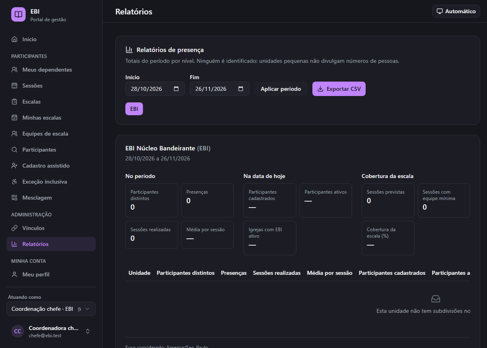

# Relatórios

Os relatórios respondem "quantas pessoas, quantas presenças, quanta cobertura de escala" — por
unidade e por período. Eles **não identificam ninguém**: a plataforma não entrega nome de criança
em relatório.

## Abrir

Menu **Administração → Relatórios**.

O período padrão é o **último mês**. Ajuste **Início** e **Fim** e toque em **Aplicar período**.

## Os indicadores

Cada bloco de números tem um significado diferente — e uma data de referência diferente:

| Grupo | Indicadores | Referência |
|---|---|---|
| **No período** | Participantes distintos, Presentes, Sessões realizadas, Média por sessão | Datas das sessões no período escolhido |
| **Na data de hoje** | Participantes cadastrados, Participantes ativos | Foto do cadastro **agora** |
| **Cobertura da escala** | Sessões previstas, Sessões com equipe mínima, Cobertura (%) | Sessões do período |

A separação importa: "cadastrados" não é "presentes no período". Um número que cai pode ser
fantasma de cadastro desatualizado, não de presença.

## Por unidade

Abaixo dos cartões, a tabela lista a unidade do seu contexto e as **subunidades** abaixo dela
(igrejas dentro do setor, EBIs dentro da igreja). Ao escolher um contexto de nó, a trilha navega
para dentro da unidade.

## Supressão de números pequenos

Unidades com **menos de 5 pessoas** aparecem como:

| O que aparece | Significa |
|---|---|
| `< 5` | O número existe, mas é pequeno demais para divulgar |
| `Não divulgado` | O total depende de uma unidade abaixo que está suprimida |
| `—` | O indicador não se aplica a essa unidade |

> **Por que:** em um EBI com 3 crianças, saber o total é saber quem faltou. A supressão protege a
> criança, não o relatório. O servidor decide a supressão — a tela só mostra o resultado.

## Exportar

**Exportar CSV** baixa a tabela do período exibido. Como os números suprimidos continuam suprimidos
na exportação, o arquivo serve para acompanhamento e reunião de liderança, **não** para listar
pessoas.

## Quem vê relatórios

Administradores (igreja, setor, regional, central), Ministérios (central, regional, setorial,
local), Coordenação (EBI e chefe). O recorte é sempre a unidade do contexto de atuação.

## Como usar na prática

- **Mensal:** compare **Presenças** com **Sessões realizadas** — a **Média por sessão** mostra a
  tendência sem precisar somar.
- **Antes da sessão:** olhe **Cobertura da escala (%)**. Abaixo do esperado, abra as escalas das
  próximas sessões (veja [Escalas](Escalas)).
- **Trimestral:** confira **Participantes ativos** contra **cadastrados**. Cadastro que nunca
  aparece pode precisar de mesclagem (veja [Participantes](Participantes)).
