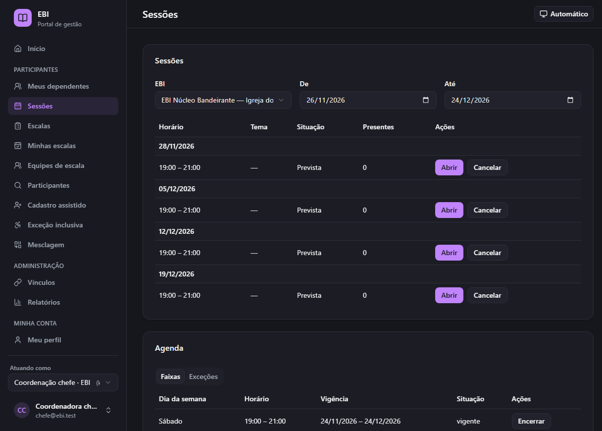

# Sessões e agenda

Uma **sessão** é um encontro do EBI (culto, reunião, aula). Ela nasce da **agenda** do EBI: as
faixas de horário dizem *quando* o EBI se reúne, e o sistema gera as sessões do período.

## Abrir a tela

Menu **Participantes → Sessões**. Escolha o EBI e o período (as datas vêm preenchidas: de hoje até
o fim do período padrão).

Cada linha mostra **horário**, **tema**, **situação** e **quantos estão presentes**, com as ações
**Abrir** e **Cancelar**.

## Situações de uma sessão

| Situação | Significa |
|---|---|
| **Prevista** | Gerada pela agenda e ainda não começou |
| **Aberta** | Acontecendo — presença pode ser registrada |
| **Encerrada** | Terminou; a presença ficou registrada |
| **Cancelada** | Não aconteceu; aceita motivo |

## Agenda: faixas de horário

Abaixo da lista de sessões fica a aba **Agenda**, com as **faixas** do dia da semana.

Cada faixa tem:

- **Dia da semana** (segunda a domingo)
- **Hora de início** e **hora de fim** (no fuso do EBI)
- **Início da vigência** e **fim da vigência** (opcional)

Para criar, preencha os campos e toque em **Criar faixa**. Para terminar uma faixa antes do fim
previsto, use **Encerrar** na linha correspondente.

> **Por que vigência:** quando o horário do EBI muda, você não apaga a faixa antiga — encerra. O
> histórico continua correto para as sessões que já aconteceram.

## Gerar as sessões

Na mesma tela, a ação de **gerar sessões** cria as sessões do período a partir das faixas. O
sistema **ignora o que já existe**: rodar de novo não duplica nada, e o retorno mostra quantas
foram criadas e quantas ignoradas.

## Exceções de calendário

A aba **Exceções** registra datas em que a rotina não segue: feriado, recesso, evento especial.
Uma exceção pode **suspender** o encontro de um dia (o sistema não gera sessão naquela data) ou
**substituir** o horário apenas naquele dia. O **motivo** é obrigatório, de 3 a 247 caracteres.

## Abrir uma sessão e registrar presença

1. Escolha o EBI e o período.
2. Na linha da sessão, toque em **Abrir**.
3. Registre a presença das crianças (por busca, nome ou matrícula).
4. Ao terminar, **encerrar** a sessão.

A sessão aberta aceita presença a qualquer momento. O encerramento consolida os números que vão
para os relatórios.

### Lançar a lista em papel (contingência)

Use quando a presença ficou numa lista em papel. Só vale para sessão **Encerrada**.

1. Em **Sessões**, toque em **Presença** na linha da sessão encerrada.
2. Toque em **Lançar lista em papel**.
3. Informe o **Motivo da contingência**, de 3 a 255 caracteres, uma vez só para a lista inteira.
4. Busque e marque cada criança, mesmo que venham de buscas diferentes. Os marcados aparecem como
   etiquetas, e o **×** remove.
5. Toque em **Lançar ‹N› presenças**, onde ‹N› é o número de marcados.

O resultado aparece como "‹n› lançadas, ‹m› já existiam". Quem já tinha presença não é duplicado.
Quem não pôde ser lançado aparece em "Não lançadas: ‹nomes›", e os demais são gravados. Quem
aparece como **Bloqueado** não pode ser marcado.

São no máximo 100 crianças por lançamento. Lista maior vai em mais de um lançamento.

**Limpar seleção** desmarca todos, e **Sair da contingência** volta ao modo normal.

A presença lançada aparece com a marca **contingência** e fica na auditoria com o motivo.

## Quem mexe em quê

| Ação | Quem faz |
|---|---|
| Ver sessões | Administradores, coordenação, auxiliar, ministério local |
| Criar e encerrar faixas, gerar sessões | Coordenação do EBI, Admin da igreja |
| Abrir/encerrar sessão | Coordenação, auxiliar autorizada, Admin da igreja |
| Registrar presença | Coordenação, auxiliar autorizada |
| Lançar lista em papel (contingência) | Coordenação, Admin da igreja |
| Ver presença de uma sessão | Coordenação, auxiliar, administradores, ministério local |

## Próximo passo

Com as sessões geradas, o próximo passo é montar a escala de cada uma: veja [Escalas](Escalas).
